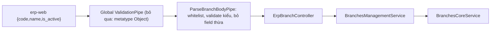

# branches-core v2 follow-up: sửa plan, verify ghi, siết body (erp-api)

Track: T2 (tiếp nối `.agents/plans/branches-core-v2`)
Structure: /api-structure, Phần B
Repo/nhánh: `erp/erp-api` / `erp-master` (không đụng `erp-web`)
Plane: Không theo dõi (anh chọn)
Consistency Check: đạt; chỗ lệch hợp đồng duy nhất (lỗi input sai) nêu ở User Review Required.
Bản chốt sẽ lưu tại `.agents/plans/branches-core-v2-followup/implementation_plan.md` sau `OK`.

## Context

Review trước đó cho thấy v2 giữ nguyên GET (11/11 truy vấn trùng legacy trên DB thực). Còn ba việc:
1. Plan cũ `branches-core-v2` lệch code: mục 2.3.4, 2.3.5, 2.2.2, scope dòng 14 và mermaid ở phần 4 vẫn mô tả compat re-export và legacy service, trong khi follow-up 4.1.1 đã xóa hết `src/branches-core`.
2. POST/PATCH/DELETE chưa verify runtime (chỉ có test mock), kể cả claim `address` của POST.
3. `@Body()` đang là `Record<string, unknown>`, không validate (nợ trong `security-baseline.md`).

Mục tiêu giữ nguyên: UI không phải đổi gì. Payload hiện tại của UI là `{code, name, is_active}` (đã đọc `erp-web/src/modules/branches/api/branchApi.ts`), nên mọi thay đổi phải để payload hợp lệ đó chạy y như cũ.

Quyết định của anh:
- Verify ghi: **staging `erp_greenway_staging` trong transaction rồi ROLLBACK**.
- Siết body: **DTO validate kiểu, bỏ qua field thừa**.

Quan sát ngoài phạm vi (không sửa): UI đọc `item.is_active !== false` nhưng API trả `isActive`, nên UI luôn coi mọi chi nhánh là active. Sửa sẽ làm UI đổi hành vi nên chỉ ghi nhận.

## Spec

Trong phạm vi: sửa plan cũ; harness so sánh ghi legacy vs v2 (nằm ở scratchpad, không vào repo); DTO + pipe cho `POST/PATCH /branches`; spec; cập nhật skill.
Ngoài phạm vi: thay đổi DB/migration, RBAC, route mới, `ParseUUIDPipe`, soft-delete, sửa `erp-web`, commit/push (chỉ khi anh yêu cầu riêng).

| AC | Kết quả bắt buộc | Task | Bằng chứng |
| --- | --- | --- | --- |
| AC-1 | Plan cũ khớp code: không còn mô tả compat re-export/legacy service ở trạng thái hiện tại | 3.1.1 | grep thuật ngữ cũ |
| AC-2 | POST/PATCH/DELETE legacy và v2 cho kết quả giống nhau (sau chuẩn hóa id/timestamp) với payload hợp lệ và các ca lỗi ID | 2.1.1, 2.3.1 | báo cáo harness |
| AC-3 | Harness không để lại dữ liệu trên staging | 2.1.1, 2.3.1 | đếm `erp_branches` trước/sau và đếm mã `ZZ_VERIFY_%` = 0 |
| AC-4 | Payload hợp lệ của UI (`code,name,is_active`) và field thừa vẫn trả đúng như cũ | 2.2.1-2.2.4 | routes/contract spec |
| AC-5 | Input sai kiểu hoặc thiếu `code`/`name` ở POST trả 400 thay vì 500 | 2.2.2, 2.2.4 | pipe spec + routes spec |
| AC-6 | Kiến trúc v2 giữ nguyên, không file vượt ngưỡng, Clean DI | 2.2.1-2.2.3, 3.1.3 | scanner `--strict`, type-check |
| AC-7 | Skill và security-baseline phản ánh trạng thái mới | 3.1.2 | đọc đối chiếu |

## User Review Required

- **Breaking có chủ đích (chỉ với input sai)**: POST thiếu hoặc sai kiểu `code`/`name`, `is_active` không phải boolean, `code` hoặc `name` rỗng/quá dài (100/255) chuyển từ 500 hoặc ghi vào DB sang 400. Payload hợp lệ và field thừa không đổi.
- **Chuỗi rỗng bị từ chối**: legacy cho phép ghi `code=''`; DTO mới dùng `IsNotEmpty`. Nếu anh muốn giữ cho phép chuỗi rỗng thì bỏ `IsNotEmpty`.
- **`is_active` dạng chuỗi** (`"true"`): legacy để Postgres ép kiểu; DTO mới chỉ nhận boolean. UI gửi boolean thật. Em sẽ grep script/caller khác trước khi chốt.
- **Ghi trên staging dùng chung**: dù ROLLBACK, vẫn là thao tác ghi tạm. Mỗi ca chạy trong transaction riêng, mã test `ZZ_VERIFY_<random>`, dừng ngay nếu `current_database()` khác `erp_greenway_staging`.

## Thiết kế kỹ thuật

Mục 3, ràng buộc kiến trúc: `main.ts` có `ValidationPipe` toàn cục với `forbidNonWhitelisted: true`. Nếu gắn class DTO thẳng vào `@Body()` thì pipe toàn cục sẽ trả 400 cho field thừa, trái quyết định "bỏ qua field thừa". Vì vậy:
- Khai báo class DTO với `class-validator`/`@nestjs/swagger` (`CreateErpBranchDto`, `UpdateErpBranchDto = PartialType(...)`).
- Thêm một pipe riêng `ParseBranchBodyPipe` gắn ở tham số: `@Body(new ParseBranchBodyPipe(CreateErpBranchDto)) body: Record<string, unknown>`. Tham số vẫn có metatype `Object` nên pipe toàn cục bỏ qua; pipe riêng dùng `plainToInstance` + `validate` với `whitelist: true`, không forbid, rồi trả object chỉ chứa field hợp lệ và ném `BadRequestException` với danh sách lỗi.
- Lý do tạo primitive mới (workflow yêu cầu ghi): repo chưa có pipe tái sử dụng (`src/common/pipes` không tồn tại, không có `PipeTransform` nào trong `src`), và không thể dùng `ValidationPipe` có sẵn vì bị pipe toàn cục chặn field thừa.
- Core service giữ nguyên `BranchInput` (`Record<string, unknown>`): không đổi `src/v2/core/branches-core`.

Rollback: revert code (không có migration). Harness chỉ ở scratchpad.

## Task Breakdown 3 Cấp

### Phase 1: DB (read-only)

- [ ] **1.1.1 Xác nhận DB và schema trước khi ghi thử** (AC-3). Files: không sửa. DoD: báo `current_database()` = `erp_greenway_staging`, cột/ràng buộc `erp_branches` khớp entity, ghi nhận số dòng hiện tại (3 dòng ở lần quét trước) và không có mã `ZZ_VERIFY_%`. Verification: `SELECT current_database()`; truy vấn `information_schema` chỉ đọc.

### Phase 2: API

- [ ] **2.1.1 Harness so sánh ghi legacy vs v2, chạy baseline trước khi siết** (AC-2, AC-3). Files: `[NEW]` `scratchpad/harness/compare-write.ts` (ngoài repo), dùng lại `scratchpad/legacy` (extract từ `HEAD`). DoD: mỗi ca chạy trong transaction riêng và ROLLBACK ở `finally`; ca gồm POST đầy đủ, POST thiếu `is_active`, POST có `address` và field thừa, PATCH bản ghi vừa tạo, PATCH ID không tồn tại, DELETE bản ghi vừa tạo, DELETE UUID không tồn tại, PATCH/DELETE ID không phải UUID (lỗi Postgres); so sánh sau khi chuẩn hóa `id`/`createdAt`/`updatedAt`; chốt claim `address` của POST. Ca DELETE bị FK chặn không chạy trên staging (đã có mock spec). Verification: `bun scratchpad/harness/compare-write.ts` cho `diffs=0`, đếm bảng trước/sau bằng nhau, mã `ZZ_VERIFY_%` = 0.
- [ ] **2.2.1 DTO class cho body** (AC-4, AC-5). Files: `[MODIFY] src/v2/modules/branches-management/dto/create-erp-branch.dto.ts` (thay type bằng `CreateErpBranchDto`: `code` string không rỗng tối đa 100, `name` string không rỗng tối đa 255, `is_active?` boolean; `ApiProperty`), `[NEW] .../dto/update-erp-branch.dto.ts` (`PartialType(CreateErpBranchDto)`). DoD: tên field là `is_active` đúng payload UI. Verification: `bunx tsc --noEmit` phạm vi file.
- [ ] **2.2.2 Pipe + spec** (AC-4, AC-5). Files: `[NEW] src/v2/modules/branches-management/pipes/parse-branch-body.pipe.ts`, `[NEW] .../pipes/parse-branch-body.pipe.spec.ts`. DoD: payload UI hợp lệ đi qua nguyên vẹn; field thừa bị loại; thiếu/sai kiểu/quá dài trả `BadRequestException`; PATCH cho phép từng field tùy chọn; Clean DI. Verification: `bunx jest src/v2/modules/branches-management/pipes --runInBand`.
- [ ] **2.2.3 Gắn pipe vào controller + spec** (AC-4, AC-6). Files: `[MODIFY] .../controllers/erp-branch.controller.ts`, `[MODIFY] .../controllers/erp-branch.controller.spec.ts`. DoD: route, guard, tag giữ nguyên; chỉ POST/PATCH đổi tham số body. Verification: `bunx jest src/v2/modules/branches-management/controllers/erp-branch.controller.spec.ts --runInBand`.
- [ ] **2.2.4 Cập nhật HTTP contract spec** (AC-4, AC-5). Files: `[MODIFY] .../controllers/erp-branch.routes.spec.ts`, `[MODIFY] .../branches-management.contract.spec.ts`. DoD: ca payload UI hợp lệ, field thừa vẫn 201/200, ca sai kiểu và thiếu `code`/`name` là 400, 401 vẫn như cũ. Verification: `bunx jest src/v2/modules/branches-management --runInBand`.
- [ ] **2.3.1 Chạy lại harness sau khi siết** (AC-2, AC-3, AC-4). Files: không sửa repo. DoD: payload hợp lệ vẫn giống legacy; chỉ các ca input sai khác (400 thay vì 500), có liệt kê trong báo cáo; dữ liệu staging không đổi. Verification: cùng lệnh 2.1.1 và đối chiếu số dòng.

### Phase 3: QC và knowledge sync

- [ ] **3.1.1 Sửa plan cũ cho khớp code** (AC-1). Files: `[MODIFY] .agents/plans/branches-core-v2/implementation_plan.md`. DoD: sửa dòng 14 (bỏ "giữ compatibility exports"), mermaid ở phần 4 (bỏ nút legacy re-export), 2.2.2, 2.3.4, 2.3.5 để mô tả trạng thái cuối (không còn `src/branches-core`, consumer import trực tiếp canonical), thêm ghi chú trỏ tới follow-up 4.1.1 và plan follow-up này; không đổi tick `[x]` đã đạt. Verification: `rg -n 'compat|re-export|legacy' ` trên file chỉ còn ngữ cảnh lịch sử.
- [ ] **3.1.2 Knowledge sync** (AC-7). Files: `[MODIFY] .agents/skills/modules/branches-core/SKILL.md` (hợp đồng body mới, danh sách 400, pipe riêng), `[MODIFY] .agents/skills/erp-api-truth/references/security-baseline.md` (bỏ `branches-core` khỏi danh sách nợ `@Body()` any, dòng 51). Verification: đọc đối chiếu với code và spec.
- [ ] **3.1.3 Gate** (AC-6). Files: không sửa. DoD: Jest scope `src/v2/core/branches-core src/v2/modules/branches-management` cùng consumer liên quan, scanner `--strict` cho hai thư mục, `bun run type:check`, `bun run build` và `dist/main.js`, eslint/prettier phạm vi file, `git diff --check`, `git status --short` xác nhận không có diff `erp-web`/schema. Verification: các lệnh trên; báo rõ scope đã chạy. Chưa commit/push.

## Verification tổng

Harness ghi (trước/sau siết), Jest scope branches (+ consumer), scanner `--strict`, type-check, build, `dist/main.js`. Không chạy full suite mỗi task.

## Session Checkpoint

- **Active Task**: None
- **Tiến độ chi tiết**: Chờ `OK`
- **Hành động tiếp theo khi Resume**: Hỏi Plane (Có/Không), rồi bắt đầu Task 1.1.1

## ⏸️ Session Checkpoint (Hoàn tất: 2026-11-07)
- **Trạng thái**: Đã thực hiện 1.1.1, 2.1.1, 2.2.1-2.2.4, 2.3.1, 3.1.1, 3.1.2, 3.1.3. Chưa commit/push.
- **Kết quả harness ghi** (`scratchpad/harness/compare-write.ts`, staging `erp_greenway_staging`, mỗi ca ROLLBACK): trước siết 16/16 trùng legacy sau chuẩn hóa key; sau siết (v2 đi qua pipe) 10 ca trùng, 6 ca khác đúng như đã duyệt: POST thiếu name, thiếu code, `is_active:"true"`, `is_active:"abc"`, code 101 ký tự, code rỗng (legacy 500 hoặc 201, nay 400). Rows 3→3, leftovers `ZZ_VERIFY_%` = 0.
- **Thay đổi lệch plan (có chủ đích)**: UpdateErpBranchDto viết tay với `ValidateIf` thay vì `PartialType`, để `null` bị 400 ở PATCH. Contract spec `branches-management.contract.spec.ts` không sửa (vẫn pass, ca 400 nằm ở routes spec). Spec unit controller không sửa (gọi trực tiếp, không qua pipe).
- **Gate**: Jest branches 10 suite/43 test PASS; Jest branches + consumer (erp-invoices, bank-transactions, accounting, operating-expenses) 100 suite/687 test PASS (sau khi thêm pipe, trước khi sửa lỗi type; sau đó chạy lại branches 10 suite/43 test PASS); scanner `--strict` PASS hai thư mục; `type:check` PASS (sau sửa `getTargetValidationMetadatas`); `build` PASS, `dist/main.js` tồn tại; eslint `--max-warnings=0` và prettier PASS trên file đổi; `git diff --check` PASS; `erp-web` 0 thay đổi.
- **Chưa làm**: DTO/pipe chưa chạy qua HTTP thật (chỉ supertest với Nest app dựng mock service); harness không gọi HTTP.
- **Quan sát chưa xử lý (ngoài phạm vi)**: UI đọc `is_active`, API trả `isActive`, nên UI luôn coi chi nhánh là active; `.env` đang trỏ staging, plan cũ ghi `erp_local`; mật khẩu staging đã bị in ra transcript khi chạy nhầm lệnh, nên cân nhắc đổi.
- **Hành động tiếp theo**: anh duyệt thay đổi (git diff), rồi quyết định commit/push theo `/erp-git-workflow` (chỉ khi anh yêu cầu).
