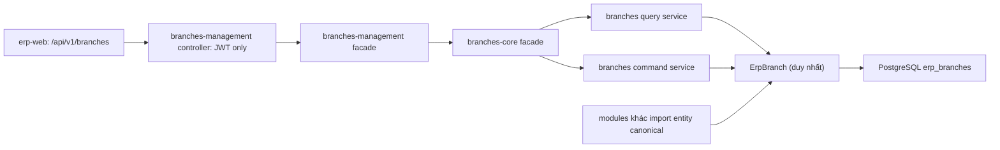

# Kế hoạch tái cấu trúc branches-core sang API v2 (erp-api)

RequestFeedback: false (đã duyệt và triển khai)
Track: T2 (migrate module cũ theo yêu cầu cụ thể của anh)
Structure: /api-structure, Phần B
Repo/nhánh: `erp/erp-api` / `erp-master`
Plane: Không theo dõi (không tạo work item ngoài yêu cầu).
Consistency Check: Đạt; các ngoại lệ v2 bắt buộc cho zero-regression được nêu công khai dưới đây.

## 1. Tóm tắt và phạm vi

Chuyển `src/branches-core` thành **core** `src/v2/core/branches-core` (một entity thật, query/command và facade dùng chung) và **HTTP module mỏng** `src/v2/modules/branches-management` (controller, DTO response/mapper, facade delegate). Giữ `/api/v1/branches` và toàn bộ hành vi đang chạy để `erp-web` không cần đổi bất cứ file nào. Không bổ sung `/api/v2/branches` trong đợt này: "v2" chỉ nói về cấu trúc backend.

Trong phạm vi: chuyển code/wiring, xóa hẳn `src/branches-core` (không giữ compatibility exports, theo follow-up 4.1.1), test contract trước và sau, cập nhật tri thức module. Ngoài phạm vi: thay đổi DB/migration, soft-delete, RBAC mới, xác thực body nghiêm ngặt (đã tách sang follow-up `branches-core-v2-followup`), sửa UI, thêm endpoint, sửa lỗi nghiệp vụ cũ, sync tenant/deploy.

> **Cập nhật sau triển khai:** các mục 2.2.2, 2.3.4, 2.3.5 và sơ đồ ở mục 4 đã được sửa để khớp trạng thái cuối (không còn compat re-export hay legacy service; consumer import trực tiếp class canonical). Chi tiết follow-up: `.agents/plans/branches-core-v2-followup/implementation_plan.md`.

### Tiêu chí chấp nhận

| AC | Kết quả bắt buộc | Task | Bằng chứng |
| --- | --- | --- | --- |
| AC-1 | Một bộ route GET/POST `/api/v1/branches`, PATCH/DELETE `/api/v1/branches/:id`; không có route trùng hoặc route mới | 2.1.1, 2.3.1-2.3.3 | route contract spec qua Nest + `supertest` |
| AC-2 | GET giữ `items,total,page,pageSize,totalPages`; default 1/20, sort mặc định `createdAt DESC`, whitelist sort và `ILIKE` code/name, kể cả chi nhánh inactive | 2.1.1, 2.2.2, 2.3.2 | query spec + snapshot hợp đồng |
| AC-3 | POST/PATCH giữ mapping chỉ `code,name,is_active` -> `isActive`, bỏ qua `address` và field thừa; dữ liệu ra `id,code,name,address,isActive,createdAt,updatedAt` với `address:null` và Date serialize như cũ; message tiếng Anh như cũ | 2.1.1, 2.2.3-2.2.5 | mapper/command/HTTP contract specs |
| AC-4 | DELETE vẫn hard-delete, trả `{message:'Branch deleted successfully'}`/HTTP 200; lỗi ID vắng mặt và lỗi FK giữ đúng luồng hiện tại | 2.1.1, 2.2.3-2.2.5 | command + HTTP contract specs |
| AC-5 | JWT-only, không thêm RBAC, UUID pipe hoặc thay đổi chấp nhận input/HTTP error | 2.1.1, 2.3.1-2.3.2 | metadata guard + request 401, body thừa, non-UUID/ID vắng mặt |
| AC-6 | Duy nhất một `ErpBranch` TypeORM entity/metadata trong v2; mọi imports quan hệ, repository khác và data source trỏ trực tiếp class canonical | 2.2.1-2.2.2, 2.3.3, 2.4.1-2.4.7, follow-up 4.1.1 | identity metadata spec + type-check/DI spec |
| AC-7 | Kiến trúc core/modules, co-located specs, knowledge sync; không có diff web/schema | 2.2.1-2.2.9, 2.4.1-2.4.7, 3.1.1-3.2.2 | scanner, Jest, build, `git diff --name-only` trong đúng repo |

## 2. Hiện trạng đã kiểm tra

- `src/branches-core/{branches-core.controller.ts,branches-core.service.ts,branches-core.module.ts,entities/erp_branch.entity.ts}`: controller chỉ `JwtAuthGuard`, `@Body() any`, `@Query() PaginationDto`; service `findAndCount`, `repository.update` rồi `findOne` (không có 404 tùy biến), `repository.delete` (không có 404 tùy biến); module export service.
- `src/app.module.ts` chỉ đăng ký `BranchesCoreModule`; `src/db/data-source.ts` đăng ký `ErpBranch`. `bank-transactions-core`, `accounting-core`, `operating-expenses-core`, `erp-invoices-core` import entity từ đường dẫn cũ; `erp-invoices-core` còn inject repository. Không có consumer ngoài module gọi trực tiếp `BranchesCoreService` theo tìm kiếm hiện tại; vẫn giữ symbol công khai để tránh gãy consumer về sau.
- `erp-web/src/modules/branches/api/branchApi.ts` và nhiều màn hình đọc `/api/v1/branches`; frontend normalize cả `is_active` lẫn `isActive`, nhưng **backend hiện trả `isActive`**. Không đổi client.
- Đã xác nhận chỉ đọc `SELECT current_database()` từ `.env` tại discovery: `erp_local`; `erp_branches` có `id uuid`, `code varchar(100) UNIQUE`, `name varchar(255)`, `address text nullable`, `is_active boolean default true`, `created_at/updated_at timestamp without time zone`. **Không có `is_deleted`**. Các FK từ bank accounts/transactions, cash books, journal entries, operating expenses có `ON DELETE NO ACTION`; xóa bản ghi được tham chiếu có thể thất bại như hiện tại. Trước bất kỳ bước nào đụng DB khi triển khai, xác nhận lại tên DB; kế hoạch này không ghi DB.
- `src/main.ts` dùng global `ValidationPipe({whitelist:true,forbidNonWhitelisted:true,transform:true})`; body `any` hiện không bị kiểm bằng DTO. `api-core`, `api-thin-module`, `api-module-v2` templates tạo `is_deleted`, RBAC, route/response và xóa mềm không khớp DB/API này.

## 3. Quyết định và ngoại lệ có chủ đích

- Anh đã chọn **giữ hành vi 100%** dù khác mặc định v2. `DELETE /:id` vẫn hard-delete; không chuyển qua `/:id/permanent`, không gắn `PURGE`, không thêm cột `is_deleted`. Đây là bảo tồn hành vi legacy, **không áp dụng mẫu xóa cứng mới cho module khác**.
- `@Body() any` là nợ bảo mật hiện có; đổi ngay sang class DTO được `ValidationPipe` áp dụng sẽ khiến field thừa trả 400 thay vì được bỏ qua. Trong đợt này dùng `@Body() body: Record<string, unknown>` (runtime metadata `Object`, không kích hoạt whitelist cho body), và định nghĩa kiểu `CreateBranchInput`/`UpdateBranchInput` ở tầng service để bỏ `any` tại đó; ghi rõ ngoại lệ security baseline ở boundary. Không gắn class DTO vào `@Body()` cho đến khi có thay đổi hợp đồng riêng được duyệt. `@Query()` tiếp tục dùng chính `PaginationDto`.
- Không thêm `CoreRbacGuard`, `@RequirePermissions`, `ParseUUIDPipe`, `GET /:id`, `column-options` hay `summaries`. Bảo vệ JWT giữ nguyên; không làm mạnh quyền truy cập một cách âm thầm.
- Dùng Plop như chuẩn scaffold **sau OK**, `wire=false` và thông số tường minh. `api-core` tạo lõi `branches-core` (style `engine`, entity `ErpBranch`); `api-module-v2` tạo module `branches-management` (`ErpBranch`, `code:string:required,name:string:required,address:text,is_active:boolean`, table `erp_branches`, route `branches`, resource tạm `erp_branches`, wire `false`). Các file generated **không được wire/chạy trước khi customize**: bỏ entity/base `is_deleted` do generator tạo, không giữ entity thứ hai; không giữ các endpoint/guard/query/response mới; bỏ resource RBAC sinh tự động (chỉ do generator tạo, không nằm trong phạm vi thay đổi quyền). Core được thay bằng entity thật và dịch vụ thật; facade module chỉ delegate. Cột `is_active` trong input generator chỉ là placeholder và phải bị loại khỏi DTO/mapper trả ra; output thực của API vẫn là `isActive`. Nếu generator sinh tên/cột mặc định khác, đối chiếu DB rồi tùy chỉnh, tuyệt đối không dùng schema giả.
- Ghi nhận khi thực thi: Plop từ chối fieldSpec `is_active` trước khi ghi file; đã dùng cú pháp hợp lệ `isActive:boolean` cho scaffold và tùy chỉnh lại ngay. Không đổi cột DB hay payload legacy `is_active`.
- Thời gian và null phải map chính xác: `address: null` không đổi thành `undefined`, `isActive` giữ camelCase, Date vẫn serialize thành chuỗi ISO; không dùng `ClassSerializerInterceptor`/`excludeExtraneousValues` tự đổi shape.
- Không sửa `erp-web`. Không chạy migration hoặc lệnh ghi DB. Chỉ commit/push nếu anh yêu cầu riêng; final gate local được thực hiện sau OK, CI/push chỉ khi được yêu cầu.

## 4. Kiến trúc, contract và rollback

HTTP GET `/api/v1/branches`: chính `PaginationDto` cũ, cùng search/sort, không lọc inactive. POST trả 201 `{data: <serialized branch>,message:'Branch created successfully'}`; PATCH trả 200 `{data:<serialized branch | null>,message:'Branch updated successfully'}`; DELETE trả 200 `{message:'Branch deleted successfully'}`. Tất cả JWT-only và swagger tag `erp_branches`; giữ lỗi runtime hiện có đối với input/ID lỗi, không tự ý chuyển sang 400/404/409. Body gõ kiểu ở tầng TS nhưng không áp đặt validator mới ở HTTP. Repository thao tác một bảng, không tạo transaction hay lock mới; TypeORM parameter binding/`ILike` và `resolveSortOrder` whitelist hiện tại vẫn được tái sử dụng.

Entity được định nghĩa duy nhất ở `src/v2/core/branches-core/entities/erp_branch.entity.ts`. Mọi quan hệ TypeORM, repository và `src/db/data-source.ts` import trực tiếp class canonical này. Theo follow-up 4.1.1, xóa hoàn toàn `src/branches-core`, không để compatibility re-export hay test ở source tree legacy. Chỉ `BranchesManagementModule` được đăng ký trong AppModule.

Rollback là revert *code và wiring* về module legacy; không có migration/schema hay chuyển đổi dữ liệu cần rollback. Nếu contract tests khác baseline thì dừng, không đưa module mới lên app. Nếu phát hiện hard-delete có nguy cơ xóa dữ liệu do FK không chặn, báo riêng thay vì đổi nghiệp vụ trong task này.

## 5. Task Breakdown 3 cấp

Mỗi task thủ công chạm tối đa 1-2 file; **task scaffold Plop là ngoại lệ nguyên tử** vì generator tạo nhiều file cùng lúc. Các lệnh verification chỉ chạy **sau OK** trong repo `erp/erp-api`; từng task dùng spec liên quan/kiểm tra tĩnh hẹp, full gate một lần cuối. Đánh dấu `[/]` khi bắt đầu và `[x]` ngay sau khi verification PASS.

### Phase 1: DB contract (read-only, không migration)

- [x] **1.1.1 Xác nhận lại DB runtime và baseline schema/FK trước triển khai** (AC-4, AC-6). Files: không sửa. DoD: ghi DB thực, cột/index/FK, `is_deleted` không tồn tại; không ghi DB. Verification: `SELECT current_database()` rồi truy vấn `information_schema` đọc-only; đối chiếu discovery.

### Phase 2: API

- [x] **2.1.1 Viết contract spec cho legacy trước chuyển đổi** (AC-1..AC-5). Files: `[NEW] src/branches-core/branches-core.contract.spec.ts`. DoD: khóa metadata GET/POST/PATCH/DELETE, JWT/no RBAC, status/shape/field camelCase/null, body thừa, sort/default/search, update/delete ID không có và xóa khi bị FK chặn qua mock repository; phân biệt mock HTTP và DB integration (không chạy thao tác ghi DB). Verification: `bunx jest src/branches-core/branches-core.contract.spec.ts --runInBand`.
- [x] **2.2.1 Scaffold v2 có kiểm soát** (AC-6, AC-7). Files: `[GENERATED] src/v2/core/branches-core/**`, `src/v2/modules/branches-management/**` và tạm thời `src/v2/core/rbac-core/enums/erp-resource.enum.ts` do Plop tự chèn. DoD: chạy `api-core` và `api-module-v2` với input mục 3; `wire=false`, chưa register vào AppModule, gỡ ngay enum resource tự sinh trong cùng bước. Verification: `git diff -- src/app.module.ts src/db/data-source.ts src/v2/core/rbac-core/enums/erp-resource.enum.ts` không có thay đổi cuối bước; rà cây files được sinh.
- [x] **2.2.2 Giữ một entity thật** (AC-6). Files: `[NEW] src/v2/core/branches-core/entities/erp_branch.entity.ts` (chuyển entity hiện hữu, không dùng base generated). Không còn file re-export ở `src/branches-core` (đã xóa theo follow-up 4.1.1). DoD: metadata y hệt entity cũ, chỉ một class TypeORM được đăng ký. Verification: inspect `getMetadataArgsStorage().tables/columns` với schema baseline; spec DI ở 2.3.3.
- [x] **2.2.3 Tách query service + spec** (AC-2). Files: `[NEW] src/v2/core/branches-core/services/branch-query.service.ts`, `[NEW] .../branch-query.service.spec.ts`. DoD: chuyển nguyên `findAndCount`/search/sort/paging, không lọc `isActive`; so sánh mock call với baseline. Verification: `bunx jest src/v2/core/branches-core/services/branch-query.service.spec.ts --runInBand`.
- [x] **2.2.4 Tách command service + spec** (AC-3, AC-4). Files: `[NEW] src/v2/core/branches-core/services/branch-command.service.ts`, `[NEW] .../branch-command.service.spec.ts`. DoD: `create/update/delete` giữ repository API, mapping `is_active`, messages/không 404 tùy biến; phản ứng lỗi FK như cũ. Verification: `bunx jest src/v2/core/branches-core/services/branch-command.service.spec.ts --runInBand`.
- [x] **2.2.5 Tạo facade core + spec** (AC-2..AC-4). Files: `[NEW] src/v2/core/branches-core/services/branches-core.service.ts`, `[NEW] .../branches-core.service.spec.ts`. DoD: giữ các phương thức công khai `findAll/create/update/remove`, delegate query/command; mapper chỉ ở boundary HTTP, không để TypeORM entity rò ra response. Verification: `bunx jest src/v2/core/branches-core/services/branches-core.service.spec.ts --runInBand`.
- [x] **2.2.6 DTO response và mapper HTTP** (AC-3, AC-7). Files: `[MODIFY] src/v2/modules/branches-management/dto/erp-branch-response.dto.ts`, `[MODIFY] .../helpers/erp-branch.mapper.ts`. DoD: shape **chính xác** entity JSON cũ, null/Date preserved, không thêm summaries/data cho DELETE. Verification: `bun -e` tạo entity mẫu (bao gồm `address:null`, `isActive:false`, timestamps), gọi mapper rồi so sánh `JSON.stringify` với object baseline; spec co-located bổ sung ở 2.2.7.
- [x] **2.2.7 Spec mapper và boundary input** (AC-3, AC-5). Files: `[MODIFY] src/v2/modules/branches-management/helpers/erp-branch.mapper.spec.ts`, `[MODIFY] .../dto/create-erp-branch.dto.ts` (hoặc input type riêng phù hợp source generated). DoD: typed input cho service, nhưng HTTP vẫn không bật validation whitelist cho body; test roundtrip `isActive`, `address:null`, Date; `update` cho phép undefined. Verification: `bunx jest src/v2/modules/branches-management/helpers/erp-branch.mapper.spec.ts --runInBand`.
- [x] **2.2.8 Lắp module core/barrel** (AC-6, AC-7). Files: `[MODIFY] src/v2/core/branches-core/branches-core.module.ts`, `[MODIFY] .../index.ts`. DoD: `TypeOrmModule.forFeature([ErpBranch])`, providers query/command/facade, exports giữ service/repository đúng DI. Verification: `bun -e` dùng Nest metadata `MODULE_METADATA` kiểm providers/imports/exports chính xác và barrels export cùng class; core DI integration spec thêm ở 2.3.3.
- [x] **2.2.9 Lắp facade module HTTP + spec** (AC-2..AC-4). Files: `[MODIFY] src/v2/modules/branches-management/branches-management.service.ts`, `[MODIFY] .../branches-management.service.spec.ts`. DoD: delegate core, mapper cho list/create/update; DTO response khớp byte-shape JSON, không đổi message. Verification: `bunx jest src/v2/modules/branches-management/branches-management.service.spec.ts --runInBand`.
- [x] **2.3.1 Lắp controller HTTP + spec** (AC-1, AC-5). Files: `[MODIFY] src/v2/modules/branches-management/controllers/erp-branch.controller.ts`, `[MODIFY] .../erp-branch.controller.spec.ts`. DoD: duy nhất 4 routes legacy, `JwtAuthGuard`, `ApiTags('erp_branches')`, `PaginationDto`, không RBAC/UUID pipe/validation body mới. Verification: `bunx jest src/v2/modules/branches-management/controllers/erp-branch.controller.spec.ts --runInBand`.
- [x] **2.3.2 HTTP contract spec hậu chuyển đổi** (AC-1..AC-5). Files: `[NEW] src/v2/modules/branches-management/controllers/erp-branch.routes.spec.ts`. DoD: Nest app áp `applyGlobalPrefix` và pipe như `main.ts`; verify 200/201/401, shape/sort/body thừa, không route v2/thừa. Verification: `bunx jest src/v2/modules/branches-management/controllers/erp-branch.routes.spec.ts --runInBand`.
- [x] **2.3.3 Module DI + identity spec** (AC-1, AC-6). Files: `[MODIFY] src/v2/modules/branches-management/branches-management.module.ts`, `[NEW] .../branches-management.di.spec.ts`. DoD: imports core, chỉ controller mới, không `forFeature` entity duplicate; spec kiểm metadata TypeORM entity từ đường dẫn cũ/mới là cùng class và provider resolve được. Verification: `bunx jest src/v2/modules/branches-management/branches-management.di.spec.ts --runInBand`.
- [x] **2.3.4 Chuyển wiring AppModule** (AC-1, AC-6). Files: `[MODIFY] src/app.module.ts`. DoD: chỉ import `BranchesManagementModule` trong app, không legacy controller; consumer entity/data-source import trực tiếp class canonical (không còn module legacy để giữ). Verification: route spec + `bun run type:check` (type-check có thể lâu hơn 10 giây, chạy tại gate tích hợp).
- [x] **2.3.5 Đóng legacy service/controller** (AC-1, AC-6). Files: `[DELETE] src/branches-core/**` (controller, service, module, entity, spec) sau khi xác minh không còn caller. DoD: không có bộ route thứ hai; không còn `BranchesCoreService` ở đường dẫn cũ (symbol cũ không được giữ, theo 4.1.1). Verification: `rg 'BranchesCoreController|branches-core/branches-core.service' src` và route spec.

### Phase 2.4: Cleanup scaffold và đối chiếu manifest

- [x] **2.4.1 Xóa hai entity placeholder** (AC-6, AC-7). Files: `[DELETE] src/v2/core/branches-core/entities/base-erp-branch.entity.ts`, `[DELETE] src/v2/modules/branches-management/entities/erp-branch.entity.ts`. DoD: chỉ entity thật ở core có `@Entity('erp_branches')`. Verification: `rg -n 'is_deleted|class ErpBranch' src/v2/core/branches-core src/v2/modules/branches-management` đối chiếu chỉ một entity thật.
- [x] **2.4.2 Xóa base DTO và contract trống** (AC-7). Files: `[DELETE] src/v2/core/branches-core/dto/base-create-erp-branch.dto.ts`, `[DELETE] src/v2/core/branches-core/contracts/branches-core.contract.ts`. DoD: không lưu hợp đồng giả `notes` hay inheritance không dùng. Verification: `rg -n 'BaseCreateErpBranchDto|BaseErpBranchContract' src/v2/core/branches-core src/v2/modules/branches-management` phải rỗng.
- [x] **2.4.3 Xóa engine placeholder và spec** (AC-7). Files: `[DELETE] src/v2/core/branches-core/services/base-branches-engine.service.ts`, `[DELETE] .../base-branches-engine.service.spec.ts`. DoD: lõi chỉ cung cấp logic thật. Verification: `rg -n 'BaseBranchesEngineService' src/v2/core/branches-core src/v2/modules/branches-management` phải rỗng.
- [x] **2.4.4 Xóa query DTO và update DTO generated** (AC-2, AC-5, AC-7). Files: `[DELETE] src/v2/modules/branches-management/dto/query-erp-branch.dto.ts`, `[DELETE] .../dto/update-erp-branch.dto.ts`. DoD: dùng `PaginationDto` hiện hữu; update input type không đổi runtime body. Verification: `rg -n 'QueryErpBranchDto|UpdateErpBranchDto' src/v2/modules/branches-management` phải rỗng.
- [x] **2.4.5 Xóa query service/spec generated ở HTTP module** (AC-2, AC-7). Files: `[DELETE] src/v2/modules/branches-management/services/erp-branch-query.service.ts`, `[DELETE] .../erp-branch-query.service.spec.ts`. DoD: chỉ core query service truy cập repo. Verification: `rg -n 'ErpBranchQueryService' src/v2/modules/branches-management` phải rỗng.
- [x] **2.4.6 Xóa command service/spec generated ở HTTP module** (AC-4, AC-7). Files: `[DELETE] src/v2/modules/branches-management/services/erp-branch-command.service.ts`, `[DELETE] .../erp-branch-command.service.spec.ts`. DoD: chỉ core command service ghi bảng, không soft-delete. Verification: `rg -n 'ErpBranchCommandService|is_deleted|isDeleted' src/v2/modules/branches-management src/v2/core/branches-core` phải rỗng.
- [x] **2.4.7 Chỉnh manifest cho core thật** (AC-6, AC-7). Files: `[MODIFY] src/v2/core/branches-core/core.manifest.json`. DoD: `family/entity/barrel/module/baseClasses` trỏ đúng symbol thật, không khai báo engine/base entity/DTO đã xóa; không để manifest giả hỗ trợ sinh thin-module khi schema thiếu `is_deleted`. Verification: đọc JSON và đối chiếu tồn tại từng path/symbol, `bunx tsc --noEmit` tại gate.

### Phase 3: QC và knowledge sync

- [x] **3.1.1 Zero-regression gate** (AC-1..AC-7). Files: không sửa ngoài code/test đang xử lý. DoD: Jest scope branches cũ/v2 + affected consumer tests; scanner `--strict` cho hai thư mục mới, lint/format theo repo, `bun run type:check`, `bun run build`, xác nhận `dist/main.js`; rà diff đảm bảo không có web/schema/RBAC vô ý. Verification: `bunx jest src/branches-core src/v2/core/branches-core src/v2/modules/branches-management --runInBand --forceExit`; `bun .agents/skills/erp-api-structure/scripts/scan-oversized-files.ts --path=src/v2/core/branches-core --strict` và tương tự module; `bun run type:check`; `bun run build`; `test -f dist/main.js`; `git diff --check`; kiểm tra manual `git status --short`. Full `verify:final` chỉ cân nhắc một lần nếu scope rộng hoặc repo yêu cầu; không chạy full suite mỗi task.
- [x] **3.2.1 Knowledge sync module** (AC-7). Files: `[NEW] .agents/skills/modules/branches-core/SKILL.md`, `[MODIFY] .agents/skills/erp-api-truth/SKILL.md`. DoD: ghi đúng entity/DB, legacy exceptions, HTTP contract và vị trí v2, link từ current truth. Verification: rà nội dung khớp tests/code; không chạy script sinh tài liệu ghi DB.
- [x] **3.2.2 Knowledge sync playbook và báo cáo** (AC-7). Files: `[MODIFY] .agents/skills/erp-api-structure/references/v2-module.md` (thêm hàng trạng thái migrate). DoD: lưu trạng thái `branches-core -> branches-core + branches-management`, đánh dấu không đổi API/DB; báo cáo phạm vi Jest/CI chưa chạy, git diff, commit/push. Verification: `git diff --check` và đọc đối chiếu tài liệu với code.

## 6. Verification bổ sung, rollout và checkpoint

Security checklist sau OK: JWT vẫn bắt buộc; không cấp thêm quyền; trường sort đi qua whitelist; `ILike` giữ parameter binding; không log secret; kiểm tra yêu cầu body DTO từ `security-baseline.md` và ghi ngoại lệ duy nhất đã được anh duyệt (không siết body để giữ contract). Không có nghiệp vụ trừ kho/ghi số dư nên không thêm `pessimistic_write`; audit hiện có qua interceptor app không đổi. Không deploy/sync nhánh hoặc tự tạo Plane trước khi được phép. Khi có yêu cầu commit/push riêng, làm theo `/erp-git-workflow`, kiểm CI xanh sau push.

Checkpoint sau migrate v2 (2026-11-07): 1.1.1 xác nhận DB `erp_local` chỉ đọc; 14 Jest suites/79 tests PASS sau follow-up; `bun run type:check`, `bun run build`, scoped eslint, scanner core/module `--strict`, `git diff --check` PASS. Không migration, không ghi DB, không đổi Web/RBAC. Prettier check và targeted import scan hoàn tất ở follow-up 4.1.1. Chưa commit/push và chưa có CI trên commit mới.

## Follow-up 4.1.1 — Chuyển hẳn mọi consumer sang v2

- [x] Chuyển các entity/module consumer và data-source sang import `src/v2/core/branches-core/entities/erp_branch.entity.ts`.
- [x] Dời baseline HTTP contract spec sang `src/v2/modules/branches-management/branches-management.contract.spec.ts`.
- [x] Xóa toàn bộ `src/branches-core` (service/module/entity re-export và spec); không giữ import compatibility.
- [x] Cập nhật module skill/current truth và xác nhận không còn `@/branches-core` hoặc relative import vào thư mục legacy trong source.
- Verification: contract + consumer Jest 14 suites/79 tests, type-check, build, eslint/prettier, `git diff --check`; thư mục `src/branches-core` không còn; chưa commit/push.
