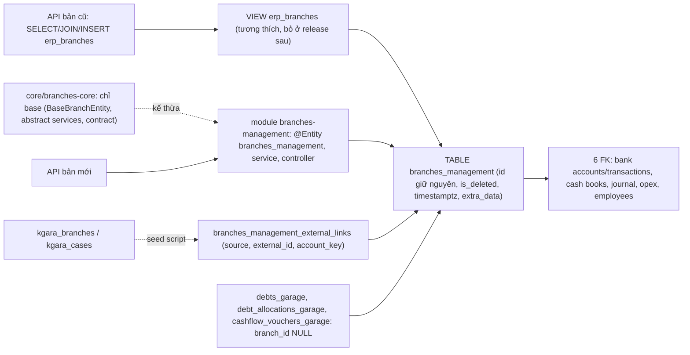

# Chuyển `erp_branches` → `branches_management` (chuẩn v2) + nền tảng nối chi nhánh garage: Kế Hoạch Triển Khai (erp-api)

Đổi bảng chi nhánh toàn hệ thống sang chuẩn `*_management` (soft-delete `is_deleted`, `timestamptz`, `extra_data`), giữ nguyên dữ liệu và id, không làm hỏng code đang chạy (view tương thích). Đồng thời dựng nền tảng để chi nhánh garage là khái niệm nội bộ, optional, nối được với chi nhánh toàn hệ thống: bảng liên kết nguồn ngoài (Kgara `external_id` + `account_key`), seed GR/CN2, cột `branch_id` nullable ở 3 bảng v2 garage.

Track: T2 (migrate `branches-core` sang chuẩn `*_management` theo lệnh trực tiếp của anh)
Structure: /erp-api-structure (Phần B: đưa `branches-core` ra khỏi `[LEGACY-CORE]` thành lõi base-only; mọi thứ cụ thể (entity, bảng, service, controller, migration) xuất phát từ module `branches-management`)
Consistency Check: đạt (chi tiết ở cuối mục Spec)
Plane (KINDU): Module "Branches Management V2" (06d90270-3f27-46b4-ae1e-0c08099161ce), Cycle "Phase: Branches Management V2 (2026-11-18)" (bb49cbef-7e31-45ec-9c8c-44e8b80206cc), label `epic:branches-management`. Story: KINDU-1317 (Phase 1 DB), KINDU-1318 (Phase 2 API), KINDU-1319 (Phase 3 UI), KINDU-1320 (Phase 4 QC). Task: KINDU-1321..1363 (theo thứ tự X.Y.Z trong plan: 1321-1332 = 1.1.1..1.4.1, 1333 = 3.1.1, 1334-1339 = 4.1.1..4.4.1, 1340-1363 = 2.1.1..2.5.2).
RequestFeedback: false (đã duyệt `OK`)
Repo/nhánh: `erp/erp-api` / `erp-master`. Bản chốt lưu tại `erp/erp-api/.agents/plans/branches-management-rename/implementation_plan.md` sau `OK`.

## Context (vì sao làm)

- Anh muốn "giải quyết triệt để `erp_branches`", đổi tên thành `branches_management` và chạy cho cả staging lẫn production, thay vì chạy song song hai bảng.
- Hiện chi nhánh toàn hệ thống (`erp_branches`) chưa có `is_deleted`, `created_at/updated_at` là `timestamp without time zone`, và công nợ/thu chi/vụ việc garage đang lọc bằng `branch_external_id` Kgara (cặp `(external_id, account_key)`, GR/MAIN và CN2/OJ dùng chung `external_id` `0b4d6d3a…`), nên không nối được với chi nhánh hệ thống.
- Anh chọn phạm vi: **nền tảng + cộng thêm cột**. Chưa đổi logic lọc ở ~44 file garage v2 (làm ở plan sau cùng backfill sổ nợ, việc 3.1.1 của `garage-cashflow-debts-ledger-v2`).

## 🧱 Quy tắc cấu trúc (anh chốt, plan này bắt buộc tuân thủ)

Theo `erp-api-structure` (`v2-module.md`, mục lõi/module): `branches-core` hiện được đánh dấu `[LEGACY-CORE]` (lõi giữ entity `ErpBranch` thật, service cụ thể, Nest module). Plan này chuyển nó về đúng chuẩn, như `users-core` + `users-management`, `cashflow-vouchers-core` + `cashflow-vouchers-garage`:

| Lớp | Chứa | Không được chứa |
|---|---|---|
| **Lõi** `src/v2/core/branches-core/` (chỉ là base cho module) | Entity trừu tượng không `@Entity` (`BaseBranchEntity`, `BaseBranchExternalLinkEntity`); service trừu tượng (query, command); contract/type (`BranchRef`, `BranchInput`, `BranchReferencePort`); `core.manifest.json` style `v2-core`, `module: null`; barrel | `@Entity`, bảng DB, `@Controller`, Nest module, provider cụ thể, tên module/consumer (ví dụ danh sách bảng tham chiếu chi nhánh) |
| **Module** `src/v2/modules/branches-management/` (điểm bắt đầu của DB và API) | `@Entity('branches_management')`, `@Entity('branches_management_external_links')`, service kế thừa base, `BranchReferenceService` (biết 6 bảng tham chiếu), `BranchExternalLinkService`, controller, DTO, mapper, facade, Nest module, script seed | — |

Hệ quả cho thứ tự làm: entity + migration của module trước (DB), rồi service/controller của module (API); lõi chỉ cung cấp base nên được viết trước hoặc cùng lúc nhưng **không sở hữu bảng**. Chiều phụ thuộc `modules → core → shared`, lõi không import module:
- `employees-core` (lõi) hiện import `ErpBranch` → đổi sang quan hệ chuỗi `@ManyToOne('BranchManagement')` và kiểu `BranchRef` lấy từ `@/v2/core/branches-core`, không import từ module (mẫu: `@OneToMany('DebtAllocationGarage', …)` ở `debts-garage`).
- Module legacy (ngân hàng, kế toán, chi phí, hóa đơn, vinfast) import `BranchManagement` qua barrel của module `@/v2/modules/branches-management`.
- Gỡ `branches-core` khỏi `LEGACY_CORE_ALLOWLIST` (`plop-helpers/apiCoreLayout.test.mjs:16`) và sửa dòng `[LEGACY-CORE]` trong `v2-module.md` / `erp-api-structure.md`; test layout phải xanh.

## Hiện trạng đã kiểm chứng (chỉ đọc)

| Hạng mục | Staging `erp_greenway_staging` | "Production" `erp_greenway_production` (xem cảnh báo) |
|---|---|---|
| `erp_branches` | 3 dòng LVL, PQ, ĐT; `extra_data = {}`; 8 cột, không `is_deleted` | Giống hệt |
| FK vào bảng | 6: `erp_bank_accounts`, `erp_bank_transactions`, `erp_cash_books`, `erp_journal_entries`, `erp_operating_expenses`, `employees_management` | Giống hệt |
| Tham chiếu thật | — | `erp_bank_accounts` 3, `erp_bank_transactions` 2.184, `erp_cash_books` 1, `erp_journal_entries` 2.192 (2.178 có chi nhánh), `erp_operating_expenses` 0 |
| `kgara_branches` | 5 dòng: GR/MAIN, GN(CN2)/OJ, HT, Root x2 | Giống hệt |
| Dữ liệu garage | 682 vụ việc (635 MAIN + 47 OJ), 718 phiếu thu chi (55 không vụ việc) | 714 vụ việc (652 MAIN + 62 OJ), 740 phiếu (62 không vụ việc) |
| 3 bảng v2 garage, bảng `proc_*_garage`, `garage_stock_*` | có, 0 dòng | có, 0 dòng |
| View phụ thuộc `erp_branches` | không | không |

Chi tiết khác:
- Code: 19 file non-spec (ngoài migration) chứa chuỗi `erp_branches` (SQL thô: `invoice-stats.service.ts:73`, `invoice-lifecycle.service.ts:629`, `invoice-branch.service.ts:78`, `finance-invoice-query.service.ts:175`, `invoice-export-excel.service.ts:165`, `invoice-dashboard-horizon.service.ts:612`, `invoice-query-helpers.ts:349`, `audit-branch-consistency.ts:63`, `operating-expenses-core.service.ts:1095`); 23 file dùng class `ErpBranch`; 8 migration cũ nhắc tên (lịch sử, không sửa).
- **Lỗi có sẵn:** `operating-expenses-core.service.ts:1095` chạy `SELECT id FROM erp_branches WHERE is_deleted = false` nhưng bảng chưa có cột này. Có `is_deleted` thì hết lỗi.
- Web gọi route `/api/v2/branches` (`bank-statements`, `employees`, `procurement`, `modules/branches/api/branchApi.ts`), không gọi tên bảng: không phải sửa web nếu giữ route.
- Mẫu có sẵn để làm theo: migration đổi tên + `timestamptz` `20261115120100-rename-user-roles-to-rbac-user-roles.ts`; tạo bảng `*_management` `20261115130000-create-employees-management.ts`; entity nền `CoreSoftDeletableEntity` (`v2/core/base-core/entities/`), migration chạy bằng `bun run migration:run` (`ChronologicalMigrationExecutor`, cả `src/db/migrations` và `src/migrations`); script có dry-run/`--apply`/`--confirm=<tên DB>` dùng `src/common/scripts/load-script-env.ts` + `script-db.ts`.

> **Cảnh báo cần xử lý trước khi đụng production:** `.env.greenway-production` trỏ `db-dev.liouni.com:5433`, trong khi `erp-api-truth` ghi Production DB ở `db-elite.liouni.com:5432` (cập nhật 2026-11-14). Em đã đọc DB tên `erp_greenway_production` ở `db-dev`. Chưa chắc đó là production thật hay bản sao. Các số "production" ở trên cần coi là chưa xác nhận cho tới Task 1.1.2.

## 📝 Spec

- **Mục tiêu**: (1) bảng `branches_management` chuẩn v2, giữ dữ liệu/id, code cũ vẫn chạy trong lúc deploy; (2) nền tảng nối Kgara ↔ chi nhánh hệ thống; (3) áp dụng được cho staging và production.
- **Trong phạm vi**: đưa `branches-core` thành lõi base-only và dồn entity/service/controller về module `branches-management`; migration đổi tên + `is_deleted` + `timestamptz` + partial unique + view tương thích; bảng liên kết nguồn ngoài; `branch_id` nullable + FK ở 3 bảng v2 garage (qua 3 entity nền); đổi entity/SQL thô ở các consumer; xóa mềm có chặn tham chiếu; script seed GR/CN2; skill/tri thức.
- **Ngoài phạm vi**: đổi logic lọc/ghi garage v2 sang `branch_id` (44 file), backfill sổ nợ, nới `branch_external_id` thành nullable, ánh xạ sang `erp_branches` cũ (PQ/LVL/ĐT; anh xác nhận GR/CN2 không trùng), đổi route `/api/v2/branches`, đổi web, xóa view tương thích (release sau), đồng bộ xuống `erp-klotus-*`.

### Tiêu chí chấp nhận

| AC | Nội dung kiểm chứng được | Task | Verification |
|---|---|---|---|
| AC-1 | `branches_management` tồn tại, giữ nguyên id và số dòng; 6 FK trỏ vào bảng mới; `erp_branches` là view đọc/ghi được | 1.3.1, 1.4.1 | truy vấn catalog + `jest` migration spec + probe SQL trong transaction rollback |
| AC-2 | Có `is_deleted` (+index), `created_at/updated_at` là `timestamptz` và **cùng thời điểm** như trước, `code` unique một phần `WHERE is_deleted = false` | 1.1.1, 1.3.1 | so sánh trước/sau cho 3 dòng; spec migration |
| AC-3 | `/api/v2/branches` giữ nguyên contract; list không trả bản ghi đã xóa mềm; `DELETE` xóa mềm (`is_deleted=true`, `is_active=false`), trả 409 khi còn tham chiếu | 2.2.1–2.2.3, 2.2.6, 2.2.7 | jest query/command/reference/controller/contract spec; smoke 4.1.3 |
| AC-4 | Không còn `erp_branches` hay `ErpBranch` trong code non-spec (ngoài migration cũ và comment); câu SQL opex hợp lệ | 2.3.x, 2.5.1 | `/usr/bin/grep -rn` + `bunx tsc --noEmit` |
| AC-5 | Bảng `branches_management_external_links` + service; seed tạo đúng chi nhánh GR và GN(CN2) + 2 liên kết Kgara, chạy lại không đổi | 1.3.2, 2.2.4, 2.4.1, 4.1.2 | spec service/script; dry-run rồi `--apply` trên staging; đối soát đếm |
| AC-6 | `debts_garage`, `debt_allocations_garage`, `cashflow_vouchers_garage` có `branch_id` nullable + FK; hành vi garage không đổi | 1.2.5, 1.2.6, 1.3.2, 4.1.1 | jest `src/v2/core/debts-core src/v2/modules/debts-garage src/v2/modules/debts-flow-garage src/v2/modules/cashflow-vouchers-garage src/v2/modules/cases-garage` |
| AC-7 | Production chỉ chạy sau khi xác nhận endpoint thật, backup, và `OK` riêng | 1.1.2, 4.2.1 | báo cáo Gate-0 + log backup + `migration:show` |
| AC-8 | Tri thức khớp code (skill `branches-core`, `debts-garage`, `employees-core`, `erp-api-truth`, `v2-module.md`) | 4.3.1 | `bash .agents/scripts/validate-agent-system.sh` |
| AC-9 | `branches-core` là lõi base-only: không `@Entity`, `@Controller`, `@Module`, `@Injectable` cụ thể, không import từ `@/v2/modules`; bảng và API thuộc module `branches-management`; `employees-core` không import module | 1.2.1, 1.2.3, 2.1.1–2.1.4, 2.5.1, 2.5.2 | test layout lõi `plop-helpers/apiCoreLayout.test.mjs` (xanh sau khi gỡ allowlist; lệnh chạy theo `package.json`, xác nhận ở 2.5.2) + `/usr/bin/grep` kiểm lõi |

Consistency Check: đạt. Mỗi AC có ít nhất một task, mỗi task truy về AC. Plan không mâu thuẫn quy chuẩn: tên bảng `*_management`, xóa mềm `is_deleted`, `timestamptz`, `extra_data`, file < 180 dòng, jest (không vitest), `branch_id` neutral ở lõi. `DELETE` đổi từ xóa cứng sang xóa mềm là ngoại lệ legacy được gỡ theo yêu cầu của anh.

## ⚠️ User Review Required

1. **Breaking change nhỏ:** `DELETE /api/v2/branches/:id` chuyển từ xóa cứng sang xóa mềm; chi nhánh còn tham chiếu trả **409** (trước đây FK `NO ACTION` làm DB báo lỗi). Message thành công giữ `Branch deleted successfully`. Web chỉ kiểm tra cách hiển thị lỗi (Task 3.1.1), không sửa.
2. **Compat view `erp_branches`** tồn tại cho tới release sau; việc xóa view là một migration riêng, cần `OK` riêng.
3. **Production:** không chạy gì khi chưa qua Task 1.1.2 (xác nhận đúng endpoint production), backup, và `OK` riêng. Migration này cũng sẽ chạy trên `erp-klotus-*` khi sync nhánh; cần Gate-0 riêng cho DB klotus (chưa kiểm).
4. Production chưa chạy gì liên quan plan này. Hai migration `GarageDebtsV2Indexes` và `GarageCashflowDebtsV2Tables` **đã chạy trên cả hai DB** (ghi chú "production chưa" trong skill `debts-garage` là sai, sẽ sửa ở 4.3.1).

## ❓ Open Questions (giả định nếu anh bỏ qua)

- [ ] Tên bảng liên kết: `branches_management_external_links` (giả định).
- [ ] Cột liên kết: `source` ('KGARA'), `external_id` varchar(100), `account_key` varchar(50) NOT NULL DEFAULT '', unique một phần `(source, external_id, account_key) WHERE is_deleted = false` (giả định).
- [ ] Mã chi nhánh seed lấy từ `kgara_branches.code/name`: `GR` "GREENWAY AUTO" và `GN` "GREENWAY AUTO - CN2" (giả định; không trùng LVL/PQ/ĐT).
- [ ] Chuyển `timestamp` → `timestamptz` bằng `AT TIME ZONE 'UTC'` như migration `rename-user-roles` (giả định; Task 1.1.1 xác minh múi giờ DB và mẫu dữ liệu trước khi chốt).
- [ ] Thời điểm xóa view tương thích: sau một lần deploy xong và không còn bản cũ (giả định).
- [ ] Cửa sổ triển khai production: chưa có, anh báo sau.

## 🏛️ Thiết kế kỹ thuật

**Migration A** `…rename-erp-branches-to-branches-management` (một transaction, `up` và `down`):
1. Kiểm tra không có bảng `branches_management`; không tạo lại khi đã có.
2. `ALTER TABLE erp_branches RENAME TO branches_management`; đổi tên PK, ràng buộc CHECK `extra_data` (tên thật lấy ở Gate-0). FK của 6 bảng con đi theo bảng (Postgres giữ theo OID).
3. Thêm `is_deleted boolean NOT NULL DEFAULT false` + `IDX_branches_management_is_deleted`; bỏ unique `code` cũ, tạo `UQ_branches_management_code_active` (`WHERE is_deleted = false`).
4. `created_at`, `updated_at` → `timestamptz` (`USING … AT TIME ZONE 'UTC'`, xác minh ở Gate-0).
5. `CREATE VIEW erp_branches AS SELECT id, extra_data, created_at, updated_at, code, name, address, is_active FROM branches_management WHERE is_deleted = false` (view đơn giản, tự ghi được).
6. `down()`: xóa view, phục hồi kiểu cột/unique/tên, `RENAME` ngược; từ chối nếu còn dòng `is_deleted = true` (tránh mất/hiện lại dữ liệu).

**Migration B** `…create-branches-management-external-links` (tách để hoàn tác riêng):
- Tạo `branches_management_external_links` (chuẩn `CoreSoftDeletable`: `id`, `extra_data` + CHECK object, `created_at/updated_at` timestamptz, `is_deleted`; `branch_id` FK `NO ACTION`, `source`, `external_id`, `account_key`; unique một phần, index `branch_id`).
- Thêm `branch_id uuid NULL` + FK `NO ACTION` + index vào `debts_garage`, `debt_allocations_garage`, `cashflow_vouchers_garage` (cả 3 đang rỗng; `branch_external_id` giữ nguyên NOT NULL).

**API:**
- **Lõi (base-only)** `src/v2/core/branches-core/`: `entities/base-branch.entity.ts` (`BaseBranchEntity extends CoreSoftDeletableEntity`: `code`, `name`, `address`, `isActive`; không `@Entity`, không index đặt tên bảng), `entities/base-branch-external-link.entity.ts` (`branchId`, `source`, `externalId`, `accountKey`), `services/abstract-branch-query.service.ts` (list/chi tiết chung, lọc `isDeleted = false`, whitelist sort), `services/abstract-branch-command.service.ts` (tạo/sửa/xóa mềm, gọi `BranchReferencePort` trước khi xóa), `contracts/branch.contract.ts` (`BranchRef`, `BranchInput`, `BranchReferencePort`), manifest, barrel.
- **Module** `src/v2/modules/branches-management/`: `entities/branch-management.entity.ts` (`@Entity('branches_management')` + `UQ_branches_management_code_active`), `entities/branch-management-external-link.entity.ts`, `services/branch-management-query.service.ts` và `-command.service.ts` (kế thừa base), `services/branch-reference.service.ts` (cài `BranchReferencePort`, biết 6 bảng tham chiếu; mở rộng thêm bảng ở đây, không ở lõi), `services/branch-external-link.service.ts` (`findByExternal(source, externalId, accountKey?)`, `findByBranch(branchId)`, `link(...)` idempotent theo khóa unique; chưa gắn vào garage), controller, DTO, mapper, facade, Nest module (`TypeOrmModule.forFeature` + providers + exports; không import module lõi vì lõi không có module).
- Trước khi viết `BranchReferenceService`, tra helper chặn xóa sẵn có (ví dụ trong `business-partners-core`, `file-attachments-core`) và dùng lại nếu khớp.
- Consumer: đổi class `ErpBranch` → `BranchManagement` (import qua barrel `@/v2/modules/branches-management`; riêng lõi `employees-core` dùng quan hệ chuỗi, xem mục Quy tắc cấu trúc) và `FROM/JOIN erp_branches` → `branches_management`. Kiểm tra tồn tại/hoạt động thêm `AND is_deleted = false`; join lấy tên chi nhánh cho dòng lịch sử **không** thêm điều kiện (dòng cũ vẫn phải thấy tên).
- Giữ route `/api/v2/branches`, response `id, code, name, address, isActive, createdAt, updatedAt, extraData`. Đổi Swagger tag `erp_branches` → `branches_management`.
- Script seed: dry-run mặc định, `--apply`, production cần `--confirm=<tên DB>`, nạp env bằng `load-script-env.ts`, idempotent theo khóa liên kết.

**Bảo mật và đồng thời:** không đổi RBAC (giữ JWT-only như `branches-core` skill, không thêm guard ngầm); `ParseBranchBodyPipe` giữ nguyên; truy vấn SQL thô dùng tham số; xóa mềm kiểm tham chiếu trong cùng transaction với cập nhật; không có khóa số dư mới.

**Rollback:** migration A, B đều có `down()`; compat view cho phép hoàn tác code mà không hoàn tác DB; backup trước mỗi lần chạy production; seed idempotent và có thể gỡ bằng xóa mềm liên kết/chi nhánh vừa tạo.

## 📋 Task Breakdown 3 Cấp & DoD

### Phase 1 — Database
**1.1 Gate-0 (chỉ đọc, skill `erp-gate-0-precheck`)**
- [x] **1.1.1 Gate-0 staging** — `DB` P0. Xác nhận `SELECT current_database()`; `SHOW timezone`, mẫu `created_at` của 3 dòng, tên PK/index/CHECK thật của `erp_branches`, danh sách FK. DoD: bảng kết quả và xác nhận chọn `AT TIME ZONE 'UTC'` đúng. Verification: truy vấn psql chỉ đọc.
- [x] **1.1.2 Gate-0 production thật** — `DB` P0. **Điểm dừng:** anh xác nhận endpoint production (`db-elite` hay `db-dev`). Lặp lại 1.1.1 trên DB đó, đối chiếu với số liệu trong mục Hiện trạng. Verification: `SELECT current_database()` + cùng bộ truy vấn.

**1.2 Entities (lõi chỉ có base; bảng thuộc module)**
- [x] **1.2.1 Base chi nhánh (lõi)** — `DB` P0. `[NEW]` `src/v2/core/branches-core/entities/base-branch.entity.ts`. DoD: `abstract`, kế thừa `CoreSoftDeletableEntity`, cột `code/name/address/isActive`, **không** `@Entity`. Verification: `bunx tsc --noEmit`.
- [x] **1.2.2 Entity chi nhánh (module)** — `DB` P0. `[NEW]` `src/v2/modules/branches-management/entities/branch-management.entity.ts`. DoD: `@Entity('branches_management')` kế thừa 1.2.1, `UQ_branches_management_code_active` (`WHERE is_deleted = false`). Verification: `bunx tsc --noEmit`.
- [x] **1.2.3 Base liên kết nguồn ngoài (lõi)** — `DB` P0. `[NEW]` `src/v2/core/branches-core/entities/base-branch-external-link.entity.ts` (abstract, không `@Entity`). Verification: `bunx tsc --noEmit`.
- [x] **1.2.4 Entity liên kết (module)** — `DB` P0. `[NEW]` `src/v2/modules/branches-management/entities/branch-management-external-link.entity.ts` (`@Entity('branches_management_external_links')`, unique một phần, quan hệ chuỗi tới `BranchManagement`). Verification: `bunx tsc --noEmit`.
- [x] **1.2.5 Cột `branchId` ở lõi công nợ** — `DB` P1. `[MODIFY]` `src/v2/core/debts-core/entities/base-debt.entity.ts`, `base-debt-allocation.entity.ts`. DoD: `branchId?: string | null` (`branch_id`), không đụng `branchExternalId`. Verification: `bunx jest src/v2/core/debts-core`.
- [x] **1.2.6 Cột `branchId` ở lõi phiếu thu chi** — `DB` P1. `[MODIFY]` `src/v2/core/cashflow-vouchers-core/entities/base-cashflow-voucher.entity.ts`. Verification: `bunx jest src/v2/core/cashflow-vouchers-core`.

**1.3 Migrations (TypeORM, có `up` + `down`)**
- [x] **1.3.1 Migration A** — `DB` P0. `[NEW]` `src/migrations/20261118100000-rename-erp-branches-to-branches-management.ts` + `.spec.ts` (theo mẫu `rename-user-roles-to-rbac-user-roles.spec.ts`). Verification: `bunx jest src/migrations/20261118100000`.
- [x] **1.3.2 Migration B** — `DB` P0. `[NEW]` `src/migrations/20261118100100-create-branches-management-external-links.ts` + `.spec.ts`. Verification: `bunx jest src/migrations/20261118100100`.
- [x] **1.3.3 Đăng ký entity** — `DB` P0. `[MODIFY]` `src/db/data-source.ts` (thay `ErpBranch` bằng `BranchManagement` import từ module `branches-management`, thêm entity liên kết). Verification: `bunx tsc --noEmit`.

**1.4 Áp dụng staging**
- [x] **1.4.1 Backup + migrate staging** — `DB` P0. **Điểm dừng: anh `OK` trước khi chạy.** Xác nhận DB là `erp_greenway_staging`, backup (skill `liouni-db-dev`), `bun run migration:show`, `bun run migration:run`. DoD: AC-1, AC-2 đạt. Verification: truy vấn catalog (3 dòng, id giữ nguyên, 6 FK, view, kiểu cột), probe `SELECT/INSERT` qua view trong transaction rollback.

### Phase 2 — API
**2.1 Lõi `branches-core` (base-only, viết các lớp trừu tượng)**
- [x] **2.1.1 Query trừu tượng** — `[NEW]` `src/v2/core/branches-core/services/abstract-branch-query.service.ts` (+ spec): chuyển logic từ `branch-query.service.ts` cũ, thêm lọc `isDeleted = false`. Verification: `bunx jest src/v2/core/branches-core/services/abstract-branch-query`.
- [x] **2.1.2 Command trừu tượng** — `[NEW]` `…/services/abstract-branch-command.service.ts` (+ spec): tạo/sửa/xóa mềm; `remove` gọi `BranchReferencePort` (409 nếu còn tham chiếu). Verification: `bunx jest src/v2/core/branches-core/services/abstract-branch-command`.
- [x] **2.1.3 Contract** — `[NEW]` `…/contracts/branch.contract.ts` (`BranchRef`, `BranchInput`, `BranchReferencePort`). Verification: `bunx tsc --noEmit`.
- [x] **2.1.4 Barrel + manifest** — `[MODIFY]` `…/index.ts` (chỉ export base), `core.manifest.json` (`style: v2-core`, `module: null`, `moduleFile: null`). Verification: `bunx tsc --noEmit`.

**2.2 Module `branches-management` (điểm bắt đầu của API)**
- [x] **2.2.1 Query** — `[NEW]` `src/v2/modules/branches-management/services/branch-management-query.service.ts` (+ spec), kế thừa 2.1.1. Verification: `bunx jest src/v2/modules/branches-management/services/branch-management-query`.
- [x] **2.2.2 Command** — `[NEW]` `…/services/branch-management-command.service.ts` (+ spec), kế thừa 2.1.2; xóa mềm đặt `isDeleted = true`, `isActive = false`. Verification: `bunx jest src/v2/modules/branches-management/services/branch-management-command`.
- [x] **2.2.3 Chặn khi còn tham chiếu** — `[NEW]` `…/services/branch-reference.service.ts` (+ spec), cài `BranchReferencePort` cho 6 bảng. Verification: `bunx jest src/v2/modules/branches-management/services/branch-reference`.
- [x] **2.2.4 Liên kết nguồn ngoài** — `[NEW]` `…/services/branch-external-link.service.ts` (+ spec). Verification: `bunx jest src/v2/modules/branches-management/services/branch-external-link`.
- [x] **2.2.5 Module + facade** — `[MODIFY]` `branches-management.module.ts` (`TypeOrmModule.forFeature`, providers, exports; bỏ `BranchesCoreModule`), `branches-management.service.ts` (facade gọi service của module, bỏ `BranchesCoreService`) + `branches-management.di.spec.ts`, `branches-management.service.spec.ts`. Verification: `bunx jest src/v2/modules/branches-management/branches-management.di.spec.ts`.
- [x] **2.2.6 Controller, DTO, mapper** — `[MODIFY]` `controllers/erp-branch.controller.ts` (Swagger tag, 409), `helpers/erp-branch.mapper.ts`, DTO/pipe import entity mới (+ spec). Verification: `bunx jest src/v2/modules/branches-management/controllers src/v2/modules/branches-management/helpers`.
- [x] **2.2.7 Contract spec** — `[MODIFY]` `branches-management.contract.spec.ts`: DELETE xóa mềm + 409, list không trả bản đã xóa, các field còn lại giữ nguyên. Verification: `bunx jest src/v2/modules/branches-management/branches-management.contract.spec.ts`.

**2.3 Consumer (đổi mẫu cơ học, mỗi dòng một task ≤ 2 file, kiểm bằng tsc + jest liên quan)**
| Task | File (đại diện) | Thay đổi |
|---|---|---|
| 2.3.1 | `bank-transactions-core/entities/erp_bank_account.entity.ts`, `erp_cash_book.entity.ts` | import `BranchManagement` |
| 2.3.2 | `bank-transactions-core/entities/erp_bank_transaction.entity.ts`, `accounting-core/entities/erp_journal_entry.entity.ts` | import `BranchManagement` |
| 2.3.3 | `operating-expenses-core/entities/erp_operating_expense.entity.ts`, `operating-expenses-core.service.ts:1095` | entity + SQL (hết lỗi `is_deleted`) |
| 2.3.4 | `erp-invoices-core/services/invoice-branch.service.ts:78`, `invoice-lifecycle.service.ts:629` | SQL + `is_deleted = false` |
| 2.3.5 | `erp-invoices-core/services/sub-services/invoice-stats.service.ts`, `invoice-dashboard-horizon.service.ts` | SQL join tên bảng |
| 2.3.6 | `invoice-export-excel.service.ts`, `invoice-query-helpers.ts`, `invoice-items-query-helpers.ts` (tách thành 2 task nếu cần) | SQL join tên bảng |
| 2.3.7 | `erp-invoices-core/erp-invoices-core.module.ts`, `invoice-portal.service.ts`, `invoice-import.service.ts` | import `BranchManagement` |
| 2.3.8 | `bank-transactions-core/services/transaction-accounting.service.ts`, `transaction-query.service.ts`, `bank-statement-export-background.service.ts`, `vinfast-parts/vinfast-parts.service.ts` | SQL/entity (chia task theo ≤ 2 file) |
| 2.3.9 | `v2/modules/invoices-finance/services/finance-invoice-query.service.ts:175`, `v2/core/employees-core/entities/employee-management.entity.ts` | SQL; ở lõi `employees-core` đổi sang `@ManyToOne('BranchManagement')` (chuỗi) + kiểu `BranchRef` từ `@/v2/core/branches-core`, **không import từ module** |
| 2.3.9b | `v2/core/employees-core/dto/create-employee-management.dto.ts`, `v2/core/employees-core/services/employee-query.service.ts` | mô tả `branches_management.id`; kiểm `leftJoinAndSelect('e.branch')` vẫn chạy với quan hệ chuỗi |
| 2.3.10 | `erp-invoices-core/scripts/audit-branch-consistency.ts` | SQL |

**Trạng thái 2.3.1–2.3.10: xong (2026-11-18).** Verification chung cho 2.3.x: `bunx tsc --noEmit` và `bunx jest --findRelatedTests <file đã sửa>`.

**2.4 Seed**
- [x] **2.4.1 Script seed Kgara → chi nhánh** — `[NEW]` `src/v2/modules/branches-management/scripts/seed-kgara-branches.ts` + spec. DoD: chỉ lấy `(external_id, account_key)` thật sự có vụ việc; tạo `GR`, `GN` + liên kết; idempotent; dry-run in danh sách. Verification: `bunx jest src/v2/modules/branches-management/scripts`.

**2.5 Dọn dẹp và trả lõi về base-only**
- [x] **2.5.1 Xóa phần cụ thể khỏi lõi** — `[DELETE]` `v2/core/branches-core/entities/erp_branch.entity.ts`, `branches-core.module.ts`, `services/branches-core.service.ts`, `services/branch-query.service.ts`, `services/branch-command.service.ts` (+ spec cũ) sau khi 2.2.x và 2.3.x xong. DoD: lõi không còn `@Entity`, `@Module`, `@Injectable` cụ thể, không import `@/v2/modules`. Verification: `bunx tsc --noEmit`; `/usr/bin/grep -rnE "@Entity|@Controller|@Module|@/v2/modules|ErpBranch|erp_branches" src/v2/core/branches-core`; `/usr/bin/grep -rn "ErpBranch\|erp_branches" src --include=*.ts | grep -v migrations`.
- [x] **2.5.2 Gỡ `[LEGACY-CORE]`** — `[MODIFY]` `plop-helpers/apiCoreLayout.test.mjs` (bỏ `'branches-core'` khỏi `LEGACY_CORE_ALLOWLIST`, dòng 16), `.agents/skills/erp-api-structure/references/v2-module.md` (dòng `branches-core` ở bảng họ), `.agents/workflows/erp-api-structure.md` nếu có nhắc. DoD: test layout lõi xanh. Verification: chạy test `plop-helpers/apiCoreLayout.test.mjs` (lệnh theo `package.json`, xác nhận khi làm).

### Phase 3 — UI (chỉ kiểm tra)
- [x] **3.1.1 Web xử lý lỗi xóa** — `[READ-ONLY]` `erp/erp-web/src/modules/branches/api/branchApi.ts` + trang chi nhánh. DoD: xác nhận web hiển thị được lỗi 409; nếu chưa thì ghi thành việc sau (cần plan riêng). Verification: đọc mã.

### Phase 4 — QC
- [x] **4.1.1 Jest + type-check phạm vi hẹp** — `QC` P0. `bunx tsc --noEmit`; jest các thư mục ở AC-6 và `src/v2/core/branches-core`, `src/v2/modules/branches-management`, `src/migrations/202611181*`. Không chạy full jest.
- [x] **4.1.2 Seed staging** — `QC` P0. **Điểm dừng: `OK` trước `--apply`.** Dry-run, xem danh sách, `--apply` với `--target` staging; chạy lần hai phải không đổi. DoD: 5 chi nhánh (3 cũ + GR + GN), 2 liên kết. Verification: truy vấn đếm.
- [x] **4.1.3 Smoke** — `[NEW]` `test/smoke/branches-management.smoke.mjs` + script `package.json` (skill `erp-e2e-api-smoke`): list, tạo, sửa, xóa mềm, 409 khi còn tham chiếu, probe view. Chỉ chạy trên staging.
- [x] **4.2.1 Production rollout** — `QC` P0. **Điểm dừng riêng, không làm cùng đợt staging:** 1.1.2 đạt → backup → `migration:show` → `migration:run` → deploy → seed dry-run → `--apply --confirm=<tên DB>` → đối soát. Cửa sổ do anh chọn. Đồng bộ xuống `erp-greenway-*`, `erp-klotus-*` theo `erp-branch-sync-workflow` (Gate-0 DB klotus trước).
- [x] **4.3.1 Knowledge-Sync** — `[MODIFY]` `.agents/skills/modules/branches-core/SKILL.md`, `debts-garage/SKILL.md` (sửa ghi chú "production chưa", ghi `branch_id`), `employees-core/SKILL.md`, `erp-api-truth/SKILL.md`; `[NEW]` ghi chú liên kết nguồn ngoài. Verification: `bash .agents/scripts/validate-agent-system.sh`.
- [ ] **4.4.1 Structure audit + Final Gate** — `bun .agents/skills/erp-api-structure/scripts/scan-oversized-files.ts --strict`; commit → `git pull --rebase github-industries erp-master` → push → CI xanh. Chỉ khi anh yêu cầu.

### Việc sau plan này
Migration xóa view `erp_branches` (release sau); đổi logic lọc/ghi garage v2 sang `branch_id` và nới `branch_external_id` nullable (gộp với backfill sổ nợ 3.1.1); bộ phân giải chi nhánh cho header cũ (ambiguous GR/CN2 đọc cả hai, ghi cần `account`).

## Điểm dừng chờ OK
1. Duyệt plan này.
2. Trước 1.1.2 (đọc production thật).
3. Trước 1.4.1 (migrate staging).
4. Trước 4.1.2 (`--apply` seed staging).
5. Trước 4.2.1 (production, backup + migrate + seed).
6. Trước commit/push (4.4.1).

## ⏸️ Session Checkpoint
- **Active Task**: `4.4.1` (commit/push chỉ khi anh yêu cầu) và bước deploy code mới.
- **Staging và production (`erp_greenway_production` @ db-dev) đã xong (2026-11-18)**: backup, migrate 2/2, đối soát đạt, seed `--apply` (GN/OJ 62 vụ việc, GR/MAIN 652), chạy lại không đổi, smoke staging 25/25 PASS.
- **Backup**: staging `/opt/backups/erp-infra/erp_greenway_staging/2026-11-18/erp_greenway_staging-022743.dump`; production `/opt/backups/erp-infra/erp_greenway_production/2026-11-18/erp_greenway_production-024128.dump`.
- **Chưa làm**: commit/push; deploy code mới (code cũ vẫn chạy nhờ view `erp_branches`); Gate-0 và migrate DB klotus trước khi sync `erp-klotus-*`; migration xóa view `erp_branches` ở release sau.
- **Lưu ý**: test layout lõi còn 1 test đỏ do `employees-core` (có từ trước); web `BranchTab.tsx` không bắt lỗi 409; tạo trùng mã vẫn trả 500.
