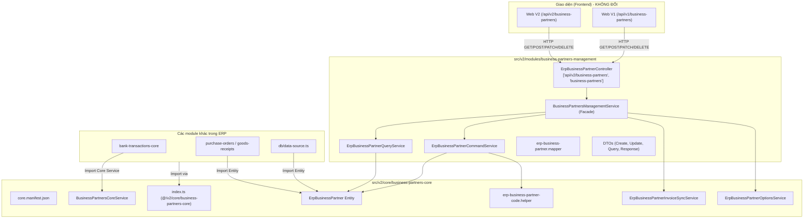

# 📋 Implementation Plan: Restructure `business-partners-core` theo chuẩn `/api-structure` (v2 core & modules)

- **Repo**: `erp/erp-api`
- **Branch**: `erp-master`
- **Database**: `erp_local` (đã xác nhận qua `SELECT current_database();`)
- **Structure**: `/api-structure` (Phần B: V2 Core & Business Modules)
- **Track**: `T2` (Restructure V2 chuẩn hóa hai tầng `core` và `modules`)
- **Naming Convention**:
  - **Core**: `src/v2/core/business-partners-core/` (`BusinessPartnersCoreModule`)
  - **Module**: `src/v2/modules/business-partners-management/` (`BusinessPartnersManagementModule`)
- **UI Impact**: **ZERO** (Không đổi route `@Controller(['api/v2/business-partners', 'business-partners'])`, không đổi envelope, không đổi payload/response, UI hoàn toàn không bị ảnh hưởng)

---

## 1. Discovery & Phân Tích Hiện Trạng

### 1.1 Vấn đề hiện tại
Thư mục `erp/erp-api/src/v2/business-partners-core/` hiện đang nằm trực tiếp dưới `src/v2/`, vi phạm chuẩn phân tầng hai cấp của kiến trúc V2:
1. **`src/v2/core/<family>/`**: Chứa nền tảng lõi dùng chung (core manifest, contracts, base/shared entities, core engine services, barrel export `@/v2/core/<family>`).
2. **`src/v2/modules/<module>/`**: Chứa business module (REST controllers, CRUD query/command services, DTOs, mappers, module wiring).

### 1.2 Cấu trúc đích sau phân rã
- **Tầng Core** (`src/v2/core/business-partners-core/`):
  - `core.manifest.json`: Khai báo họ `business-partners-core` theo chuẩn manifest v2 (để `listCoreFamilies` nhận diện).
  - `contracts/business-partner.contract.ts`: Interface hợp đồng và kiểu dữ liệu chuẩn (`IBusinessPartner`, `PartnerType`).
  - `entities/erp_business_partner.entity.ts`: Entity `ErpBusinessPartner` duy nhất của hệ thống.
  - `helpers/erp-business-partner-code.helper.ts`: Logic sinh và chuẩn hóa mã đối tác (`nextPartnerCode`, `normalizePartnerCode`).
  - `services/`: Các service lõi dùng chung (`erp-business-partner-invoice-sync.service.ts`, `erp-business-partner-options.service.ts`, `business-partners-core.service.ts`).
  - `business-partners-core.module.ts`: Module lõi xuất entity và core services.
  - `index.ts`: Barrel export toàn bộ cho `@/v2/core/business-partners-core`.
- **Tầng Module** (`src/v2/modules/business-partners-management/`):
  - `controllers/erp-business-partner.controller.ts`: REST controller phục vụ cả `/api/v2/business-partners` và alias `/api/v1/business-partners`.
  - `dto/`: Bộ DTOs nhập xuất của module (Create, Update, Query, Response, Options, Sync).
  - `helpers/erp-business-partner.mapper.ts`: Mapper entity <-> response DTO.
  - `services/`: Query service (`erp-business-partner-query.service.ts`) và Command service (`erp-business-partner-command.service.ts`).
  - `business-partners-management.service.ts`: Facade service điều phối cho module.
  - `business-partners-management.module.ts`: Module đăng ký controller và providers, import `BusinessPartnersCoreModule`.

---

## 2. Kiến Trúc & Luồng Dữ Liệu



---

## 3. Bất Biến & Đảm Bảo Zero-Regression (UI Invariance)

1. **REST Endpoints & Routing**:
   - Controller tiếp tục lắng nghe 2 route song song: `@Controller(['api/v2/business-partners', 'business-partners'])`.
   - Web V2 gọi `/api/v2/business-partners` giữ nguyên.
   - Web V1 gọi `/api/v1/business-partners` giữ nguyên.
2. **Response Envelope & DTOs**:
   - `GET /`: `{ items, total, page, pageSize, totalPages, summaries }`.
   - `GET /:id`, `POST /`, `PATCH /`, `DELETE /`: `{ message, data }`.
   - `GET /column-options`: `{ items, total, next }`.
   - `GET /next-code`: `{ nextCode }`.
   - `GET /options`: `{ items, total, page, pageSize, totalPages }`.
   - `POST /sync-from-invoices`: `{ message, dryRun, count, items }`.
3. **RBAC & Guards**:
   - `ErpResource.BUSINESS_PARTNERS` và `ErpAction.*` giữ nguyên 100%.
4. **Phụ thuộc nội bộ**:
   - Mọi import từ các module khác (`sales-orders-core`, `bank-transactions-core`, `purchase-orders`, `db/data-source.ts`, v.v.) được chuyển hướng sang `@/v2/core/business-partners-core`.
5. **Clean DI Constructor**:
   - Mỗi service chỉ có 1 constructor signature duy nhất, không overload, không union type.

---

## 4. Kế Hoạch Triển Khai Chi Tiết (Task 3 Cấp X.Y.Z)

### Phase 2: API Backend Restructuring

#### Group 2.1: Xây dựng Tầng Core (`src/v2/core/business-partners-core/`)
- [x] **Task 2.1.1: Tạo manifest, contracts và entity trong `v2/core/business-partners-core`**
  - **Phân hệ**: `API` | **Ưu tiên**: `P0`
  - **Runner**: `Main Agent`
  - **Files**:
    - `[NEW]` [core.manifest.json](file:///home/dev/repos-dev-03/erp/erp-api/src/v2/core/business-partners-core/core.manifest.json)
    - `[NEW]` [contracts/business-partner.contract.ts](file:///home/dev/repos-dev-03/erp/erp-api/src/v2/core/business-partners-core/contracts/business-partner.contract.ts)
    - `[NEW]` [entities/erp_business_partner.entity.ts](file:///home/dev/repos-dev-03/erp/erp-api/src/v2/core/business-partners-core/entities/erp_business_partner.entity.ts)
    - `[NEW]` [entities/index.ts](file:///home/dev/repos-dev-03/erp/erp-api/src/v2/core/business-partners-core/entities/index.ts)
  - **DoD**: Khởi tạo cấu trúc core, `core.manifest.json` đúng chuẩn `listCoreFamilies`, entity chuyển sang core giữ nguyên tên cột và decorators TypeORM.
  - **Verification**: `bunx tsc --noEmit src/v2/core/business-partners-core/entities/erp_business_partner.entity.ts`

- [x] **Task 2.1.2: Di chuyển helpers và core services vào `v2/core/business-partners-core`**
  - **Phân hệ**: `API` | **Ưu tiên**: `P0`
  - **Runner**: `Main Agent`
  - **Files**:
    - `[NEW]` [helpers/erp-business-partner-code.helper.ts](file:///home/dev/repos-dev-03/erp/erp-api/src/v2/core/business-partners-core/helpers/erp-business-partner-code.helper.ts)
    - `[NEW]` [helpers/erp-business-partner-code.helper.spec.ts](file:///home/dev/repos-dev-03/erp/erp-api/src/v2/core/business-partners-core/helpers/erp-business-partner-code.helper.spec.ts)
    - `[NEW]` [services/erp-business-partner-invoice-sync.service.ts](file:///home/dev/repos-dev-03/erp/erp-api/src/v2/core/business-partners-core/services/erp-business-partner-invoice-sync.service.ts)
    - `[NEW]` [services/erp-business-partner-invoice-sync.service.spec.ts](file:///home/dev/repos-dev-03/erp/erp-api/src/v2/core/business-partners-core/services/erp-business-partner-invoice-sync.service.spec.ts)
    - `[NEW]` [services/erp-business-partner-options.service.ts](file:///home/dev/repos-dev-03/erp/erp-api/src/v2/core/business-partners-core/services/erp-business-partner-options.service.ts)
    - `[NEW]` [services/erp-business-partner-options.service.spec.ts](file:///home/dev/repos-dev-03/erp/erp-api/src/v2/core/business-partners-core/services/erp-business-partner-options.service.spec.ts)
    - `[NEW]` [services/business-partners-core.service.ts](file:///home/dev/repos-dev-03/erp/erp-api/src/v2/core/business-partners-core/services/business-partners-core.service.ts)
    - `[NEW]` [services/business-partners-core.service.spec.ts](file:///home/dev/repos-dev-03/erp/erp-api/src/v2/core/business-partners-core/services/business-partners-core.service.spec.ts)
  - **DoD**: Di chuyển và cập nhật imports cho helper sinh mã, invoice sync service, options service và core service; spec đi kèm pass.
  - **Verification**: `bunx jest src/v2/core/business-partners-core --forceExit`

- [x] **Task 2.1.3: Tạo `business-partners-core.module.ts` và barrel export `index.ts`**
  - **Phân hệ**: `API` | **Ưu tiên**: `P0`
  - **Runner**: `Main Agent`
  - **Files**:
    - `[NEW]` [business-partners-core.module.ts](file:///home/dev/repos-dev-03/erp/erp-api/src/v2/core/business-partners-core/business-partners-core.module.ts)
    - `[NEW]` [index.ts](file:///home/dev/repos-dev-03/erp/erp-api/src/v2/core/business-partners-core/index.ts)
  - **DoD**: Khai báo `TypeOrmModule.forFeature([ErpBusinessPartner])`, export các core service và barrel export cho alias `@/v2/core/business-partners-core`.
  - **Verification**: `bunx tsc --noEmit src/v2/core/business-partners-core/index.ts`

---

#### Group 2.2: Xây dựng Tầng Module (`src/v2/modules/business-partners-management/`)
- [x] **Task 2.2.1: Chuyển DTOs và mapper vào `v2/modules/business-partners-management`**
  - **Phân hệ**: `API` | **Ưu tiên**: `P0`
  - **Runner**: `Main Agent`
  - **Files**:
    - `[NEW]` [dto/create-erp-business-partner.dto.ts](file:///home/dev/repos-dev-03/erp/erp-api/src/v2/modules/business-partners-management/dto/create-erp-business-partner.dto.ts)
    - `[NEW]` [dto/update-erp-business-partner.dto.ts](file:///home/dev/repos-dev-03/erp/erp-api/src/v2/modules/business-partners-management/dto/update-erp-business-partner.dto.ts)
    - `[NEW]` [dto/query-erp-business-partner.dto.ts](file:///home/dev/repos-dev-03/erp/erp-api/src/v2/modules/business-partners-management/dto/query-erp-business-partner.dto.ts)
    - `[NEW]` [dto/erp-business-partner-response.dto.ts](file:///home/dev/repos-dev-03/erp/erp-api/src/v2/modules/business-partners-management/dto/erp-business-partner-response.dto.ts)
    - `[NEW]` [dto/query-erp-business-partner-options.dto.ts](file:///home/dev/repos-dev-03/erp/erp-api/src/v2/modules/business-partners-management/dto/query-erp-business-partner-options.dto.ts)
    - `[NEW]` [dto/sync-erp-business-partners-from-invoices.dto.ts](file:///home/dev/repos-dev-03/erp/erp-api/src/v2/modules/business-partners-management/dto/sync-erp-business-partners-from-invoices.dto.ts)
    - `[NEW]` [helpers/erp-business-partner.mapper.ts](file:///home/dev/repos-dev-03/erp/erp-api/src/v2/modules/business-partners-management/helpers/erp-business-partner.mapper.ts)
    - `[NEW]` [helpers/erp-business-partner.mapper.spec.ts](file:///home/dev/repos-dev-03/erp/erp-api/src/v2/modules/business-partners-management/helpers/erp-business-partner.mapper.spec.ts)
  - **DoD**: Di chuyển toàn bộ DTOs và mapper, trỏ import entity sang `@/v2/core/business-partners-core`.
  - **Verification**: `bunx jest src/v2/modules/business-partners-management/helpers/erp-business-partner.mapper.spec.ts --forceExit`

- [x] **Task 2.2.2: Chuyển Query và Command services vào `v2/modules/business-partners-management`**
  - **Phân hệ**: `API` | **Ưu tiên**: `P0`
  - **Runner**: `Main Agent`
  - **Files**:
    - `[NEW]` [services/erp-business-partner-query.service.ts](file:///home/dev/repos-dev-03/erp/erp-api/src/v2/modules/business-partners-management/services/erp-business-partner-query.service.ts)
    - `[NEW]` [services/erp-business-partner-query.service.spec.ts](file:///home/dev/repos-dev-03/erp/erp-api/src/v2/modules/business-partners-management/services/erp-business-partner-query.service.spec.ts)
    - `[NEW]` [services/erp-business-partner-command.service.ts](file:///home/dev/repos-dev-03/erp/erp-api/src/v2/modules/business-partners-management/services/erp-business-partner-command.service.ts)
    - `[NEW]` [services/erp-business-partner-command.service.spec.ts](file:///home/dev/repos-dev-03/erp/erp-api/src/v2/modules/business-partners-management/services/erp-business-partner-command.service.spec.ts)
  - **DoD**: Query/Command service hoạt động chuẩn xác với Entity và Code Helper từ core; specs pass 100%.
  - **Verification**: `bunx jest src/v2/modules/business-partners-management/services --forceExit`

- [x] **Task 2.2.3: Thiết lập Facade Service, Controller và Module trong `v2/modules/business-partners-management`**
  - **Phân hệ**: `API` | **Ưu tiên**: `P0`
  - **Runner**: `Main Agent`
  - **Files**:
    - `[NEW]` [business-partners-management.service.ts](file:///home/dev/repos-dev-03/erp/erp-api/src/v2/modules/business-partners-management/business-partners-management.service.ts)
    - `[NEW]` [business-partners-management.service.spec.ts](file:///home/dev/repos-dev-03/erp/erp-api/src/v2/modules/business-partners-management/business-partners-management.service.spec.ts)
    - `[NEW]` [controllers/erp-business-partner.controller.ts](file:///home/dev/repos-dev-03/erp/erp-api/src/v2/modules/business-partners-management/controllers/erp-business-partner.controller.ts)
    - `[NEW]` [controllers/erp-business-partner.controller.spec.ts](file:///home/dev/repos-dev-03/erp/erp-api/src/v2/modules/business-partners-management/controllers/erp-business-partner.controller.spec.ts)
    - `[NEW]` [controllers/erp-business-partner.routes.spec.ts](file:///home/dev/repos-dev-03/erp/erp-api/src/v2/modules/business-partners-management/controllers/erp-business-partner.routes.spec.ts)
    - `[NEW]` [business-partners-management.module.ts](file:///home/dev/repos-dev-03/erp/erp-api/src/v2/modules/business-partners-management/business-partners-management.module.ts)
  - **DoD**: Controller giữ nguyên route `['api/v2/business-partners', 'business-partners']`, Facade điều phối command/query/sync/options, route spec kiểm tra cả V1 và V2 routes pass 100%.
  - **Verification**: `bunx jest src/v2/modules/business-partners-management/controllers --forceExit`

---

#### Group 2.3: Chuyển đổi phụ thuộc hệ thống & Dọn dẹp thư mục cũ
- [x] **Task 2.3.1: Cập nhật imports trong các module phụ thuộc và `app.module.ts` / `data-source.ts`**
  - **Phân hệ**: `API` | **Ưu tiên**: `P0`
  - **Runner**: `Main Agent`
  - **Files**:
    - `[MODIFY]` [src/app.module.ts](file:///home/dev/repos-dev-03/erp/erp-api/src/app.module.ts) (đăng ký `BusinessPartnersManagementModule`)
    - `[MODIFY]` [src/db/data-source.ts](file:///home/dev/repos-dev-03/erp/erp-api/src/db/data-source.ts)
    - `[MODIFY]` [src/bank-transactions-core/bank-transactions-core.module.ts](file:///home/dev/repos-dev-03/erp/erp-api/src/bank-transactions-core/bank-transactions-core.module.ts)
    - `[MODIFY]` [src/bank-transactions-core/services/transaction-accounting.service.ts](file:///home/dev/repos-dev-03/erp/erp-api/src/bank-transactions-core/services/transaction-accounting.service.ts)
    - `[MODIFY]` [src/bank-transactions-core/entities/erp_bank_transaction.entity.ts](file:///home/dev/repos-dev-03/erp/erp-api/src/bank-transactions-core/entities/erp_bank_transaction.entity.ts)
    - `[MODIFY]` `src/{sales-orders-core,goods-issues-core,goods-receipts-core,purchase-orders-core,operating-expenses-core,public-warranty,basic-masters-core,v2/modules/purchase-orders}` (chuyển import `ErpBusinessPartner` sang `@/v2/core/business-partners-core`)
  - **DoD**: Toàn bộ các module trong hệ thống trỏ về vị trí mới của entity và core module.
  - **Verification**: `bunx tsc --noEmit`

- [x] **Task 2.3.2: Xóa thư mục cũ `src/v2/business-partners-core`**
  - **Phân hệ**: `API` | **Ưu tiên**: `P0`
  - **Runner**: `Main Agent`
  - **Files**:
    - `[DELETE]` Toàn bộ `src/v2/business-partners-core/`
  - **DoD**: Không còn file nào sót lại trong thư mục cũ `src/v2/business-partners-core/`.
  - **Verification**: `test ! -d src/v2/business-partners-core && echo "DELETED OK"`

---

### Phase 4: QC & Verification

- [x] **Task 4.1.1: Quality Gate toàn diện (TypeCheck, Unit Tests, CI Check, Scanner)**
  - **Phân hệ**: `QC` | **Ưu tiên**: `P0`
  - **Runner**: `Main Agent`
  - **Files**: `Toàn bộ repo erp-api`
  - **DoD**:
    1. `bun run type:check` pass 0 error.
    2. Toàn bộ tests của `business-partners` (cả core và module) pass 100%.
    3. `bun .agents/skills/erp-api-structure/scripts/scan-oversized-files.ts --strict` pass.
    4. Không có file nào vượt ngưỡng kích thước hay vi phạm Clean DI.
  - **Verification**:
    ```bash
    cd erp/erp-api
    bun run type:check
    bunx jest src/v2/core/business-partners-core src/v2/modules/business-partners-management --forceExit
    bun .agents/skills/erp-api-structure/scripts/scan-oversized-files.ts --strict --path=src/v2/core/business-partners-core
    bun .agents/skills/erp-api-structure/scripts/scan-oversized-files.ts --strict --path=src/v2/modules/business-partners-management
    ```

- [x] **Task 4.1.2: Knowledge-Sync (Cập nhật module skill & references)**
  - **Phân hệ**: `QC` | **Ưu tiên**: `P1`
  - **Runner**: `Main Agent`
  - **Files**:
    - `[MODIFY]` [.agents/skills/modules/business-partners-core/SKILL.md](file:///home/dev/repos-dev-03/erp/erp-api/.agents/skills/modules/business-partners-core/SKILL.md)
    - `[MODIFY]` [.agents/skills/erp-api-truth/SKILL.md](file:///home/dev/repos-dev-03/erp/erp-api/.agents/skills/erp-api-truth/SKILL.md)
    - `[MODIFY]` [.agents/skills/erp-api-structure/references/v2-module.md](file:///home/dev/repos-dev-03/erp/erp-api/.agents/skills/erp-api-structure/references/v2-module.md)
  - **DoD**: Cập nhật cây thư mục và đường dẫn mới trong tài liệu tri thức module, đảm bảo Knowledge-Sync Guard.
  - **Verification**: `git status --short`
