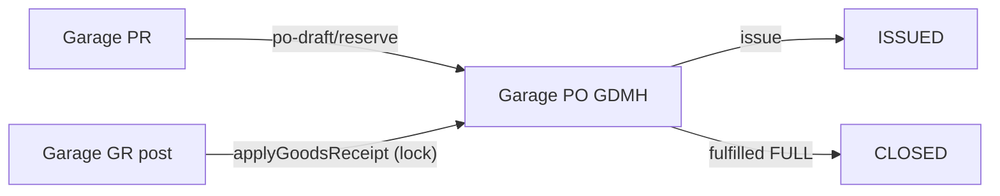

# Garage Procurement (PR + PO) thay thế Garage Purchase Orders: Kế Hoạch Triển Khai (erp-api + erp-web)

Track: T2 (migrate sang lõi v2 `procurement-*`, user đã ra lệnh)
Structure: /api-structure (Phần B, lõi v2) + /ui-structure (Phần B, `src/v2/`) + /standardize-table + /standardize-drawer
Consistency Check: đạt (mỗi AC ánh xạ ≥1 task, xem bảng truy vết)
Plane: KINDU-286 → KINDU-324 (Module "Garage Procurement: PR/PO thay Garage Purchase Orders"; Cycles: Phase 1-2 (2026-11-12→11-20), Phase 3 (11-19→11-27), Phase 4 (11-26→12-04); Stories KINDU-286..289; Tasks KINDU-291..324; label epic:garage-procurement)

## Context
Garage có 2 luồng PO song song: `garage-purchase-orders` (GPO, bảng `erp_garage_purchase_orders`, chỉ approve/confirm/cancel, không liên kết PR/GR) và `garage-procurement-requests/orders` (PR → PO, duyệt RBAC, issue, receipts, acceptances, reserve/release số lượng PR). Luồng thứ hai mới là luồng đúng nghiệp vụ nhưng còn thiếu: sửa header PO, giải phóng số lượng PR khi PO DRAFT bị bỏ, quyền approve/reject chưa seed, thiếu `payment_status`/`supplier_invoice_no`, DTO receipts chưa validate, phiếu nhập garage (GR) chưa nối PO (nên PO không bao giờ nhận hàng), chưa có UI. Mục tiêu: hoàn thiện luồng này, làm UI, rồi gỡ GPO.

## Spec
Phạm vi (user đã chốt): API + nối GR + UI + gỡ GPO (deprecate, đếm dữ liệu trước khi drop); thêm 2 cột thanh toán vào PO mới; seed approve/reject cho role đang có quyền garage.
Ngoài phạm vi: DNTT, phiếu chi, phân bổ thanh toán, ghi `payment_status` (cột chỉ tồn tại, mặc định `UNPAID`); liên kết hóa đơn NCC; đổi luật short-close (giữ: `close` không release PR); luồng non-garage `erp-procurement-*` (chỉ hưởng lợi từ thay đổi ở lõi).

Tiêu chí chấp nhận:
- AC-1: Sửa header PO (supplier, ngày, remarks, supplier_invoice_no, branch) khi DRAFT qua `PATCH :id`.
- AC-2: PO DRAFT bị bỏ/xóa (`DELETE :id`, soft delete) thì release số lượng PR đã reserve.
- AC-3: Role đang có quyền garage có approve/reject trên `garage_procurement_requests/orders`.
- AC-4: PO có `payment_status` (default UNPAID) và `supplier_invoice_no`; list có filter status/supplier/date/search, `next-no`, `column-options`; response có branch, createdBy, issuedAt, acceptances.
- AC-5: DTO receipts/acceptances validate đầy đủ; PR→PO kiểm tra cùng branch.
- AC-6: GR garage nối PO: `post` ghi nhận `qty_fulfilled` + trạng thái PO trong cùng transaction (khóa `pessimistic_write`); `cancel` GR POSTED hoàn lại. Chỉ nhận khi PO ISSUED, đúng supplier/branch, không vượt SL đặt.
- AC-7: `post`/`cancel` GR không cộng/trừ nhầm tồn chi nhánh khác khi `branchId` null.
- AC-8: UI PR và PO trên erp-web (list, drawer, hành động duyệt, lịch sử duyệt, nhận hàng/nghiệm thu, tạo PO từ PR); GR chọn được PO.
- AC-9: GPO bị gỡ (API, Web, quyền, bảng) chỉ sau khi đếm dữ liệu; có dữ liệu thì migrate trước.

| AC | Task | Verification |
| :--- | :--- | :--- |
| AC-1 | 2.1.1, 2.1.2 | jest `procurement-order-command` header edit spec |
| AC-2 | 2.1.3 | jest spec release-on-delete |
| AC-3 | 1.2.1 | đọc migration + jest rbac seed spec (nếu có) |
| AC-4 | 1.1.1, 2.2.1, 2.2.2 | tsc + jest mapper/query spec |
| AC-5 | 2.3.1, 2.3.2 | jest dto/command spec |
| AC-6 | 1.1.2, 2.4.1, 2.4.2, 2.4.3 | jest GR command/fulfilment spec |
| AC-7 | 2.5.1 | jest GR post spec branch null |
| AC-8 | 3.1.x–3.3.x | vitest/test của erp-web theo từng file |
| AC-9 | 4.2.1–4.2.3 | COUNT + jest + tsc |

## User Review Required
- Quyết định đã chốt: xem Phạm vi ở trên.
- Breaking change: route/quyền GPO biến mất ở Task 4.2; web menu "Đơn mua hàng Garage" đổi sang PR/PO mới.
- Giả định em đã chọn (anh sửa nếu khác): xóa PO DRAFT dùng `DELETE` (soft delete) thay vì thêm `cancel` từ DRAFT; `close` (short-close) không release PR; map trạng thái cũ khi migrate GPO: CONFIRMED→ISSUED, PARTIAL_RECEIVED/RECEIVED→ISSUED + `fulfillment_status` PARTIAL/FULL.

## Open Questions
- [ ] Dữ liệu GPO có tồn tại ở staging/tenant nào? (quyết định 4.2 là drop thẳng hay migrate). Sẽ đếm read-only sau `OK` và báo tên DB.
- [ ] Hủy GR POSTED đã nhận hàng cho PO: hoàn `qty_fulfilled` (giả định đã chọn) hay chặn hủy?

## Thiết kế kỹ thuật

- Lõi dùng chung: `src/v2/core/procurement-orders/**` (thêm `updateHeader`, `softDeleteDraft` + release qua `RequestLinkPort`, `revertGoodsReceipt`), module garage chỉ khai báo bảng/DTO/controller.
- GR → PO: `GarageGoodsReceiptsCoreModule` import `GarageProcurementOrdersModule` (export `GarageProcurementOrderFulfilmentService`), gọi trong transaction của `post`/`cancel`; tránh vòng phụ thuộc bằng port nếu cần.
- File mới/sửa ≤180 dòng; không trả Entity từ Controller; `@RequirePermissions` dùng `ErpResource` hiện có.
- Rollback: mọi migration có `down()`; drop GPO là migration riêng, chỉ chạy sau kiểm đếm, backup trước.

## Task Breakdown

### Phase 1 – DB (erp-api, `src/migrations`)
- [ ] **1.1.1 Cột thanh toán PO** `[NEW]` migration: `payment_status varchar(50) default 'UNPAID'` (+index), `supplier_invoice_no varchar(100) null` trên `erp_garage_proc_orders`. DoD: có `up/down`. Verification: `bunx tsc --noEmit`.
- [ ] **1.1.2 Cột liên kết GR** `[NEW]` migration: `garage_procurement_order_id uuid null` (FK RESTRICT, index) trên `erp_garage_goods_receipts`; `procurement_order_line_id uuid null` trên lines. Verification: `bunx tsc --noEmit`.
- [ ] **1.2.1 Seed approve/reject** `[NEW]` migration: copy từ role có `update` trên `garage_procurement_requests/orders` (NOT EXISTS), `down()` xóa đúng bản đã thêm. Verification: đọc SQL + `bunx tsc --noEmit`.
- Migration chạy (`bun run migration:run`) chỉ ở giai đoạn thực thi, sau xác nhận `SELECT current_database();`.

### Phase 2 – API (erp-api)
- [ ] 2.1.1 `[MODIFY]` core `abstract-procurement-order-command.service.ts`: `updateHeader` (chỉ DRAFT, khóa header). Spec cạnh file.
- [ ] 2.1.2 `[MODIFY]` garage `procurement-order.controller.ts` + `procurement-order.dto.ts`: `PATCH :id` (UpdateHeaderDto, validate).
- [ ] 2.1.3 `[MODIFY]` core command: `softDeleteDraft` (release PR) + `DELETE :id` ở controller (quyền `DELETE`).
- [ ] 2.2.1 `[MODIFY]` entity/DTO/mapper garage PO: `paymentStatus`, `supplierInvoiceNo`; response thêm branch, createdBy, issuedAt, acceptances.
- [ ] 2.2.2 `[MODIFY]` `procurement-order-query.service.ts`: filter status/supplier/date/search, `next-no`, `column-options` (tái dùng pattern `abstract-purchase-order-query.service.ts` của GPO).
- [ ] 2.3.1 `[MODIFY]` `procurement-order.dto.ts`: `@ValidateNested` + `@Type` + `@IsUUID` cho `ReceiveGoodsDto`/`AcceptServicesDto`.
- [ ] 2.3.2 `[MODIFY]` core command `createDraft`/`replaceDraftLines`: kiểm tra PO cùng branch với PR.
- [ ] 2.4.1 `[MODIFY]` GR entity/DTO/mapper: `procurementOrderId`, line `procurementOrderLineId`; validate supplier/branch khớp PO.
- [ ] 2.4.2 `[MODIFY]` core fulfilment: thêm `revertGoodsReceipt` (đối xứng `applyGoodsReceipt`, khóa header).
- [ ] 2.4.3 `[MODIFY]` `garage-goods-receipt-command.service.ts` `post`/`cancel`: gọi fulfilment trong cùng transaction; import module.
- [ ] 2.5.1 `[MODIFY]` GR command: dùng `IsNull()` khi `branchId` null + khóa `pessimistic_write` dòng tồn; (P2) unique index `(branch_id, item_code) NULLS NOT DISTINCT` chỉ sau khi kiểm không trùng.
- [ ] 2.6.1 `[MODIFY]` `rbac-core.service.ts`: đảm bảo `garage_procurement_requests/orders` có trong danh sách resource UI.
- [ ] 2.7.1 `[MODIFY]` GPO controller: đánh dấu deprecated (header `Deprecation`, `@ApiExcludeController`), chưa xóa.
- Mỗi task có spec; Verification: `bunx jest src/v2/modules/garage-procurement-orders/<file>.spec.ts`, `bunx jest src/v2/modules/garage-goods-receipts/<file>.spec.ts`.

### Phase 3 – UI (erp-web, theo /ui-structure + /standardize-table + /standardize-drawer)
Chi tiết file cụ thể xác định khi thực thi (đọc `erp-web-truth` và skill module); mẫu tham chiếu: module GPO và garage-goods-receipts hiện có.
- [ ] 3.1.x Module `src/v2/modules/garage-procurement-requests`: api client + React Query keys, list (`SpreadsheetPageTemplate`, STT 1-based, Header Filter), drawer (`StandardFormDrawer`, vw), hành động submit/recall/approve/reject/cancel/close (modal confirm, reason), lịch sử duyệt, nút "Tạo PO từ PR" (`po-draft`).
- [ ] 3.2.x Module `garage-procurement-orders`: list/drawer, sửa header, hành động + issue, nhận hàng (receipts) và nghiệm thu (acceptances/void), hiển thị `payment_status`, `supplier_invoice_no`.
- [ ] 3.3.x GR garage: chọn PO (ISSUED) và dòng PO khi tạo phiếu.
- [ ] 3.4.x Route (`v2RouteConfig.ts`, `v2PageRegistry.tsx`), menu (`v2Navigation.config.ts`), i18n vi/en (không hardcode), `rbac.ts` types.
- Verification: test theo từng file của erp-web (`bunx vitest run <file>`), `bunx tsc --noEmit`.

### Phase 4 – QC & gỡ GPO
- [ ] 4.1.1 Spec tích hợp luồng PR → PO → approve → issue → GR post → FULL/CLOSED và cancel GR (mock DataSource theo pattern repo).
- [ ] 4.2.1 Đếm dữ liệu GPO (read-only `SELECT current_database(); SELECT COUNT(*) FROM erp_garage_purchase_orders`) trên từng DB mục tiêu; báo kết quả.
- [ ] 4.2.2 Nếu >0: migration chuyển dữ liệu GPO sang bảng mới (map trạng thái ở trên). Nếu =0: bỏ qua.
- [ ] 4.2.3 Gỡ GPO: API (module, entity, `app.module.ts:61,182`, `data-source.ts:95-96,212-213`, enum/rbac), Web (danh sách file đã khảo sát: module, route, nav, locales, GarageNavSection, adapters, rbac types, `pageUrl`, `App.tsx`), migration drop bảng + xóa quyền `garage_purchase_orders` (giữ migration cũ).
- [ ] 4.3.1 Knowledge Sync: cập nhật skill `garage-procurement-orders`, `garage-procurement-requests`, `garage-goods-receipts`; xóa skill `garage-purchase-orders`; cập nhật `erp-api-truth`/`erp-web-truth`; Final Gate: commit → `git pull --rebase github-industries erp-master` → push → CI xanh. Mỗi repo con làm riêng.

## Verification tổng
CI GitHub xanh (check, test, build); thủ công trên staging: tạo PR → duyệt → tạo PO từ PR → duyệt → issue → tạo GR chọn PO → post → PO PARTIAL/FULL → cancel GR → số lượng hoàn; user không có quyền approve nhận 403; self-approval nhận 403.

## ⏸️ Session Checkpoint
- **Active Task**: None
- **Hành động tiếp theo khi Resume**: sau `OK`, hỏi Plane, lưu bản chốt vào `.agents/plans/garage-procurement-replace-gpo/implementation_plan.md`, bắt đầu Task 4.2.1 (đếm dữ liệu) và 1.1.1.
