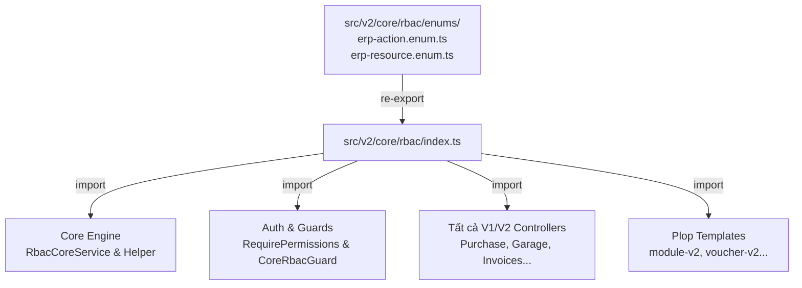

# Di Chuyển Toàn Bộ Phần Tồn Đọng rbac-core Sang v2/core/rbac (erp-api)

Tóm tắt mục tiêu: Di dời toàn bộ phần còn lại trong `src/rbac-core` (gồm các enums `ErpAction`, `ErpResource`) vào thư mục lõi `src/v2/core/rbac/enums`, cập nhật barrel export tại `src/v2/core/rbac/index.ts`, cập nhật generator plop và refactor toàn bộ các file import `@/rbac-core` sang `@/v2/core/rbac`, sau đó xóa bỏ hoàn toàn thư mục `src/rbac-core`.

Track: T2
Structure: /api-structure
Consistency Check: đạt
Plane: KINDU-349 (Tasks: KINDU-350 -> KINDU-354)

---

## 📝 Spec

- **Mục tiêu**:
  1. Đưa `ErpAction` và `ErpResource` về đúng vị trí chuẩn kiến trúc V2: `src/v2/core/rbac/enums/`.
  2. Xuất các enums này trực tiếp từ barrel `src/v2/core/rbac` để thống nhất điểm truy cập cho toàn bộ backend.
  3. Cập nhật cơ chế sinh code tự động (`plop-helpers/apiV2Wiring.mjs` và các file `plop-templates/`).
  4. Cập nhật đồng bộ toàn bộ ~80 file import `@/rbac-core` sang `@/v2/core/rbac`.
  5. Xóa bỏ hoàn toàn thư mục cũ `src/rbac-core`.
  6. Đồng bộ tri thức module `rbac-core` SKILL.md và tài liệu liên quan.
- **Phạm vi (In-Scope)**:
  - `erp/erp-api/src/v2/core/rbac/enums/`: tạo mới từ `src/rbac-core/enums/`
  - `erp/erp-api/src/v2/core/rbac/index.ts`: export `export * from './enums';`
  - `erp/erp-api/src/v2/core/rbac/helpers/` & `services/`: đổi import nội bộ sang relative path `../enums`
  - `erp/erp-api/plop-helpers/apiV2Wiring.mjs` & `apiV2Wiring.test.mjs`: trỏ `rbacResource` về đường dẫn mới
  - `erp/erp-api/plop-templates/`: cập nhật import từ `@/v2/core/rbac`
  - `erp/erp-api/src/`: cập nhật tất cả ~80 files đang import từ `@/rbac-core` hoặc `@/rbac-core/enums`
  - `erp/erp-api/src/rbac-core/`: xóa toàn bộ thư mục
  - Tài liệu & Skill: cập nhật `.agents/skills/modules/rbac-core/SKILL.md`
- **Ngoài phạm vi (Out-of-Scope)**:
  - Không thay đổi database schema hay DDL migration (action và resource là varchar).
  - Không sửa frontend `erp-web` (vì web chỉ gọi HTTP endpoint `/api/v1/rbac-core` được quản lý bởi module `rbac-roles`).

| AC | Mô tả Tiêu chí Chấp nhận | Task tương ứng | Lệnh Verification |
| :--- | :--- | :--- | :--- |
| `AC-1` | `ErpAction` và `ErpResource` nằm tại `src/v2/core/rbac/enums/` và được export qua `@/v2/core/rbac` | `1.1.1`, `1.1.2` | `bunx tsc --noEmit` |
| `AC-2` | Lõi `src/v2/core/rbac` tự import enum qua relative path nội bộ | `1.1.3` | `bunx jest src/v2/core/rbac/services/rbac-core.service.spec.ts` |
| `AC-3` | Bộ sinh code Plop và wiring helper trỏ đúng vào enum mới | `2.1.1`, `2.1.2` | `node --test plop-helpers/apiV2Wiring.test.mjs` |
| `AC-4` | Toàn bộ ~80 files trong `src/` chuyển import sang `@/v2/core/rbac`, không còn file nào import `rbac-core` | `2.2.1`, `2.2.2`, `2.2.3` | `grep -rn "@/rbac-core" src/` không trả về kết quả |
| `AC-5` | Xóa sạch thư mục `src/rbac-core` và kiểm tra type check toàn dự án | `2.3.1` | `bunx tsc --noEmit` |
| `AC-6` | Toàn bộ unit tests liên quan đến RBAC và guard PASS | `3.1.1` | `bunx jest src/v2/core/rbac/ src/v2/modules/rbac-roles/ src/auth/guards/` |
| `AC-7` | Cập nhật tri thức module trong `.agents/skills/modules/rbac-core/SKILL.md` | `3.2.1` | Review nội dung file skill |

---

## ⚠️ User Review Required

> **Phạm vi tác động refactor import**:
> Việc xóa hẳn thư mục `src/rbac-core` yêu cầu sửa đổi dòng import của khoảng **80 file** mã nguồn (chủ yếu là Controllers và Decorators).
> - Để đảm bảo an toàn tuyệt đối và không gián đoạn, ta sẽ:
>   1. Chuyển files enum sang `src/v2/core/rbac/enums` trước và export qua barrel.
>   2. Cập nhật generator và hàng loạt các import.
>   3. Xác nhận `bunx tsc --noEmit` pass 100% trước khi xóa thư mục `src/rbac-core`.

---

## ❓ Open Questions

- [x] Có cần giữ file proxy/shim tại `src/rbac-core/index.ts` không?
  - *Quyết định*: Theo yêu cầu của User (*"di chuyển những gì còn tồn đọng trong rbac-core vào rbac"*), ta sẽ di chuyển triệt để, cập nhật tất cả import và **xóa hẳn** thư mục `src/rbac-core`.

---

## 🏛️ Thiết kế kỹ thuật

### Sơ đồ luồng tham chiếu sau khi hoàn tất



### Chi tiết thay đổi

1. **Vị trí file mới**:
   - `src/v2/core/rbac/enums/erp-action.enum.ts`
   - `src/v2/core/rbac/enums/erp-resource.enum.ts`
   - `src/v2/core/rbac/enums/index.ts`
2. **Barrel Export**:
   Trong `src/v2/core/rbac/index.ts`:
   ```ts
   export * from './enums';
   export * from './entities/core-role.entity';
   export * from './entities/core-permission.entity';
   export * from './entities/core-user-role.entity';
   export * from './helpers/permission-match.helper';
   export * from './services/rbac-core.service';
   export * from './rbac-core.module';
   ```
3. **Plop Wiring**:
   Trong `plop-helpers/apiV2Wiring.mjs`:
   `rbacResource: 'src/v2/core/rbac/enums/erp-resource.enum.ts'`

---

## 📋 Task Breakdown 3 Cấp & DoD

### Phase 1: Chuẩn bị Enums tại Lõi `v2/core/rbac`

- [x] **Task 1.1.1: Tạo thư mục enums và chuyển file enum vào `v2/core/rbac`**
  - **Phân hệ**: `API` | **Ưu tiên**: `P0`
  - **Runner**: `Main Agent`
  - **Files**:
    - `[NEW]` `erp/erp-api/src/v2/core/rbac/enums/erp-action.enum.ts`
    - `[NEW]` `erp/erp-api/src/v2/core/rbac/enums/erp-resource.enum.ts`
    - `[NEW]` `erp/erp-api/src/v2/core/rbac/enums/index.ts`
  - **DoD**: File enum được sao chép chuẩn xác sang vị trí mới, giữ nguyên comment và marker `// plop:api-v2-resources`.
  - **Verification**: `test -f erp/erp-api/src/v2/core/rbac/enums/erp-resource.enum.ts`

- [x] **Task 1.1.2: Export enums qua barrel `src/v2/core/rbac/index.ts`**
  - **Phân hệ**: `API` | **Ưu tiên**: `P0`
  - **Runner**: `Main Agent`
  - **Files**: `[MODIFY]` `erp/erp-api/src/v2/core/rbac/index.ts`
  - **DoD**: Bổ sung `export * from './enums';` vào đầu barrel file.
  - **Verification**: `bunx tsc --noEmit`

- [x] **Task 1.1.3: Cập nhật relative import nội bộ trong `src/v2/core/rbac`**
  - **Phân hệ**: `API` | **Ưu tiên**: `P0`
  - **Runner**: `Main Agent`
  - **Files**:
    - `[MODIFY]` `erp/erp-api/src/v2/core/rbac/helpers/permission-match.helper.ts`
    - `[MODIFY]` `erp/erp-api/src/v2/core/rbac/services/rbac-core.service.ts`
    - `[MODIFY]` `erp/erp-api/src/v2/core/rbac/services/rbac-core.service.spec.ts`
  - **DoD**: Đổi import từ `@/rbac-core/enums` sang `../enums`.
  - **Verification**: `bunx jest src/v2/core/rbac/services/rbac-core.service.spec.ts`

---

### Phase 2: Cập Nhật Plop Generator, Caller Imports & Xóa `src/rbac-core`

- [x] **Task 2.1.1: Cập nhật đường dẫn trong `plop-helpers/apiV2Wiring.mjs` & test**
  - **Phân hệ**: `API` | **Ưu tiên**: `P0`
  - **Runner**: `Main Agent`
  - **Files**:
    - `[MODIFY]` `erp/erp-api/plop-helpers/apiV2Wiring.mjs`
    - `[MODIFY]` `erp/erp-api/plop-helpers/apiV2Wiring.test.mjs`
  - **DoD**: Cập nhật `API_V2_WIRING_FILES.rbacResource` sang `src/v2/core/rbac/enums/erp-resource.enum.ts`, test pass.
  - **Verification**: `node --test plop-helpers/apiV2Wiring.test.mjs`

- [x] **Task 2.1.2: Cập nhật import trong các mẫu Plop template**
  - **Phân hệ**: `API` | **Ưu tiên**: `P1`
  - **Runner**: `Main Agent`
  - **Files**:
    - `[MODIFY]` `erp/erp-api/plop-templates/workflow-common/controller.ts.hbs`
    - `[MODIFY]` `erp/erp-api/plop-templates/module-v2/controller.ts.hbs`
    - `[MODIFY]` `erp/erp-api/plop-templates/voucher-v2/controller.ts.hbs`
    - `[MODIFY]` `erp/erp-api/plop-templates/voucher-v2/controller.spec.ts.hbs`
  - **DoD**: Đổi import từ `@/rbac-core...` sang `@/v2/core/rbac`.
  - **Verification**: `grep -rn "@/rbac-core" plop-templates/` không trả về kết quả.

- [x] **Task 2.2.1: Cập nhật import tại các tầng Core (Auth, Common, Module Config)**
  - **Phân hệ**: `API` | **Ưu tiên**: `P0`
  - **Runner**: `Main Agent`
  - **Files**:
    - `[MODIFY]` `src/auth/decorators/require-permissions.decorator.ts`
    - `[MODIFY]` `src/module-config/guards/entity-values-permission.guard.ts`
    - `[MODIFY]` `src/module-config/module-config.controller.ts`
    - `[MODIFY]` `src/common/services/document-traceability.service.ts`
  - **DoD**: Đổi import sang `@/v2/core/rbac`.
  - **Verification**: `bunx tsc --noEmit`

- [x] **Task 2.2.2: Cập nhật import tại các modules V2 (`src/v2/modules/` và `src/v2/admin-*`)**
  - **Phân hệ**: `API` | **Ưu tiên**: `P0`
  - **Runner**: `Main Agent`
  - **Files**: Các controller và spec trong `src/v2/modules/` (garage-procurement-*, garage-purchase-*, rbac-roles, v.v.).
  - **DoD**: Tất cả các file trong `src/v2/` import `ErpAction, ErpResource` từ `@/v2/core/rbac`.
  - **Verification**: `bunx tsc --noEmit`

- [x] **Task 2.2.3: Cập nhật import tại các modules V1 còn lại (`src/*-core/`)**
  - **Phân hệ**: `API` | **Ưu tiên**: `P0`
  - **Runner**: `Main Agent`
  - **Files**: Các controller và spec trong `src/inventory-*`, `src/kgara-*`, `src/erp-invoices-*`, v.v.
  - **DoD**: Tất cả các file trong `src/` không còn file nào import từ `rbac-core`.
  - **Verification**: `grep -rn "@/rbac-core" src/` không còn kết quả nào ngoại trừ chính thư mục `src/rbac-core`.

- [x] **Task 2.3.1: Xóa hoàn toàn thư mục `src/rbac-core`**
  - **Phân hệ**: `API` | **Ưu tiên**: `P0`
  - **Runner**: `Main Agent`
  - **Files**: `[DELETE]` `erp/erp-api/src/rbac-core/`
  - **DoD**: Thư mục `src/rbac-core` được xóa bỏ hoàn toàn; dự án biên dịch thành công không còn phụ thuộc.
  - **Verification**: `bunx tsc --noEmit`

---

### Phase 3: QC & Knowledge Sync

- [x] **Task 3.1.1: Chạy kiểm thử các test suite liên quan đến RBAC & Auth**
  - **Phân hệ**: `QC` | **Ưu tiên**: `P0`
  - **Runner**: `Main Agent`
  - **Files**: —
  - **DoD**: Toàn bộ unit tests của `rbac-roles`, `v2/core/rbac`, và `auth` PASS 100%.
  - **Verification**: `bunx jest src/v2/core/rbac/ src/v2/modules/rbac-roles/ src/auth/guards/`

- [x] **Task 3.2.1: Đồng bộ tri thức trong Module Skill `rbac-core` và tài liệu liên quan**
  - **Phân hệ**: `QC` | **Ưu tiên**: `P1`
  - **Runner**: `Main Agent`
  - **Files**:
    - `[MODIFY]` `erp/erp-api/.agents/skills/modules/rbac-core/SKILL.md`
    - `[MODIFY]` `erp/erp-api/.agents/skills/erp-api-structure/references/v2-module.md`
  - **DoD**: Cập nhật đường dẫn enums thành `src/v2/core/rbac/enums/` và barrel `@/v2/core/rbac`.
  - **Verification**: Kiểm tra diff của các tài liệu.

---

## ⏸️ Session Checkpoint
- **Active Task**: `None`
- **Tiến độ chi tiết**: Đã hoàn thành 100% các task (Phase 1, 2, 3). `bunx tsc --noEmit` và các test suites PASS 100%. Thư mục `src/rbac-core` đã được dọn sạch hoàn toàn.
- **Hành động tiếp theo khi Resume**: Sẵn sàng commit và sync theo quy trình Git chuẩn.
