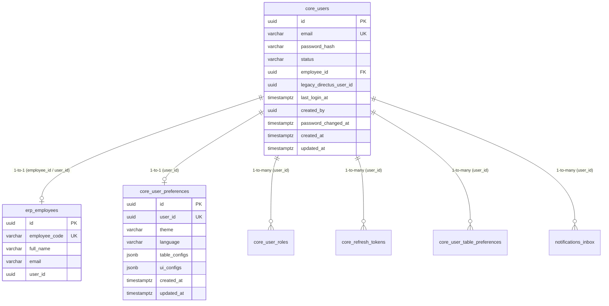

# 📦 Module Tri Thức: Quản Lý Người Dùng Hệ Thống (ERP Users) - Backend (`erp-api`)

## 1. Tổng quan Nghiệp vụ

Module `erp-users` (bao gồm `src/users` và `src/users-admin`) là trung tâm quản lý danh tính, tài khoản và cấu hình người dùng nội bộ của hệ sinh thái ERP:
- **Quản lý Vòng đời Tài khoản (Account Lifecycle)**:
  - Trạng thái hoạt động: `ACTIVE` (đang hoạt động) và `INACTIVE` (bị vô hiệu hóa/ngưng hoạt động).
  - Tự động mã hóa mật khẩu bằng thuật toán `bcrypt` chuẩn an toàn (salt rounds = 10).
  - Quản trị viên có thể tạo mới, cập nhật, kích hoạt, vô hiệu hóa tài khoản và reset mật khẩu khẩn cấp.
  - Người dùng có thể tự đổi mật khẩu qua luồng xác thực cá nhân (`auth/change-password`).
- **Liên kết 1-1 với Hồ sơ Nhân viên (`erp_employees`)**:
  - Mỗi tài khoản `core_users` có thể liên kết tương ứng với một hồ sơ nhân viên trong `erp_employees` thông qua khóa ngoại `employee_id`.
  - Cơ chế ràng buộc độc quyền: Một nhân viên chỉ được liên kết với duy nhất một tài khoản người dùng tại một thời điểm (`employee.userId === user.id`).
  - Tự động đồng bộ địa chỉ email giữa tài khoản và nhân viên khi thực hiện liên kết nếu nhân viên chưa có email.
  - Hỗ trợ gỡ liên kết an toàn (unlink employee), tự động xóa `userId` trên bảng `erp_employees`.
- **Cấu hình Người dùng Cá nhân hóa (Preferences)**:
  - Bảng `core_user_preferences`: Lưu theme (`classic`), ngôn ngữ giao diện (`vi`), cấu hình bảng (`table_configs`), và thiết lập UI (`ui_configs`).
  - Bảng `core_user_table_preferences`: Quản lý cấu hình cột hiển thị, thứ tự sắp xếp và các custom view của bảng dữ liệu theo từng màn hình.
- **Tra cứu, Lọc Đa Chiều & Infinite Scroll Column Options**:
  - Tìm kiếm tổng hợp (`search`): Tìm đồng thời trên `user.email`, `emp.fullName` và `emp.employeeCode`.
  - Lọc theo cột (`column_filters`): Hỗ trợ đa giá trị, giá trị rỗng `__BLANK__`, và tìm kiếm toàn bộ kết quả khớp `__ALL_MATCHING__`.
  - API nạp options vô tận (`GET /api/v1/admin/users/column-options`): Hỗ trợ lazy load options theo trang cho bộ lọc header bảng.
- **Nhật ký Kiểm toán Toàn diện (Audit Trail)**:
  - Mọi thao tác thêm/sửa/đổi trạng thái/đổi mật khẩu/liên kết nhân viên đều được ghi log chi tiết vào `audit_logs` thông qua `AuditCoreService` với module `users` và entity `core_user`.

---

## 2. Database Schema & Quan hệ Dữ liệu

### 2.1. Sơ đồ Quan hệ Dữ liệu (Mermaid ERD)



### 2.2. Chi tiết Bảng `core_users` (Tài khoản Người dùng)

| Cột | Kiểu dữ liệu | Nullable | Mặc định | Mô tả & Ràng buộc |
| :--- | :--- | :--- | :--- | :--- |
| `id` | `uuid` | NO | `gen_random_uuid()` | Khóa chính (PK) |
| `email` | `varchar(255)` | NO | — | Email đăng nhập, chuẩn hóa chữ thường, `UNIQUE INDEX` |
| `password_hash` | `varchar(255)` | NO | — | Chuỗi hash mật khẩu bcrypt (salt = 10) |
| `status` | `varchar(50)` | NO | `'ACTIVE'` | Trạng thái (`ACTIVE`, `INACTIVE`) |
| `employee_id` | `uuid` | YES | `NULL` | FK logic liên kết `erp_employees.id` |
| `legacy_directus_user_id` | `uuid` | YES | `NULL` | ID tham chiếu lịch sử từ hệ thống Directus cũ |
| `last_login_at` | `timestamptz` | YES | `NULL` | Thời điểm đăng nhập thành công gần nhất |
| `created_by` | `uuid` | YES | `NULL` | ID người dùng tạo tài khoản này |
| `password_changed_at` | `timestamptz` | YES | `NULL` | Thời điểm đổi hoặc reset mật khẩu gần nhất |
| `created_at` | `timestamptz` | NO | `now()` | Thời điểm tạo bản ghi |
| `updated_at` | `timestamptz` | NO | `now()` | Thời điểm cập nhật bản ghi |

### 2.3. Chi tiết Bảng `core_user_preferences` (Cấu hình Người dùng)

| Cột | Kiểu dữ liệu | Nullable | Mặc định | Mô tả & Ràng buộc |
| :--- | :--- | :--- | :--- | :--- |
| `id` | `uuid` | NO | `uuid_generate_v4()` | Khóa chính (PK) |
| `user_id` | `uuid` | NO | — | ID người dùng, `UNIQUE INDEX` |
| `theme` | `varchar(50)` | NO | `'classic'` | Chủ đề giao diện |
| `language` | `varchar(10)` | NO | `'vi'` | Ngôn ngữ hiển thị (`vi`, `en`) |
| `table_configs` | `jsonb` | NO | `'{}'` | Cấu hình bảng hiển thị chung |
| `ui_configs` | `jsonb` | NO | `'{}'` | Thiết lập giao diện tùy biến |
| `created_at` | `timestamptz` | NO | `now()` | Thời điểm tạo |
| `updated_at` | `timestamptz` | NO | `now()` | Thời điểm cập nhật |

---

## 3. Cấu trúc Source Code Backend

```text
erp/erp-api/src/
├── users/
│   ├── entities/
│   │   ├── core-user.entity.ts               # TypeORM entity cho bảng core_users
│   │   └── core-user-preference.entity.ts    # TypeORM entity cho bảng core_user_preferences
│   ├── users.service.ts                      # Logic cơ bản: hash password, findByEmail, seed user, registerLocal
│   └── users.module.ts                       # Khai báo UsersModule, export UsersService
├── users-admin/
│   ├── dto/
│   │   └── user-admin.dto.ts                 # DTOs: Create, Update, List, ResetPassword, LinkEmployee
│   ├── users-admin.controller.ts             # REST Controller /api/v1/admin/users với RBAC Guard
│   ├── users-admin.service.ts                # Nghiệp vụ quản trị: CRUD, getColumnOptions, audit logging
│   └── users-admin.module.ts                 # Khai báo UsersAdminModule kết nối TypeOrm, AuditCore
└── auth/
    ├── auth.controller.ts                    # Endpoints /api/v1/auth (login, register, change-password)
    └── auth.service.ts                       # Logic xác thực JWT, refresh token
```

---

## 4. Danh sách API Endpoints & RBAC Contract

Toàn bộ các API quản trị người dùng thuộc `UsersAdminController` được bảo vệ bởi 2 guards:
- `JwtAuthGuard`: Yêu cầu Bearer Access Token hợp lệ.
- `CoreRbacGuard` & `@RequirePermissions({ resource: ErpResource.ADMIN_USERS, action: ErpAction.MANAGE })`: Yêu cầu người dùng có quyền quản trị tài khoản người dùng (`admin_users:manage` hoặc `*:*`).

**Base Route**: `/api/v1/admin/users`

| Phương thức | Đường dẫn | Quyền hạn (RBAC) | Mô tả & Input chính | Phản hồi chính |
| :--- | :--- | :--- | :--- | :--- |
| `POST` | `/api/v1/admin/users` | `admin_users:manage` | Tạo mới tài khoản (`CreateUserAdminDto`: email, password, employeeId) | `{ message, data: SafeUser }` |
| `GET` | `/api/v1/admin/users` | `admin_users:manage` | Danh sách người dùng (`ListUsersAdminDto`: page, pageSize, search, status, column_filters, sorts) | `{ data: SafeUser[], total, page, pageSize }` |
| `GET` | `/api/v1/admin/users/column-options` | `admin_users:manage` | Options vô tận cho filter header (`column`, `search`, `page`, `pageSize`, `filters`) | `{ items: [{ label, value }], total, next }` |
| `GET` | `/api/v1/admin/users/:id` | `admin_users:manage` | Chi tiết một tài khoản theo UUID | `{ data: SafeUser }` |
| `PATCH` | `/api/v1/admin/users/:id` | `admin_users:manage` | Cập nhật thông tin tài khoản (`UpdateUserAdminDto`: status, employeeId) | `{ message, data: SafeUser }` |
| `POST` | `/api/v1/admin/users/:id/activate` | `admin_users:manage` | Kích hoạt tài khoản (`status = 'ACTIVE'`) | `{ message, data: SafeUser }` |
| `POST` | `/api/v1/admin/users/:id/deactivate` | `admin_users:manage` | Vô hiệu hóa tài khoản (`status = 'INACTIVE'`) | `{ message, data: SafeUser }` |
| `POST` | `/api/v1/admin/users/:id/reset-password` | `admin_users:manage` | Quản trị viên đặt lại mật khẩu mới (`ResetPasswordAdminDto`: newPassword) | `{ message }` |
| `POST` | `/api/v1/admin/users/:id/link-employee` | `admin_users:manage` | Liên kết tài khoản với nhân viên (`LinkEmployeeDto`: employeeId) | `{ message, data: SafeUser }` |
| `POST` | `/api/v1/admin/users/:id/unlink-employee` | `admin_users:manage` | Gỡ liên kết nhân viên khỏi tài khoản (`employeeId = null`) | `{ message, data: SafeUser }` |

*Ghi chú Cấu trúc `SafeUser`*: Không bao giờ trả về trường `passwordHash`. Chứa thông tin tài khoản kèm object `employee` thu gọn (`id`, `fullName`, `employeeCode`, `email`, `phone`, `status`).

---

## 5. Logic Nghiệp vụ Trọng tâm

### 5.1. Mã hóa & Xác thực Mật khẩu (Bcrypt)
- **Tạo Hash**: Sử dụng `genSaltSync(10)` và `hashSync(password, salt)`.
- **Kiểm tra**: So sánh thông qua `compareSync(password, passwordHash)`.
- **Cập nhật mốc thời gian**: Khi admin reset hoặc user đổi mật khẩu, cập nhật trường `passwordChangedAt = new Date()`.

### 5.2. Liên kết Hai chiều với Nhân viên (`ErpEmployee`)
- **Nguyên tắc Toàn vẹn**:
  1. Kiểm tra nhân viên mục tiêu có tồn tại hay không; nếu không ném `NotFoundException`.
  2. Nếu nhân viên đó đã có `userId` khác với `user.id` hiện tại, lập tức chặn và ném `ConflictException('Employee này đã liên kết user khác')`.
  3. Nếu user đang liên kết với nhân viên cũ, hệ thống tự động gỡ bỏ liên kết trên bản ghi nhân viên cũ (`oldEmployee.userId = null`).
  4. Cập nhật `employee.userId = user.id`. Nếu nhân viên chưa có email (`!employee.email`), tự động điền email của user.
  5. Khi gỡ liên kết (`unlink`), đặt `user.employeeId = null` và giải phóng `employee.userId = null`.

### 5.3. Tìm kiếm Đa từ khóa & Đa trường
- Áp dụng tiện ích chuẩn `applyMultiKeywordMultiFieldFilter`:
  - Cho phép tách chuỗi tìm kiếm theo khoảng trắng thành các từ khóa độc lập.
  - Áp dụng điều kiện `ILIKE` trên cả 3 trường cùng lúc: `user.email`, `emp.fullName`, `emp.employeeCode`.
  - Hỗ trợ lọc theo khoảng ngày tạo `date_from` và `date_to` (tự động cộng `23:59:59.999` cho ngày kết thúc).

### 5.4. Lọc Nâng cao và Infinite Scroll Column Options
- Hàm `getColumnOptions`:
  - Phân trang lazy load các giá trị duy nhất (distinct values) của cột.
  - Hỗ trợ cross-column filtering: Khi lọc ở cột A, các tùy chọn ở cột B chỉ nạp các giá trị thuộc tập dữ liệu hợp lệ.
  - Hỗ trợ giá trị đặc thù: `__BLANK__` (bản ghi rỗng/null) và `__ALL_MATCHING__` (áp dụng toàn bộ kết quả lọc tìm kiếm trước đó).

### 5.5. Ghi nhận Nhật ký Kiểm toán (Audit Trail)
- Tất cả các mutation đều ghi nhận thông qua `AuditCoreService.recordAction`:
  - `module: 'users'`, `entityType: 'core_user'`, `entityId: user.id`.
  - Lưu đầy đủ `beforeSnapshot` và `afterSnapshot` để phục vụ đối soát lịch sử thay đổi.
  - Lưu `actorUserId`, `actorEmail`, `ipAddress`, `userAgent`, `requestId`.

---

## 6. Tích hợp Liên Module

1. **`auth` (Module Xác thực)**:
   - Dùng `UsersService` để tra cứu thông tin tài khoản qua email khi người dùng đăng nhập.
   - Khi đăng nhập thành công, gọi `usersService.updateLastLogin(userId)` để lưu vết `lastLoginAt`.
   - Sinh JWT Payload chứa `sub: user.id`, `email: user.email`.
   - Quản lý session qua bảng `core_refresh_tokens` tham chiếu khóa ngoại `user_id -> core_users.id` với `ON DELETE CASCADE`.
2. **`employees-core` (Hồ sơ Nhân sự)**:
   - Tham chiếu chéo giữa `core_users.employee_id` và `erp_employees.user_id`.
   - Cho phép hiển thị thông tin nhân viên (họ tên, mã NV, phòng ban) kèm theo tài khoản trên giao diện quản trị.
3. **`rbac-core` (Phân quyền & Vai trò)**:
   - Bảng `core_user_roles` liên kết nhiều-nhiều giữa `core_users.id` và `core_roles.id`.
   - Khi kiểm tra quyền qua `CoreRbacGuard`, hệ thống nạp các quyền từ những vai trò mà user đang nắm giữ.
4. **`audit-core` (Kiểm toán Hệ thống)**:
   - Tiếp nhận các sự kiện thay đổi dữ liệu người dùng (`CREATE_USER`, `UPDATE_USER`, `RESET_PASSWORD`, v.v.).
5. **`table-preferences-core` & `app-config` (Cá nhân hóa Giao diện)**:
   - Bảng `core_user_table_preferences` và `core_user_preferences` gắn liền với `user_id`, tự động dọn dẹp theo `ON DELETE CASCADE` khi user bị xóa khỏi DB.
6. **`notifications-inbox` (Hộp thư Thông báo)**:
   - Lưu trữ các thông báo gửi trực tiếp đến từng người dùng cụ thể thông qua `notifications_inbox.user_id`.

---

## 7. Quy tắc Kiểm thử & Báo cáo Chất lượng

Khi sửa đổi mã nguồn liên quan đến module `users` hoặc `users-admin`, bắt buộc chạy các lệnh kiểm tra sau tại thư mục `erp/erp-api`:

```bash
# 1. Kiểm tra Type & Biên dịch
bun run type:check

# 2. Kiểm tra Unit Test liên quan đến Auth & Users
bun run test -- src/auth/auth.service.spec.ts src/v2/modules/rbac-roles/rbac-roles.service.spec.ts

# 3. Chạy toàn bộ test suites của module
bun run test:find -- src/users src/users-admin
```

---

## Danh mục Kiểm tra Hoàn tất (Checklist)

- [x] Đã quét đủ cả Entity, DTO, Controller, Service của module `users` và `users-admin`.
- [x] File skill được lưu đúng tại `erp-api/.agents/skills/modules/erp-users/SKILL.md`.
- [x] YAML frontmatter có `name: erp-users` và `description` rõ ràng.
- [x] Thư mục module được tự động quản lý qua `.agents/skills.json` của workspace.
- [x] Đã cập nhật tham chiếu trong `erp-api/.agents/skills/erp-api-truth/SKILL.md`.
