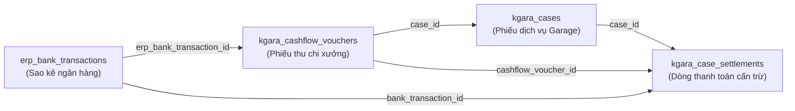
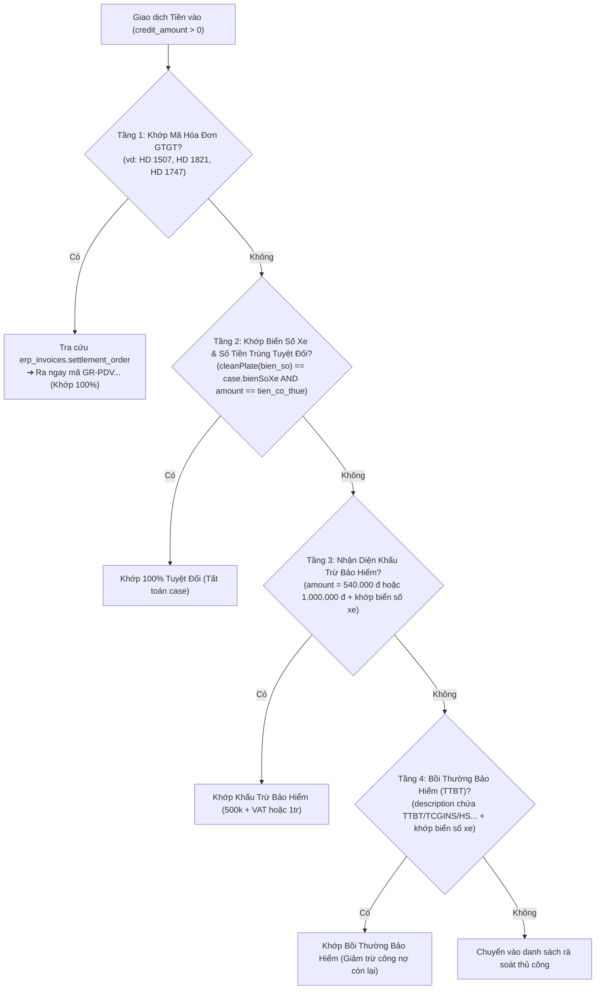

# 📦 Module Tri Thức: Đối Soát Sao Kê Ngân Hàng Với Phiếu Dịch Vụ Garage (`garage-bank-reconciliation`) - Backend (`erp-api`)

## 1. Tổng Quan Nghiệp Vụ

Quy trình **Đối Soát Sao Kê Ngân Hàng Với Phiếu Dịch Vụ Garage** là cầu nối tài chính nghiệp vụ giữa dòng tiền thực tế thu về tài khoản ngân hàng doanh nghiệp (`erp_bank_transactions`) và hồ sơ doanh thu / công nợ dịch vụ sửa chữa xưởng (`kgara_cases`).

### 1.1. Mục tiêu cốt lõi:
1. **Truy vết & Bóc tách Dòng Tiền (Transaction Parser)**: Phân tích nội dung chuyển khoản từ các ngân hàng (BIDV, Techcombank, ACB, VPBank...) để tự động nhận diện:
   - Biển số xe (`bienSoXe` dạng `51M11271`, `51D-888.01`, `70LD-00642`, `77A18857`, `50LD17947`, `50LD19731`).
   - Mã số hóa đơn GTGT (`HD 1507`, `HD 1821`, `HD 1747`).
   - Tên khách hàng / người nộp / đối tác chuyển tiền.
   - Loại nghiệp vụ: Khách hàng tự trả, Bảo hiểm bồi thường (TTBT), Khấu trừ bảo hiểm (500k + VAT = 540k hoặc 1.000.000 đ).
2. **Khớp nối Chính xác 1-1 với Phiếu Dịch Vụ (`kgara_cases`)**:
   - Dò tìm chính xác hồ sơ sửa chữa tương ứng, kiểm tra số tiền có thuế (`tien_co_thue`), số tiền đã thanh toán (`tien_da_thanh_toan`) và công nợ còn lại (`tien_con_phai_thanh_toan`).
3. **Sinh & Cập nhật Phiếu Thu Xưởng (`kgara_cashflow_vouchers`)**:
   - Tích hợp trực tiếp vào tab **Thu chi xưởng** (`/garage-debts?tab=cashflow`).
   - **Quy tắc ngày chuẩn**: Ngày phát sinh phiếu thu (`transDate`) **BẮT BUỘC** lấy đúng theo ngày giao dịch sao kê (múi giờ Việt Nam `YYYY-MM-DD`), không dùng ngày hiện tại của hệ thống.
   - Mã phiếu thu sinh chuẩn: `PT-GARA-YYMMDD-XXX` dựa trên ngày giao dịch thực tế.
4. **Tự động Cấn Trừ & Tính Toán Lại Công Nợ (`kgara_case_settlements`)**:
   - Tạo dòng thanh toán với `sourceChannel = 'ON_SYSTEM'`, `paymentMethod = 'BANK_TRANSFER'`, `bankTransactionId`, `cashflowVoucherId`.
   - Gọi hàm tự động cập nhật lại `tien_da_thanh_toan` và `tien_con_phai_thanh_toan` trên `kgara_cases` theo chuẩn ACID.

---

## 2. Database Schema & Quan Hệ Dữ Liệu 4 Bảng



### 2.1. Chi tiết Bảng & Ràng Buộc:

#### A. Bảng `erp_bank_transactions` (Sao kê nguồn)
- `id` (`uuid`, PK): Khóa chính giao dịch ngân hàng.
- `trans_date` (`timestamp`): Ngày giờ giao dịch (lưu UTC trong DB, chuyển đổi GMT+7 khi hiển thị và tính toán).
- `reference_number` (`varchar`): Số tham chiếu / Mã giao dịch ngân hàng.
- `credit_amount` (`numeric(18,4)`): Số tiền thu vào tài khoản.
- `description` (`text`): Nội dung chuyển khoản gốc từ ngân hàng.
- `correspondent_name` (`varchar`): Tên người chuyển tiền / đối tác.

#### B. Bảng `kgara_cashflow_vouchers` (Phiếu thu/chi xưởng)
- `id` (`uuid`, PK)
- `voucher_code` (`varchar(50)`, UNIQUE): Mã phiếu format `PT-GARA-YYMMDD-XXX`.
- `voucher_type` (`varchar(20)`): `'RECEIPT'` (Phiếu thu).
- `amount` (`numeric(18,2)`): Số tiền thu.
- `trans_date` (`date`): **Bắt buộc trùng ngày sao kê** (`YYYY-MM-DD`).
- `case_id` (`uuid`, FK -> `kgara_cases.id`, nullable): Liên kết phiếu dịch vụ.
- `erp_bank_transaction_id` (`uuid`, FK -> `erp_bank_transactions.id`, nullable): Tham chiếu sao kê ngân hàng.
- `note` (`text`): Diễn giải chi tiết lý do thu / đối soát.

#### C. Bảng `kgara_case_settlements` (Sổ cấn trừ thanh toán)
- `id` (`uuid`, PK)
- `case_id` (`uuid`, FK -> `kgara_cases.id`): Phiếu dịch vụ được cấn trừ.
- `settlement_type` (`varchar(20)`): `'RECEIPT'`.
- `amount` (`numeric(18,2)`): Số tiền thanh toán thực tế.
- `trans_date` (`date`): Ngày thanh toán (trùng ngày sao kê).
- `bank_transaction_id` (`uuid`, FK -> `erp_bank_transactions.id`, nullable).
- `cashflow_voucher_id` (`uuid`, FK -> `kgara_cashflow_vouchers.id`, nullable).
- `source_channel` (`varchar(50)`): `'ON_SYSTEM'` (Thu qua ngân hàng trên hệ thống).
- `payment_method` (`varchar(50)`): `'BANK_TRANSFER'`.
- `payer_type` (`varchar(20)`): `'KH'` (Khách hàng) hoặc `'OTHER'`.

#### D. Bảng `kgara_cases` (Hồ sơ dịch vụ xưởng)
- `id` (`uuid`, PK)
- `so_chung_tu` (`varchar`): Mã phiếu dịch vụ (vd: `GR-PDV2610-0022`).
- `bien_so_xe` (`varchar`): Biển số xe (vd: `51M11271`, `51D88801`).
- `tien_co_thue` (`numeric(18,2)`): Tổng giá trị dịch vụ có thuế.
- `tien_da_thanh_toan` (`numeric(18,2)`): Tổng số tiền đã thanh toán.
- `tien_con_phai_thanh_toan` (`numeric(18,2)`): Công nợ còn lại cần thu.

---

## 3. Thuật Toán Đối Soát 4 Tầng (Reconciliation Algorithm)

Quy trình tự động bóc tách từ `description` sao kê để tìm kiếm cặp khớp với `kgara_cases`:



### 3.1. Chi tiết 4 Tầng Nhận Diện:

1. **Tầng 1 - Căn cứ Mã Hóa Đơn GTGT**:
   - Nếu nội dung chuyển khoản có cụm từ `HD [SốHĐ]` (ví dụ `HD 1507`, `HD 1821`, `HD 1747`):
   - Truy vấn `erp_invoices` lấy trường `settlement_order` (chứa chính xác mã `GR-PDV...`).
   - Khớp trực tiếp vào `kgara_cases` với độ tin cậy tuyệt đối 100%.

2. **Tầng 2 - Căn cứ Biển Số Xe Chuẩn Hóa & Số Tiền Khớp 100%**:
   - Chuẩn hóa biển số xe: Bỏ dấu gạch ngang, dấu chấm, khoảng trắng (vd: `51D-888.01` $\rightarrow$ `51D88801`).
   - Tìm case có cùng biển số xe mà `tien_co_thue == credit_amount` hoặc `tien_con_phai_thanh_toan == credit_amount`.
   - Kết quả: Khớp chính xác 100% (vd: Case `GR-PDV2607-0001` tiền thuế 11.880.000 đ khớp giao dịch 11.880.000 đ của T.E.C).

3. **Tầng 3 - Căn cứ Khấu Trừ Bảo Hiểm (Mức Cố Định)**:
   - Đặc thù ngành bảo hiểm xe cơ giới: Khách hàng chi trả mức khấu trừ chế tài cố định:
     - Mức 1: **540.000 đ** = 500.000 đ miễn thường + 8% VAT (hoặc 550.000 đ với 10% VAT).
     - Mức 2: **1.000.000 đ** = Mức khấu trừ nguyên bản của các hợp đồng bảo hiểm lớn.
   - Khi nội dung ghi `thanh toan bao hiem xe [BiểnSố]` hoặc `khau tru bao hiem xe [BiểnSố]` với đúng số tiền 540k hoặc 1tr, khớp ngay với case đang mở của xe đó.

4. **Tầng 4 - Căn cứ Bồi Thường Bảo Hiểm (TTBT)**:
   - Các công ty bảo hiểm (TCGINS, Bảo Việt, PVI, PTI...) bồi thường tiền sửa chữa:
   - Nội dung thường có: `TTBT xe [BiểnSố] HS...` (Hồ sơ bồi thường).
   - Số tiền thường là phần còn lại sau khi trừ khấu trừ (vd: xe 77A18857 bồi thường 4.340.749 đ).
   - Khớp vào case để giảm trừ công nợ bảo hiểm.

---

## 4. Nguyên Tắc & Quy Chuẩn Bắt Buộc Khi Tạo Phiếu Thu Xưởng

### 4.1. Quy Chuẩn Ngày Giao Dịch (Date Mandate)
> [!IMPORTANT]
> **TUYỆT ĐỐI KHÔNG DÙNG NGÀY HIỆN TẠI (`new Date()`) ĐỂ LÀM NGÀY PHIẾU THU!**
> - Ngày của phiếu thu xưởng (`trans_date` trong `kgara_cashflow_vouchers`) và ngày của bản ghi cấn trừ (`trans_date` trong `kgara_case_settlements`) **BẮT BUỘC** phải là ngày giao dịch trên sao kê ngân hàng (`trans_date` chuyển sang múi giờ `Asia/Ho_Chi_Minh` định dạng `YYYY-MM-DD`).
> - Tiền tố ngày trên mã phiếu `PT-GARA-YYMMDD-XXX` cũng phải lấy theo ngày giao dịch đó (ví dụ giao dịch ngày 02/10/2026 thì mã phiếu là `PT-GARA-261002-XXX`).

### 4.2. Cơ Chế Chống Trùng Lặp (Deduplication Guard)
Trước khi tạo mới bất kỳ phiếu thu nào:
1. **Kiểm tra `erp_bank_transaction_id`**: Nếu giao dịch sao kê đã được liên kết với một phiếu thu (`kgara_cashflow_vouchers.erp_bank_transaction_id == bankTxnId`), không tạo mới.
2. **Kiểm tra Phiếu Thu Đã Tạo Thủ Công**: Nếu trong DB đã tồn tại phiếu thu cho đúng `case_id`, cùng `amount` và cùng ngày mà chưa gắn `erp_bank_transaction_id`, hệ thống **CHỈ CẬP NHẬT LIÊN KẾT** (`erp_bank_transaction_id = bankTxnId`), không tạo thêm phiếu mới để tránh double doanh thu.

### 4.3. Đảm Bảo Tính Toàn Vẹn ACID & Tính Toán Lại Công Nợ
Mọi thao tác tạo/sửa phiếu thu gắn với case bắt buộc:
1. Mở Transaction qua `queryRunner.startTransaction()`.
2. Lưu bản ghi `KgaraCashflowVoucher`.
3. Lưu bản ghi `KgaraCaseSettlement` với `sourceChannel = 'ON_SYSTEM'`, `paymentMethod = 'BANK_TRANSFER'`.
4. Gọi `_recalculateCaseDebt`:
   $$\text{tienDaThanhToan} = \sum_{\text{settlementType} = \text{'RECEIPT'}} \text{amount}$$
   $$\text{tienConPhaiThanhToan} = \max(0, \text{netPayable} - \text{tienDaThanhToan})$$
5. Commit transaction an toàn.

---

## 5. Danh Sách API Endpoints Liên Quan

Base Path: `/api/v1/greenway/cashflow-vouchers` (Quyền: `GARAGE_CASHFLOW`)

| Method | Endpoint | Quyền | Mô tả |
|---|---|---|---|
| `GET` | `/` | `READ` | Danh sách phiếu thu/chi xưởng (hỗ trợ filter theo ngày, type, case_id) |
| `POST` | `/` | `CREATE` | Tạo phiếu thu/chi mới kèm tự động tạo settlement và tính lại công nợ case |
| `PUT` | `/:id` | `UPDATE` | Cập nhật phiếu thu/chi (đồng bộ sang settlement và cập nhật công nợ) |
| `DELETE` | `/:id` | `DELETE` | Xóa phiếu thu/chi (chặn xóa nếu đã đồng bộ với sao kê ngân hàng) |

---

## 6. Quy Tắc Kiểm Thử & Kiểm Soát Chất Lượng (QC Mandate)

1. **Gate 0 Verification**:
   ```bash
   psql "$DATABASE_URL" -c "
   SELECT cf.voucher_code, cf.amount, cf.trans_date, cs.amount as settlement_amount, kc.so_chung_tu, kc.tien_con_phai_thanh_toan
   FROM kgara_cashflow_vouchers cf
   JOIN kgara_case_settlements cs ON cs.cashflow_voucher_id = cf.id
   JOIN kgara_cases kc ON kc.id = cf.case_id
   WHERE cf.erp_bank_transaction_id = '<BANK_TXN_UUID>';
   "
   ```
2. **Kiểm tra không bị âm công nợ**:
   ```bash
   psql "$DATABASE_URL" -c "SELECT COUNT(*) FROM kgara_cases WHERE tien_con_phai_thanh_toan < 0;"
   # Kết quả phải luôn bằng 0
   ```
3. **Unit Tests**:
   - `bunx jest src/kgara-api-core/services/garage-cashflow.service.spec.ts`
   - `bun run type:check`
