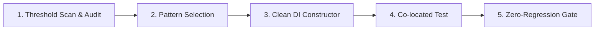

# 🏗️ ERP API Structure Workflow (`/erp-api-structure`)

Workflow gộp hai quy trình cấu trúc backend. **Phần A** dùng khi một Controller hoặc Service cũ vượt ngưỡng. **Phần B** dùng khi tạo module mới hoặc chuyển module sang v2. Playbook, ngưỡng và checklist nằm ở skill `erp-api-structure`.

Chọn phần: module cũ (v1) vượt ngưỡng thì làm Phần A. Module đã v2 thì không refactor theo Phần A. Tạo module mới hoặc chuyển v2 thì làm Phần B.

---

## 🅰️ Phần A: Tách Controller/Service quá lớn (v1)

Workflow này hướng dẫn Developer và Agent quy trình chuẩn 5 giai đoạn khi **phân rã (refactor)** các Controller (`> 300` LoC), Service (`> 500` LoC) hoặc Engines (`> 800` LoC) quá lớn trong `erp-api` nhằm tuân thủ nguyên lý **Single Responsibility Principle (SRP)**, đảm bảo khả năng mở rộng, dễ viết unit test và tránh xung đột mã nguồn.

---

### 🎯 4 Nguyên Tắc Sống Còn (Core Directives)



1. **Tuân Thủ Ngưỡng Kích Thước File**:
   | Loại File | Cảnh Báo (WARNING) | Nghiêm Trọng (CRITICAL) | Pattern Đề Xuất |
   | :--- | :---: | :---: | :--- |
   | **Controller** (`*.controller.ts`) | **> 300 dòng** | **>= 1,000 dòng** | **Pattern A** (Sub-Controllers) |
   | **Service** (`*.service.ts`) | **> 500 dòng** | **>= 1,000 dòng** | **Pattern B** (Sub-Services & Facade) |
   | **Handler** (`*.handler.ts`, vd `ai-hub-core`) | **> 400 dòng** | **>= 1,000 dòng** | **Pattern E/C**: tách prompt, parser, hằng số thành module thuần; giữ nguyên constructor |
   | **Logic / Helper / Engine** | **> 800 dòng** | **>= 1,000 dòng** | **Pattern C** (Pure Engine / Query Builder) |
   | **Script** (`scripts/`, `src/**/scripts/`) | **> 800 dòng** | **>= 1,000 dòng** | Gọi lại service/handler của app, không nhân đôi logic (xem mục *Script độc lập*) |

   > File dữ liệu thuần (`*.data.ts`), `*.spec.ts`, `*.d.ts` **không** tính vào ngưỡng.
   > Prompt AI dài hơn ~80 dòng phải nằm trong file `*.prompt.ts` riêng (hằng số thuần), không nằm trong handler/service.

2. **Bảo Toàn REST Contract & Backward Compatibility**:
   - Tuyệt đối **KHÔNG** làm thay đổi endpoint route path (`@Get`, `@Post`), query parameters, HTTP status, headers hoặc cấu trúc DTO response.
   - Khi chia nhỏ Service, file Service gốc đóng vai trò **Facade**, delegate sang các Sub-Services để không làm gãy các Controller hoặc Module khác đang gọi tới.

3. **Clean Constructor Mandate (TUYỆT ĐỐI CẤM Constructor Overload / Union Types)**:
   - Trong mọi class NestJS `@Injectable()`, **TUYỆT ĐỐI CẤM** dùng TypeScript Constructor Overloading hoặc Union Types (`arg: SubService | Repository<Entity>`).
   - **Lý do**: TypeScript `emitDecoratorMetadata` sinh `design:paramtypes` dựa trên signature thực thi. Union types làm metadata bị gán `undefined` / `Object`, gây crash NestJS runtime (`UnknownDependenciesException`) dù `tsc` và `build` đều pass.
   - **Quy chuẩn**: Luôn dùng Clean DI Constructor với 1 signature duy nhất và cập nhật unit tests (`*.spec.ts`) để truyền mock sub-services.

4. **Co-located Testing & Zero-Entity Leaking**:
   - Unit test `.spec.ts` nằm ngay cạnh file được test (co-located).
   - Controller chỉ trả về DTOs đã qua sanitize/mapping, tuyệt đối không trả TypeORM Entities trực tiếp ra client.

5. **Script độc lập (backfill, seed, netoff...) phải theo cùng chuẩn với app** — chi tiết ở mục *Script độc lập* bên dưới: dùng lại service/handler, env qua loader chuẩn, mặc định dry-run, không đường dẫn tuyệt đối.

---

### 🧭 Quy Trình 5 Giai Đoạn Chuẩn (5-Phase SOP)

#### 🔹 GIAI ĐOẠN 1: Quét Ngưỡng & Phân Tích Hiện Trạng (Scan & Audit)

Trước khi can thiệp mã nguồn:
1. Chạy script quét (read-only, chạy trong `erp-api`) để nắm file vượt ngưỡng, vi phạm Clean DI và script chưa theo chuẩn:
   ```bash
   bun .agents/skills/erp-api-structure/scripts/scan-oversized-files.ts                 # toàn repo (src + scripts)
   bun .agents/skills/erp-api-structure/scripts/scan-oversized-files.ts --path=src/ai-hub-core
   bun .agents/skills/erp-api-structure/scripts/scan-oversized-files.ts --json          # cho CI/agent
   bun .agents/skills/erp-api-structure/scripts/scan-oversized-files.ts --strict        # exit 1 nếu vi phạm Clean DI
   ```
   Báo cáo gồm 3 phần: file vượt ngưỡng · vi phạm constructor (overload/union, kể cả khi viết nhiều dòng) · vệ sinh script.
   **Chỉ refactor file thuộc phạm vi task**; danh sách tồn đọng của cả repo chỉ để tham khảo, không tự ý mở rộng phạm vi.
2. Đọc file mục tiêu, liệt kê:
   - Danh sách các public methods và private helpers.
   - Danh sách các dependency được inject vào constructor hiện tại (`DataSource`, repositories, other services).
   - Các controller / service khác đang phụ thuộc vào service này.

---

#### 🔹 GIAI ĐOẠN 2: Lựa Chọn Pattern Kiến Trúc Phù Hợp

```
File cần refactor là gì?
├── 1. Controller > 300 dòng gom nhiều sub-resource?
│   └── 👉 Pattern A: Phân rã thành Sub-Controllers trong thư mục `controllers/`
│
├── 2. Service > 500 dòng ôm đồm nhiều nghiệp vụ/báo cáo?
│   └── 👉 Pattern B: Phân rã thành Sub-Services trong `services/` + Service gốc làm Facade Delegate
│
├── 3. Thuật toán tính toán nặng (FIFO, BOM explosion, P&L aggregation, Aging)?
│   └── 👉 Pattern C: Trích xuất Pure Engine / Query Builder trong `engines/` hoặc `helpers/`
│
├── 4. Controller/Service trả thẳng TypeORM Entity?
│   └── 👉 Pattern D: Chuẩn hóa Response DTOs & Mapping Engine (Zero-Entity Leaking)
│
├── 5. Module Gateway tích hợp đa phân hệ (AI Hub, Integrations)?
│   └── 👉 Pattern E: Phân rã theo Domain Handlers trong `handlers/` + Clients trong `clients/`
│       Handler lớn: giữ `InvoiceAiHandler` làm facade (constructor KHÔNG đổi, để script/spec cũ không gãy)
│       và tách phần thuần ra `handlers/<domain>/` (`*.prompt.ts`, `*.parsers.ts`, `*.constants.ts`, `*.types.ts`).
│       Ví dụ chuẩn: `src/ai-hub-core/handlers/invoice/`.
│
└── 6. Service gần ngưỡng (> 80% = 400 dòng) cần thêm logic mới?
    └── 👉 KHÔNG thêm vào file đó. Tạo sub-service/helper thuần mới (vd `InvoiceCategoryMemoryService`,
        `invoice-journal-lines.helper.ts`) và inject bằng Clean DI constructor.
```

---

#### 🔹 GIAI ĐOẠN 3: Triển Khai Phân Rã & Thiết Lập Clean DI Facade

##### 1. Triển khai Pattern A: Sub-Controllers
```
src/[module-name]/
├── [module-name].module.ts
├── controllers/
│   ├── [resource-a].controller.ts
│   └── [resource-b].controller.ts
```

```typescript
// src/kgara-api-core/controllers/kgara-customers.controller.ts
import { Controller, Get, Query, UseGuards } from '@nestjs/common';
import { JwtAuthGuard } from '../../auth/jwt-auth.guard';
import { CoreRbacGuard } from '../../auth/guards/core-rbac.guard';
import { RequirePermissions } from '../../auth/decorators/require-permissions.decorator';
import { KgaraCustomersService } from '../services/kgara-customers.service';

@UseGuards(JwtAuthGuard, CoreRbacGuard)
@Controller('greenway/customers')
export class KgaraCustomersController {
  constructor(private readonly customersService: KgaraCustomersService) {}

  @Get('debt')
  @RequirePermissions('garage.customers.read')
  async getCustomersDebt(@Query() query: any) {
    return this.customersService.getCustomersDebt(query);
  }
}
```

##### 2. Triển khai Pattern B: Sub-Services + Facade
```
src/[module-name]/
├── [module-name].module.ts
├── [module-name].service.ts             # FACADE DELEGATE
└── services/
    ├── [domain-a].service.ts
    ├── [domain-a].service.spec.ts        # Co-located test
    ├── [domain-b].service.ts
    └── [domain-b].service.spec.ts        # Co-located test
```

```typescript
// Sub-Service độc lập
@Injectable()
export class SalesReportService {
  private readonly logger = new Logger(SalesReportService.name);
  constructor(private readonly dataSource: DataSource) {}

  async getSalesDashboard(query: SalesReportQueryDto): Promise<SalesReportResponseDto> {
    // Logic tính toán chuyên biệt...
  }
}

// Facade Service (Giữ nguyên public signature)
@Injectable()
export class ReportsCoreService {
  constructor(
    private readonly salesReportService: SalesReportService,
    private readonly purchasingReportService: PurchasingReportService,
  ) {}

  getSalesDashboard(query: SalesReportQueryDto) {
    return this.salesReportService.getSalesDashboard(query);
  }

  getPurchasingDashboard(query: PurchasingReportQueryDto) {
    return this.purchasingReportService.getPurchasingDashboard(query);
  }
}
```

##### 3. Triển khai Pattern C: Pure Engines & Helpers
- Đặt tại `engines/` hoặc `helpers/`.
- Sử dụng pure functions hoặc static methods (không inject NestJS DI) để test độc lập nhanh chóng:
```typescript
// src/kgara-api-core/helpers/debt-aging.helper.ts
export interface AgingBucketResult {
  aging_0_30: number;
  aging_31_60: number;
  aging_61_90: number;
  aging_over_90: number;
}

export function calculateAgingBuckets(
  records: Array<{ amount: number; createdAt: Date }>,
): AgingBucketResult {
  // Pure logic...
}
```

---

#### 🔹 GIAI ĐOẠN 4: Cập Nhật NestJS Module & Co-located Unit Tests

##### 1. Đăng ký Module:
Khai báo toàn bộ Sub-Controllers, Sub-Services mới vào `[module-name].module.ts`:
```typescript
@Module({
  controllers: [
    ReportsCoreController,
    SalesReportController,
  ],
  providers: [
    ReportsCoreService, // Facade
    SalesReportService, // Sub-service
    PurchasingReportService, // Sub-service
  ],
  exports: [ReportsCoreService, SalesReportService],
})
export class ReportsCoreModule {}
```

##### 2. Cập nhật Unit Tests Co-located:
- Tạo `[sub-service].service.spec.ts` ngay bên cạnh sub-service.
- Cập nhật file test của Facade Service: Sử dụng mock của Sub-Services:
```typescript
describe('ReportsCoreService (Facade)', () => {
  let service: ReportsCoreService;
  let salesReportService: Partial<SalesReportService>;

  beforeEach(async () => {
    salesReportService = {
      getSalesDashboard: jest.fn().mockResolvedValue({ totalRevenue: 1000 }),
    };

    const module: TestingModule = await Test.createTestingModule({
      providers: [
        ReportsCoreService,
        { provide: SalesReportService, useValue: salesReportService },
      ],
    }).compile();

    service = module.get<ReportsCoreService>(ReportsCoreService);
  });

  it('should delegate getSalesDashboard to SalesReportService', async () => {
    const query = { dateFrom: '2026-01-01' };
    await service.getSalesDashboard(query);
    expect(salesReportService.getSalesDashboard).toHaveBeenCalledWith(query);
  });
});
```

---

#### 🔹 GIAI ĐOẠN 5: Zero-Regression Quality Gate & Verification

> **Khi chạy cùng `/erp-plan`**: các lệnh *full* dưới đây (`build`, `bunx jest --forceExit`, `check:ci`) chỉ chạy **một lần ở Final Gate (Task 4.x.1)**.
> Ở từng task nhỏ chỉ dùng lệnh scoped: `bunx tsc --noEmit`, `bunx jest <spec>` hoặc `bunx jest --findRelatedTests <file>`.
> Khi chạy riêng lẻ (không qua plan) thì chạy đầy đủ như sau.

```bash
# 1. Build Verification (đảm bảo TypeScript và metadata DI hợp lệ)
bun run build

# 2. Chạy toàn bộ Unit Tests liên quan
bunx jest --forceExit

# 3. Chạy CI check toàn diện
bun run check:ci

# 4. Quét lại xem file đã xuống dưới ngưỡng chưa
bun .agents/skills/erp-api-structure/scripts/scan-oversized-files.ts
```

---

### 🔁 Hướng v2-ready (chuẩn bị migrate v2)

Áp dụng khi refactor module v1 (track T1). Mục tiêu: hình dạng code sau refactor trùng với `api-module-v2`, để migrate về sau chỉ còn di chuyển và wiring.

| Refactor v1 tạo ra | Tương ứng v2 (`/erp-api-structure`) |
| :--- | :--- |
| `<module>.service.ts` là Facade delegate | Facade y hệt |
| `services/<e>-query.service.ts` + `services/<e>-command.service.ts` | y hệt |
| `helpers/<e>.mapper.ts` + `dto/<e>-response.dto.ts` (Pattern D bắt buộc) | y hệt |
| Engine tính toán thuần (Pattern C) | y hệt |
| Spec co-located + **spec hợp đồng** (route, RBAC, hình dạng response) | dùng lại để so sánh khi migrate |

Quy tắc:
- Tách theo trục đọc/ghi trước, rồi mới tách theo nghiệp vụ.
- Giữ nguyên route, RBAC, response, DTO public.
- **Không** tạo `src/v2/` bằng tay. `src/v2` chỉ sinh bằng `bunx plop api-module-v2` khi có lệnh migrate (track T2).
- Module đã migrate hoặc đang migrate v2: không refactor v1 nữa, chuyển sang `/erp-api-structure`.
- Khi chạy scanner, dùng `--path=src/v2` để tách báo cáo v2 khỏi v1.

### 🧰 Script độc lập (`scripts/`, `src/**/scripts/`)

Script chạy tay (backfill, seed, netoff...) vẫn phải theo chuẩn của app — đã từng xảy ra script tự gọi AI, tự đánh số chứng từ và tự map tài khoản **lệch** với app (6/14 danh mục khác tài khoản).

1. **Dùng lại service/handler của app**, không nhân đôi logic nghiệp vụ. Không cần khởi động Nest: dựng service bằng constructor từ một `DataSource`
   (mẫu: `scripts/backfill-invoice-categories-autopost.ts`). Không dùng `NestFactory` với `AppModule` (sẽ kích hoạt cron).
2. **Gọi AI qua `NineRouterClient`/handler**, không `fetch` thẳng tới 9router (mất retry/timeout/`NineRouterError`).
3. **Env qua loader chuẩn** `src/common/scripts/load-script-env.ts` — tên file khớp pipeline (`erp-<tenant>-<stage>` ↔ `.env.<tenant>-<stage>` ↔ secret `<TENANT>_<STAGE>_API_ENV`). Thứ tự chọn nguồn:
   tham số vị trí `.env*` → `--env=<file>` → `--target=<tenant>-<stage>` → `ENV_FILE` → `.env` → `process.env` (container).
   - **Hermetic**: đã chọn file thì chỉ dùng file đó; biến Bun tự nạp từ file env mặc định mà file chọn không có sẽ bị gỡ (tránh lẫn tenant).
   - File chỉ định không tồn tại ⇒ báo lỗi, **không** tự đổi file. **Không** hard-code tên file env mặc định.
   - Mặc định **dry-run**; ghi DB cần `--apply`; DB production (tên DB/tên file chứa `production`) cần thêm `--confirm=<tên DB>`.
   - Nếu env rơi về `.env` mặc định mà DB là production ⇒ script từ chối, buộc chỉ định env tường minh.
   - Luôn in `ENV`/`DB host:port/tên` (che user/password) trước khi chạy. SSL dùng `resolvePgSsl`, không hard-code `ssl:false`.
   - **Ma trận cờ ghi** (`getWriteGuard`): ghi khi có `--apply` (bí danh cũ `--execute`); `--dry-run` hoặc `DRY_RUN=true|1` luôn ép dry-run, kể cả khi có `--apply`; DB production cần thêm `--confirm=<tên DB>`.
   - **Dry-run bằng rollback** (`src/common/scripts/script-db.ts`): script `pg` dùng `connectPg`/`withPgSession`, script TypeORM chỉ dùng `ds.query` dùng `createScriptDataSource(...).begin()`. Mọi lệnh chạy trong một transaction, cuối cùng COMMIT nếu `guard.allowed` còn lại ROLLBACK nên số dòng báo cáo khớp lần ghi thật.
     Không dùng cho script đã tự quản `BEGIN/COMMIT` (transaction lồng) hay có tác dụng ngoài DB (R2, gọi API, `nextval`): các lời gọi đó phải tự gate bằng `guard.allowed`.
     Kiểm chứng "dry-run không để lại dấu vết" bằng `countRows`/`diffCounts` (`dry-run-probe.helper.ts`) trên DB đích đã xác nhận bằng `SELECT current_database();`.
4. **Không đường dẫn tuyệt đối** (`/home/dev/...`): tính từ `__dirname`/`import.meta.url` hoặc `process.cwd()`. Package ESM (`"type":"module"`) dùng `fileURLToPath(import.meta.url)`.
5. **AI lỗi ≠ kết quả**: lỗi AI phải được phân biệt (`fallbackReason: AI_ERROR`) để chạy lại được; không ghi mã/danh mục sai âm thầm.
   Riêng hóa đơn mua vào không phân loại được thì hạch toán TK tạm `T0003` (chủ ý của kế toán để dò tay), kèm marker `[T0003_FALLBACK:<lý do>]` trong mô tả bút toán.
6. **Kiểm tra script ghi dữ liệu**: chỉ kiểm tra tĩnh (`bunx tsc`, `bun build --no-bundle`, `node --check`) và chạy **dry-run** trên `.env`.
   Tuyệt đối không chạy thử script `execute-*`, `commit-*`, upload R2... để "xem thử".

### 🔎 Lệnh audit nhanh (portable)

```bash
# Quét tổng hợp (khuyến nghị): kích thước + Clean DI + vệ sinh script
bun .agents/skills/erp-api-structure/scripts/scan-oversized-files.ts --strict

# Đếm service/controller vượt ngưỡng (không phụ thuộc globstar của shell)
find src -name '*.service.ts' ! -name '*.spec.ts' -exec wc -l {} + | awk '$1>500 && $2!="total"' | sort -nr | head -20
find src -name '*.controller.ts' ! -name '*.spec.ts' -exec wc -l {} + | awk '$1>300 && $2!="total"' | sort -nr | head -20

# Controller trả thẳng Entity
/usr/bin/grep -rn "Promise<.*Entity>" src --include='*.controller.ts'

# Đường dẫn tuyệt đối còn sót (trừ cấu hình quyền cục bộ và dump dữ liệu)
/usr/bin/grep -rIn "/home/dev/" src scripts --include='*.ts' --include='*.js' --include='*.sh'
```

> ⚠️ **Cảnh báo công cụ**: trong môi trường agent, lệnh `grep` có thể là hàm bọc **tôn trọng `.gitignore`** — nó âm thầm bỏ qua các file bị ignore
> (vd phần lớn `erp-api/scripts/*`, `backups/`). Với kiểm tra "không còn sót" hãy dùng `/usr/bin/grep` hoặc script scan ở trên.
> `grep "constructor(.*|.*)"` chỉ khớp constructor viết trên **một dòng**; constructor đã xuống dòng (Prettier) sẽ bị bỏ sót — dùng `--strict` của script scan.

### 📋 Checklist Kiểm Tra Hoàn Thành (Backend Refactor DoD)

- [ ] **Bảo toàn REST Contract**: 100% routes, query params, DTOs không bị thay đổi.
- [ ] **Bảo toàn Facade Signatures**: Tất cả callers cũ gọi vào Service gốc vẫn hoạt động bình thường.
- [ ] **Tuân thủ Clean Constructor**: 0 constructor overload, 0 union types trong `@Injectable()`.
- [ ] **Kích thước file đạt chuẩn**: Controller $< 300\text{ dòng}$, Service $< 500\text{ dòng}$, Engines $< 800\text{ dòng}$.
- [ ] **Zero-Entity Leaking**: Controller chỉ trả về DTOs.
- [ ] **Module Registration**: Đã khai báo đầy đủ providers, controllers và exports trong NestJS Module.
- [ ] **Co-located Tests**: Mọi Sub-Service đều có file `.spec.ts` đi kèm và test Facade delegate pass 100%.
- [ ] **Không nhân đôi logic**: script/handler mới gọi lại service, helper, hằng số sẵn có (VD: `VINFAST_TAX_CODES`, `CATEGORY_TO_DEBIT_ACCOUNT_MAP`), không tự định nghĩa lại.
- [ ] **Script đạt chuẩn**: env qua loader, dry-run mặc định, không đường dẫn tuyệt đối, đã kiểm tra tĩnh (không chạy script ghi dữ liệu).
- [ ] **Không đẩy service qua ngưỡng**: file sửa xong vẫn ≤ ngưỡng của loại (đo bằng `wc -l`).
- [ ] **Sẵn sàng migrate v2** (nếu module sẽ migrate): Facade + query/command + mapper + response DTO + spec hợp đồng đã có; không còn logic nghiệp vụ trong controller.
- [ ] **Build & Test Pass**: `bun run build`, `bunx jest --forceExit`, `bun run check:ci` hoàn toàn không có lỗi.

---

## 🅱️ Phần B: Module v2 (Facade + sub-services)

Workflow này định nghĩa **API v2** trong `erp-api`: route chuẩn là `api/v2/<tên thư mục module>` (một chuỗi, không alias v1), response list là `{ items, pagination, summaries?, extraData? }` (`extraData` chỉ khi list có dữ liệu phụ chung, ví dụ `unreadCount`), không đổi DB có sẵn. Chi tiết: skill `erp-api-structure`, `references/v2-module.md` mục 0a và mục Hợp đồng response. Một module v2 là module được sinh đúng cấu trúc đích ngay từ đầu, và các module cũ chỉ chuyển sang v2 khi người dùng ra lệnh (rolling migration).

Skill đi kèm (quy ước, bẫy, checklist): [`./../skills/erp-api-structure/references/v2-module.md`](../skills/erp-api-structure/references/v2-module.md)
Generator: `api-module-v2` (xem [`plop-generate`](../skills/plop-generate/SKILL.md), mục Generator 3)

#### Chọn generator (đồng bộ với `erp-ui-structure` Phần B)

| Tình huống | Generator | Kết quả |
| :--- | :--- | :--- |
| Họ nghiệp vụ mới, CRUD (không có trạng thái) | `api-core` (chọn `engine`) | `src/v2/core/<họ>/` kèm `core.manifest.json` |
| Họ chứng từ có vòng đời trạng thái mới | `api-core` (chọn `abstract-services`) | `src/v2/core/<họ>/`: contract với `<Entity>Action` và bảng `<ENTITY>_TRANSITIONS` (rỗng), entity có `status`/`createdBy`, command abstract có `transition()`/`createDraft()` và hook `// CUSTOM` |
| Lõi điều phối chuỗi nhiều module (đơn → nhận hàng → tồn, sự kiện sau commit) | `api-core` (chọn `orchestrator`) | `src/v2/core/<họ>-flow-core/`: contract các cổng, `Abstract<Họ>FlowService` (`runInTransaction`, sự kiện sau commit), spec, barrel; không entity/controller. Module con kế thừa, nối cổng vào service cụ thể (ví dụ `procurement-flow-garage`) |
| Module CRUD thuộc họ đã có lõi `engine` | `api-thin-module` (chọn lõi, nhập module, entity, trường riêng, bật wire) | `src/v2/modules/<module>/`: entity và create DTO kế thừa Base của lõi; facade, query/command, mapper, controller, RBAC, spec (cùng pipeline `api-module-v2`); khi wire tự nối `app.module.ts` và `data-source.ts`. Trường riêng trùng cột của lõi bị từ chối. Sinh thử: `bunx plop api-thin-module` |
| Module chứng từ thuộc họ `abstract-services` | `api-workflow-module` (chỉ nhận họ `abstract-services`) | `src/v2/modules/<module>/`: entity con, DTO tạo, command con (điền `headerEntity`, `docType`), controller `POST /` và `POST /:id/transition/:action`, module, spec tối thiểu, RBAC; khi wire tự nối `app.module.ts` và `data-source.ts`. Nghiệp vụ điền ở hook `// CUSTOM` và bảng transition của lõi. Chưa có endpoint đọc: dev tự thêm. Sinh thử: `bunx plop api-workflow-module` |
| Entity đơn lẻ, không thuộc họ chứng từ | `api-module-v2` | `src/v2/modules/<module>/` đầy đủ Facade + sub-services |
| Chứng từ Header + Lines (không có lõi) | `api-voucher-v2` | Cảnh báo nếu họ đã có lõi; nên dùng `api-thin-module` |
| Module V1 cũ | `api-module` | `[LEGACY-V1]`, chỉ giữ để tham khảo |

Quy tắc (áp cho mọi họ v2 trong erp-api):
- **Lõi** (`src/v2/core/<họ>-core/`) chỉ là **base để kế thừa**: entity trừu tượng (`abstract`, không `@Entity`), service trừu tượng, type, helper thuần, `core.manifest.json`, barrel. Không chứa `@Entity`, `@Controller`, job `@Cron`, service cụ thể tiêm trực tiếp hay bảng DB.
- **Module** (`src/v2/modules/<gốc>-<biến thể>/`) chứa mọi thứ cụ thể: entity có `@Entity`, service kế thừa base, job, controller, DTO, mapper, facade và module Nest.
- Test `plop-helpers/apiCoreLayout.test.mjs` chặn vi phạm. Các họ cũ còn vi phạm nằm trong `LEGACY_CORE_ALLOWLIST` và được đánh dấu `[LEGACY-CORE]`; chuyển xong một họ thì gỡ khỏi danh sách. Chuyển từng họ khi có lệnh riêng.
- Không sinh lại Base entity hay engine của một họ đã có lõi.

**Cron và job định kỳ**: job là class trong module, kế thừa `ScheduledJob` (lớp nền trừu tượng ở `src/v2/core/scheduler-core/`), khai báo `jobName`, `cron`, `timeZone` và `run()`. Module `src/v2/modules/scheduler-jobs/` (`SchedulerJobsModule`, import một lần trong `AppModule`) tự tìm mọi job qua `DiscoveryService` và đăng ký. Không thêm `@Cron(...)` hay `setInterval` mới để chạy nền. Chi tiết: `.agents/skills/modules/scheduler-jobs/SKILL.md`.

### 🏷️ Quy tắc đặt tên bảng (v2)

- **Dạng chuẩn**: `<gốc>_<hậu tố>`, snake_case, **không** prefix `erp_`. Ví dụ: `notifications_inbox`, `goods_receipts_garage`, `proc_orders_garage`.
- **Bảng thuộc module**, đặt theo tên module cộng hậu tố sau gốc. Ví dụ module `notifications-inbox` có bảng `notifications_inbox`.
- **Lõi không có bảng**: không dùng hậu tố `_core` cho bảng mới. Bảng `notifications_core` cũ đã đổi thành `notifications_inbox`.
- **Module**: hậu tố theo biến thể, khớp quy ước thư mục (`-garage`, `-erp`, `-finance`). Module không có biến thể thì dùng `<gốc>` trần.
- **Entity con (dòng chứng từ)**: `<header>_lines` hoặc `<header>_lines_<hậu tố>`, theo mẫu bảng header.
- **Không đổi tên bảng đang có** (`erp_*`, `core_*`). Quy tắc này chỉ áp dụng cho bảng tạo mới. Đổi tên bảng cũ là một task migration riêng, cần lệnh của người dùng.
- Bảng nằm trong `src/v2/**` không dùng prefix `core_` hay `erp_` để tránh nhầm với bảng v1.
- Khi chạy generator, luôn truyền `tableNameInput` tường minh (xem mục "Chọn generator"). Mặc định của plop tuân theo quy tắc này.

---

### 🎯 Định nghĩa API v2

```
src/v2/modules/<module>/
  entities/<entity>.entity.ts              # TypeORM, cột snake_case, cờ isDeleted
  dto/create-<e>.dto.ts                    # validation (class-validator)
  dto/update-<e>.dto.ts                    # PartialType(Create)
  dto/query-<e>.dto.ts                     # extends PaginationDto
  dto/<e>-response.dto.ts                  # hình dạng trả ra API (không trả entity)
  helpers/<e>.mapper.ts (+ .spec)          # hàm thuần: entity <-> DTO
  services/<e>-query.service.ts (+ .spec)  # đọc: phân trang, tìm kiếm, lấy theo id
  services/<e>-command.service.ts (+ .spec)# ghi: create, update, softDelete
  <module>.service.ts (+ .spec)            # Facade: điều phối và map sang response DTO
  controllers/<e>.controller.ts (+ .spec)  # RBAC (ErpResource/ErpAction) + Swagger
  <module>.module.ts
```

Bốn quy tắc cứng:
1. **Không lộ entity**: controller và facade chỉ trả response DTO (mapper làm việc đó).
2. **Constructor DI sạch**: một chữ ký duy nhất, không overload, không union type.
3. **Spec co-located**: mỗi đơn vị có `*.spec.ts` cạnh file nguồn.
4. **Ngưỡng kích thước**: controller ≤ 300 LoC, service ≤ 500 LoC, helper/engine ≤ 800 LoC. Vượt ngưỡng thì dùng `/erp-api-structure`.

---

### 🧭 5 Giai Đoạn

#### Giai đoạn 1: Discovery (chỉ đọc)
1. Xác định module đích và bảng: đọc `.agents/skills/modules/<module>/SKILL.md` nếu module đã có.
2. Kiểm tra DB đúng với `.env` theo quy tắc workspace: chạy `SELECT current_database();` trước khi đọc schema, báo tên DB cho người dùng.
3. Kiểm tra trùng: `routePath` (không trùng controller khác), `ErpResource` (không trùng key/value trong `src/v2/core/rbac-core/enums/erp-resource.enum.ts`), tên entity.
4. Chốt danh sách trường (`fieldSpec`) với người dùng. Mọi quyết định nghiệp vụ (mã duy nhất, trạng thái, số tiền) phải được chốt trước khi sinh.

#### Giai đoạn 2: Scaffold bằng plop
```bash
cd erp/erp-api
bunx plop api-module-v2 <module-core> <Entity> "<fieldSpec>" "<tableName>" "<routePath>" "<permissionResource>" <wire>
```
- Thứ tự tham số: `moduleInput`, `entityInput`, `fieldSpecInput`, `tableNameInput`, `routePathInput`, `permissionResourceInput`, `wireInput`.
- Để chuỗi rỗng `""` để dùng giá trị mặc định: bảng `<gốc>` hoặc `<gốc>_<biến thể>` (xem "Quy tắc đặt tên bảng"), route và resource theo module bỏ `-core`.
- `fieldSpec`: `name:type[:required],...`, type ∈ `string | text | number | decimal | boolean | date | status`. `createdAt` được sinh tự động.
- `wire = true`: nối module vào `src/app.module.ts` và entity vào `src/db/data-source.ts`. Resource RBAC **luôn** được thêm vào `erp-resource.enum.ts`.
- Input sai sẽ dừng trước khi ghi file nào.
- Sau khi sinh: `bunx prettier --write "src/v2/modules/<module>/**/*.ts"`.

#### Giai đoạn 3: Nghiệp vụ (làm tay, có test)
Code sinh ra là CRUD hoàn chỉnh nhưng **chưa có nghiệp vụ**. Bổ sung ở đúng lớp:
- Kiểm tra trùng mã, quy tắc trạng thái: `<entity>-command.service.ts` (thêm vào `create`/`update`, kèm spec).
- Giao dịch ghi số dư/tồn kho: `QueryRunner` + `setLock('pessimistic_write')` trong command service.
- Phân quyền theo dữ liệu (tenant, đối tác): thêm điều kiện vào `query.service.ts`.
- Nhật ký thao tác: `erp_audit_logs` / `audit-core`.
- Mọi thay đổi nghiệp vụ phải có spec tương ứng (TDD khi có thể).

#### Giai đoạn 4: Kiểm tra cấu trúc
- Controller không trả entity (chỉ gọi facade). Facade không trả entity.
- Mỗi sub-service và mapper có spec cạnh file.
- Không có constructor overload hay union type.
- Chạy scanner ngưỡng kích thước:
  ```bash
  bun .agents/skills/erp-api-structure/scripts/scan-oversized-files.ts --strict
  ```

#### Giai đoạn 5: Quality Gate
Chạy theo phạm vi thu hẹp trong lúc làm, rồi một lần duy nhất ở commit cuối:
```bash
bun run type:check                                 # tsc --noEmit
bunx jest src/v2/modules/<module> --forceExit         # spec của module
bunx eslint "src/v2/modules/<module>/**/*.ts" --max-warnings=0
bun run verify:final                               # tùy chọn local; full QC chạy trên CI sau push
```
- Test generator (chỉ khi sửa `plop-helpers/`): `bun test plop-helpers` (jest không chạy các file này vì `rootDir` là `src`).
- Cập nhật module skill theo Knowledge-Sync: `.agents/skills/modules/<module>/SKILL.md` (hoặc `/scan-module-knowledge`).

---

### 🔁 Đưa module cũ sang v2 (rolling, theo lệnh người dùng)

Không tự động migrate. Chỉ làm khi người dùng ra lệnh cho từng module:
1. Đọc module hiện tại và liệt kê các endpoint, DTO, và phụ thuộc từ module khác (module khác import service này).
2. Giữ nguyên hợp đồng: cùng route, cùng hình dạng response, cùng quyền RBAC.
   - Nếu module đã refactor v2-ready (Facade + query/command + mapper + spec hợp đồng) thì chỉ cần di chuyển và wiring; spec hợp đồng cũ là chuẩn so sánh.
3. Lưu bản gốc file cũ ra ngoài repo (scratchpad), xóa file trùng tên với generator, rồi sinh. Không để `*.legacy.ts` trong `src/`, vì tsc sẽ lỗi. Chi tiết: skill `erp-api-structure` mục 3b. So sánh response với bản gốc bằng spec hợp đồng.
4. Chuyển controller và module cũ sang facade mới, xóa code cũ sau khi spec pass.
5. Báo cáo: danh sách endpoint đã kiểm tra và phụ thuộc đã cập nhật.

---

### ⚠️ Giới hạn đã biết
- Generator không sinh nghiệp vụ, phân quyền theo dữ liệu, hay audit log: phải làm ở Giai đoạn 3.
- Generator không gán quyền cho vai trò trong RBAC. Thêm resource vào enum chỉ đăng ký khả năng, quyền cấp cho vai trò quản lý ở module RBAC.
- Mô hình xóa dùng cờ `isDeleted` (đúng quy ước repo), không dùng `DeleteDateColumn`. Template `api-module` cũ dùng `deletedAt` và không nên dùng cho module mới.

---

### 🗑️ Chính sách xóa (module v2)

Mặc định là **xóa mềm** (`isDeleted = true`), theo `.agents/AGENTS.md`. **Xóa cứng** là ngoại lệ, chỉ dùng khi người dùng yêu cầu rõ và thỏa đủ các điều kiện dưới đây.

| Thao tác | Route | Quyền (`ErpAction`) | Điều kiện | Hành vi |
| :--- | :--- | :--- | :--- | :--- |
| Xóa mềm | `DELETE /:id` | `DELETE` | Chỉ `DRAFT`; không có số lượng đang được chứng từ khác giữ | `isDeleted = true`, không xóa dòng, không xóa lịch sử duyệt |
| Xóa cứng | `DELETE /:id/permanent` | `PURGE` (chỉ cấp cho vai trò admin) | Chỉ `DRAFT`; không còn bản ghi phụ thuộc (kể cả đã xóa mềm) | Trả số lượng giữ về chứng từ nguồn, xóa dòng rồi xóa đầu đề, giữ lịch sử duyệt |

Quy tắc bắt buộc:
- **Kiểm phụ thuộc ở tầng service trước khi xóa.** Khóa ngoại từ chứng từ con tới chứng từ cha là `RESTRICT` (ví dụ đơn mua tới đề nghị, phiếu nhập tới đơn mua). Đếm bản ghi phụ thuộc trong cùng transaction, ghi lớp con ghi đè hook `assertNoDependent…`. Trả 409 có thông điệp rõ, không để DB báo lỗi thô.
- **Đếm cả bản ghi đã xóa mềm.** Khóa ngoại không phụ thuộc cờ `isDeleted`.
- **Dòng con xóa cùng transaction.** Khi quan hệ là `CASCADE` (dòng đề nghị, dòng và nghiệm thu đơn mua), vẫn xóa tường minh để không phụ thuộc cấu hình DB.
- **Không xóa lịch sử duyệt** (`erp_approval_events`). Bảng này không có khóa ngoại, lưu theo `doc_id`, nên bản ghi cũ vẫn còn để kiểm toán.
- **Quyền riêng:** xóa cứng dùng `ErpAction.PURGE`, không gộp vào `DELETE`. Action là chuỗi (`varchar`), không cần migration; vai trò có `*` hoặc `SUPER_ADMIN` tự khớp.
- **Route riêng:** `:id/permanent` tách khỏi `:id` để không nhầm với xóa mềm. Spec RBAC kiểm cả hai route.
- **UI:** thao tác xóa cứng và xóa mềm phải có modal xác nhận (theo `.agents/AGENTS.md`).
- **Test bắt buộc:** nhánh thành công, nhánh bị chặn do trạng thái, nhánh bị chặn do phụ thuộc, và RBAC của từng route.
