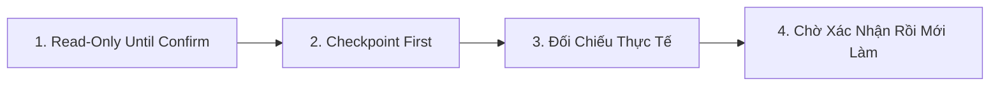

# ⏯️ ERP API Continue Workflow (`/erp-continue`) - Backend

Workflow chuẩn khi người dùng muốn **tiếp tục một task `erp-api` đang dở** từ phiên trước, mà chưa muốn lập plan mới. Workflow này là điểm vào của Giao thức Tiếp tục (Resume Protocol) trong `/erp-plan`.

---

## 🎯 Khi Nào Kích Hoạt Workflow Này

1. User gõ `/erp-continue`, `tiếp tục`, `continue`, hoặc hỏi "đang làm dở đến đâu rồi".
2. Phiên trước kết thúc khi task còn `[/] In Progress` và có Session Checkpoint.
3. Không kích hoạt khi chưa có plan nào. Khi đó chuyển sang `/erp-plan`.

---

## 🛡️ 4 Nguyên Tắc Cốt Lõi (Core Principles)



1. **🔒 Read-Only Until Confirm**:
   - Các bước khôi phục trạng thái chỉ đọc: đọc plan, `git status`, `git diff --stat`, đọc Plane.
   - **TUYỆT ĐỐI KHÔNG** sửa file, không chạy test runner, không chạy migration, không commit/push trước khi User xác nhận.
2. **📌 Checkpoint First**:
   - Nguồn đầu tiên là mục `## ⏸️ Session Checkpoint` trong `implementation_plan.md`.
   - Không đoán tiến độ từ trí nhớ hội thoại.
3. **🔍 Đối Chiếu Thực Tế**:
   - So checkpoint với `git status` của đúng repo `erp/erp-api` và với trạng thái task trên Plane (nếu task có identifier như `KINDU-12`).
   - Nếu lệch, nêu rõ chỗ lệch và đề xuất cách xử lý. Không tự chọn bản đúng.
4. **✋ Chờ Xác Nhận**:
   - Kết thúc bằng câu hỏi xác nhận. Chỉ chạy Giai đoạn 5 của `/erp-plan` sau khi User trả lời `tiếp tục`.

---

## 🧭 Quy Trình Khôi Phục

### Bước 1. Tìm plan đang dở
- Quét `erp/erp-api/.agents/plans/*/implementation_plan.md`, lấy plan có task `[/] In Progress` hoặc task `[ ]` đầu tiên chưa xong.
- Nếu có Antigravity Brain, kiểm tra thêm `implementation_plan.md` và `walkthrough.md` của phiên gần nhất làm bản phụ.
- Có nhiều plan dở: liệt kê và hỏi User chọn plan nào. Không tự chọn.
- Không có plan dở: báo "không có task dở" và gợi ý `/erp-plan` hoặc `/erp-review`.

### Bước 2. Đọc checkpoint
- Đọc mục `## ⏸️ Session Checkpoint (Tạm dừng lúc: ...)` mới nhất.
- Ghi lại: Active Task, Tiến độ chi tiết, Việc chưa xong, Git Status, Hành động tiếp theo khi Resume.

### Bước 3. Đối chiếu repo
- Chạy `git status` và `git diff --stat` trong `erp/erp-api`.
- So danh sách file đã sửa với mục Git Status trong checkpoint.
- Nếu task có identifier Plane: đọc trạng thái hiện tại bằng `workitem` `retrieve_by_identifier` của skill `plane-work-items`. Chỉ đọc, không cập nhật.
- Nếu test scope cuối đã ghi trong plan, nêu lại scope đó. Không chạy lại trước khi có xác nhận.

### Bước 4. Báo cáo và chờ xác nhận
Trình theo mẫu dưới đây, rồi dừng.

---

## 💬 Định Dạng Phản Hồi

```markdown
### 1. Đang dở ở đâu
- Plan: `erp/erp-api/.agents/plans/<task-slug>/implementation_plan.md`
- Active Task: `Task X.Y.Z: [Tên Task]` (`[/] In Progress`)
- Plane: `KINDU-N` (trạng thái: ...) hoặc "không theo dõi"

### 2. Đối chiếu
- Checkpoint khớp với git status: [có / lệch]
- Lệch (nếu có): [file/chỗ lệch] → [đề xuất]

### 3. Việc tiếp theo khi tiếp tục
- [Hành động cụ thể lấy từ "Hành động tiếp theo khi Resume"]

### 4. Xác nhận
Trả lời `tiếp tục` để em chạy tiếp từ task trên. Hoặc nói rõ nếu muốn đổi plan/task khác.
```

---

## 🔗 Tham Chiếu

- Giao thức Tiếp tục và mẫu Session Checkpoint: `/erp-plan`, Giai đoạn 5.
- Kiểm tra git và đẩy code: `/erp-git-workflow`.
- Chỉ đọc, không lập plan: `/erp-review`.
