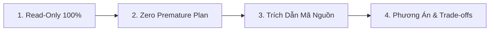

# 🔍 ERP API Review & Technical Q&A Workflow (`/erp-review`) - Backend

Workflow chuẩn khi người dùng muốn kiểm tra, review mã nguồn, phân tích lỗi hoặc hỏi đáp kỹ thuật liên quan đến **`erp-api`** (NestJS, PostgreSQL, TypeORM) mà **CHƯA MUỐN LÊN PLAN & CHƯA SỬA CODE**.

---

## 🎯 Khi Nào Kích Hoạt Workflow Này

1. User hỏi về logic nghiệp vụ, tính toán chi phí, khấu hao, tồn kho hoặc luồng xử lý trong backend.
2. User muốn review một file DTO, Service, Controller, Entity hoặc Migration.
3. User muốn kiểm tra nguyên nhân bug/lỗi (tại sao API trả về 500, tại sao dữ liệu bị duplicate, lỗi typeorm query).
4. Thảo luận thiết kế API v2 hoặc refactoring Service trước khi bắt tay vào làm.

---

## 🛡️ 4 Nguyên Tắc Cốt Lõi (Core Principles)



1. **🔒 Read-Only 100%**:
   - Sử dụng các công cụ đọc mã nguồn (`view_file`, `grep_search`, `find_by_name`).
   - **TUYỆT ĐỐI KHÔNG** sửa file, không chạy test suite ghi dữ liệu, không chạy migration (`bun run migration:run`), không commit/push.
2. **🛑 Zero Premature Plan**:
   - **KHÔNG TỰ Ý** tạo `implementation_plan.md`, `walkthrough.md` hay danh sách task chi tiết (`X.Y.Z`).
   - Trả lời thẳng vào câu hỏi hoặc vấn đề được nêu ra.
   - Chỉ chuyển sang lập kế hoạch khi người dùng yêu cầu rõ ràng (ví dụ: *"OK, lên plan đi"* hoặc gõ `/erp-plan`).
3. **📌 Dẫn Chứng Trực Tiếp Từ Mã Nguồn (Evidence-First)**:
   - Luôn trích dẫn chính xác file và dòng code (ví dụ `[src/modules/...#L40-L60]`).
   - Kiểm tra `DATABASE_URL` trong `.env` và schema PostgreSQL thực tế khi cần làm rõ quan hệ bảng.
4. **💡 Phân Tích Kỹ Thuật & Đề Xuất Giải Pháp**:
   - Nêu rõ nguyên nhân gốc rễ (Root Cause).
   - Đưa ra giải pháp kèm ưu / nhược điểm (Phương án A vs Phương án B) và khuyến nghị phương án tối ưu.

---

## 📋 Checklist Đánh Giá Backend API

- [ ] **Data Flow**: Controller chỉ làm nhiệm vụ parse/validate request và gọi Service. Business logic nằm trọn trong Service.
- [ ] **Validation DTO**: Đầy đủ `class-validator` decorators; không nhận param lỏng lẻo.
- [ ] **Concurrency & Lock**: Các tác vụ tài chính, tồn kho, công nợ có bọc trong QueryRunner với `setLock("pessimistic_write")` không?
- [ ] **RBAC Guard**: Đã gắn `@RequirePermissions(...)` với constants chuẩn; kiểm tra tenant/partner isolation.
- [ ] **Database Indexes**: Kiểm tra composite indexes cho các query filter/sorting phức tạp.
- [ ] **Error Handling**: Sử dụng exception chuẩn của NestJS (`BadRequestException`, `NotFoundException`, `ConflictException`), không nuốt lỗi (swallow errors).

---

## 💬 Định Dạng Phản Hồi

```markdown
### 1. Phân tích hiện trạng / Trả lời
[Giải thích ngắn gọn, đi thẳng vào trọng tâm câu hỏi của User]

### 2. Dẫn chứng mã nguồn (Evidence)
- File `[erp/erp-api/src/...#L...]`: [Đoạn logic thực tế]
- Điểm bất thường / Rủi ro (nếu có): [Mô tả chi tiết]

### 3. Đề xuất phương án xử lý
- **Phương án 1 (Khuyến nghị)**: [Mô tả + Ưu điểm]
- **Phương án 2 (Thay thế)**: [Mô tả + Hạn chế]

---
*(Chờ phản hồi từ User trước khi chuyển sang lập Plan triển khai)*
```
